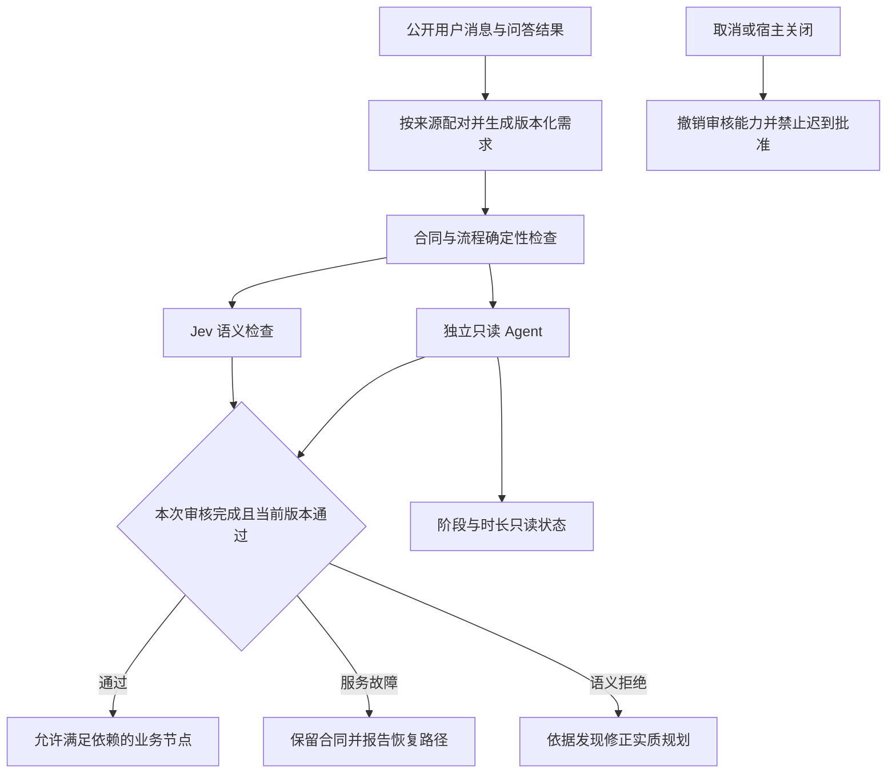

# 本机规划审核超时与授权来源恢复

## 背景与目标

真实会话日志显示规划 Agent 在 180000ms 被总截止取消，问答选中的授权没有进入需求快照，过大的上下文页请求失败。长期目标原文没有变化，主持者在连续准入失败后调用 update_goal(blocked)，宿主解除自动激活。目标是修复可恢复故障的原因与反馈，保留独立审核和全部业务安全约束。本轮仅本机部署、验证与人工测试交接，不推送 GitHub，不创建 release，不执行原交易业务。

## 修改范围

- `src/config.ts`、`src/service.ts`、`src/tools.ts`：默认规划总等待不限（0），显式正数截止仍有效；用户取消、关闭、迟到权限隔离仍有效。状态只读显示当前审核阶段、模型、运行时长、配置截止，不能视作批准。
- `src/context-store.ts`、`src/task-tools.ts`：合法正整数页大小安全收窄到单页上限，公布单位和分页上限；非法数值拒绝，任务权限、版本与摘要检查先行。
- `src/task-model.ts`、`src/host-contract.ts`、`src/service.ts`：从宿主公开消息中配对 ask_user_question 与成功结构化回答，保留问题、选项及真实答案来源；普通工具输出和其他自动消息不构成人类授权。
- `src/planning-review.ts`、`src/planning-recovery.ts`：区分审核未完成与已发现的身份违规；服务故障、语义拒绝分别反馈，保留低分阻塞。
- 对应单元/宿主集成测试、本机证据：检查超过旧截止仍可成功、取消/关闭不放行、合法分页连续读取、问答捕获与非人类消息排除。

## 数据与 API

不新增依赖，不改业务 API，不迁移交易数据。状态响应新增只读审核运行元信息；上下文页增加实际页大小信息。需求来源字段使用可选、向后兼容结构；新增的真实授权来源会使旧批准失效，需要显式审核。配置 `planningReview.timeoutMs=0` 表示总等待不限，不取消模型供应方/宿主的网络层超时，不承诺外部服务永不失败。

## 风险与验证

总等待不限不等于保证最终返回；用户可取消，关闭会撤销审核权限。超大上下文请求只缩小单页，不截断整份材料，调用者沿 nextCursor 读取。问答必须来自真实 ask_user_question 的匹配调用结果，不执行任意工具内容，不扩大授权。旧材料继续拒绝被当作当前批准证据。

先隔离构建与回归，正反 Agent 审查，再确认生产空闲并受控交接内存任务。用真实模型的独立只读场景验证模型/工具链，明确模型实际耗时及通过/拒绝结果。OpenViking 服务可用性单独验证，不用 Jev health 代替规划 Agent 健康。

## 回滚

部署前保留源码提交、编译文件、profile 与各 owner 状态。回滚需停派发并导出当前内存任务，再恢复前一编译产物与配置；不得重放旧业务写操作。保留原业务 goal 与批准状态，不人为改成通过。
