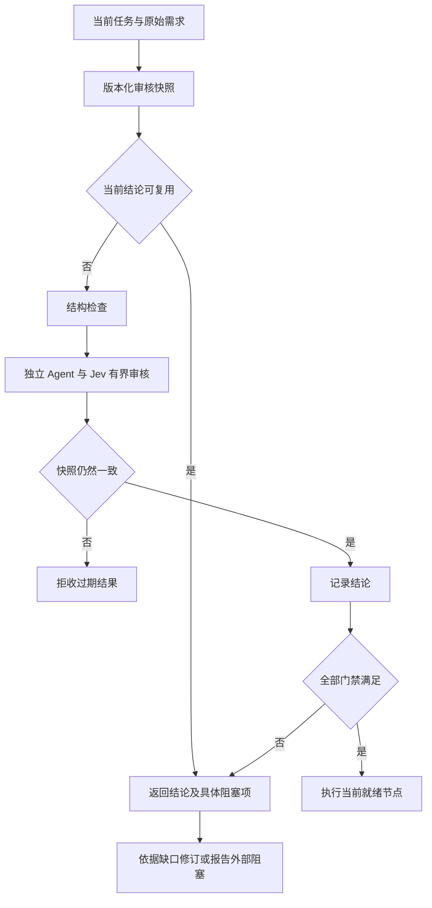

# 2.9.2 长期任务规划准入与恢复

## 背景与目标
用户报告维护任务与长期总目标的规划审核连续阻塞；无进展的改卡、重新评分不能恢复执行。修复已确认的版本绑定、重复审核、等待无截止和诊断缺口；明确阶段合同不代表总体目标完成。禁止降低门槛、伪造通过或自动开启实盘。

## 修改范围
- `src/planning-review.ts`：题目版本/策略/身份绑定，审核问题和逐维诊断。
- `src/planning-recovery.ts`、`src/service.ts`：当前结论复用、有界等待、取消及恢复路径。
- `src/policy.ts`、`src/tools.ts`：可选阶段合同与工具输出。
- `src/config.ts`、预设生成器：审核截止时间、停止无变化重试的指引。
- 对应单元/宿主回归；`docs/evidence/planning-liveness-2.9.2/` 保存实测与审查。

## 数据与 API
旧任务卡保持可读。新增可选阶段合同，保留用户原始需求全文；延期项不是已完成项。审核题目升级时旧批准失效。规划截止时间是等待期限，不是 Jev 配额限制。现有门禁与实现后验收继续生效。不新增依赖。

## 控制流

## 风险与验证
同快照缓存不能延续旧题目批准；网络/取消失败应可重试而不能永久冻结。超时后即使底层迟到也不能发布通过或残留权限。阶段声明必须接受独立覆盖审核，不能作为权限豁免。用回归测试验证 CAS、负结论缓存、强制复审、超时/迟到/取消、阶段覆盖及旧卡兼容；真实宿主与真实 Jev 验证分开记录，不将模拟推理算作真实模型通过。

安全不变量：执行许可必需当前快照且当前题目版本通过。活性边界：每次审核在截止时间内返回或明确超时；相同确定性负结论普通重复调用不产生新审核。无法保证任意模型/网络/业务方案必然通过。

## 发布与回滚
隔离工作树构建验证，通过后同步本机、单实例重启及 smoke，发布 v2.9.2 和 tarball/manifest/SHA256。保留旧插件和配置备份；回滚恢复旧包并重启，不修改业务仓库与交易开关。

## 真实宿主追加缺陷

实际测试确认新宿主独立专家预设没有挂载任务绑定工具，导致提示要求读取上下文而实际无法调用。新增 `src/task-tools.ts` 复用根与专家的受绑定定义，`src/expert-tools.ts` 只注册上下文/文件/纯计算及配置允许的邮箱，不提供天枢治理工具。更新专家预设、包导出，并校验全部JS导出入口的tarball闭包。旧start路径保留既有Jev能力，新入口不新增全局Jev；规划初审仍禁止借助Jev或消息读取作者材料。
