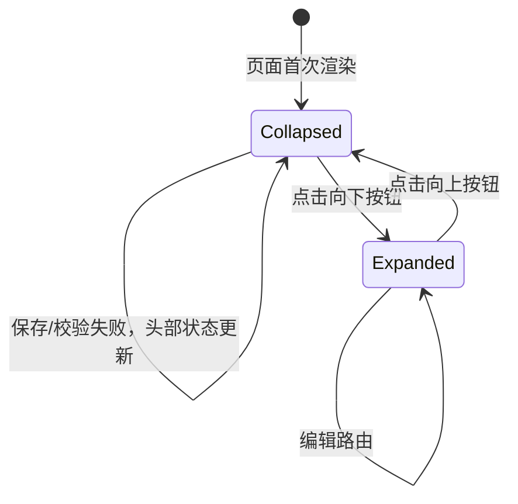
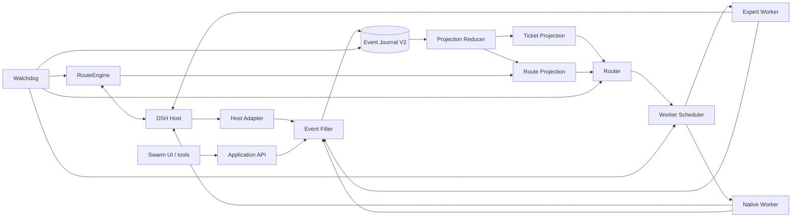
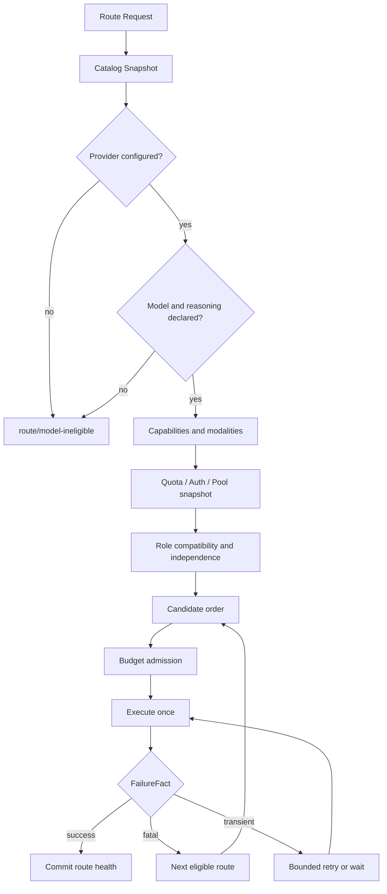
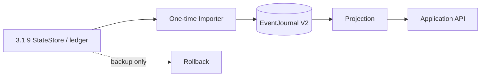

# DSH Agent Swarm 3.2.0 重大重构与能力保留方案

## 1. 文档状态

- 状态：3.2.0 增量重构已实现，正在完成全量回归、正反审计、真机验收与发布门禁。
- 目标版本：`3.2.0`。
- 发布基线：`3.1.9`，提交 `f33ca1efc03cb8c4cc75495172bcdff4892ba2cc`。
- 当前分支：`feat/v3.2.0`。
- 架构参考：DeepSeek Harness 团队 `dsh-superagent-prototype`，提交 `6337fc823ce20251c8de8085948165c81aaa701e`，MIT License。
- 参考材料：该仓库 `docs/000-philosophy.md` 至 `docs/008-cookbook.md`。
- 已实现范围：Antigravity/DSH OpenCode Go/OpenCode provider 兼容；专家卡默认折叠；Ticket/RouteEngine/Router-Worker/EventJournal/Watchdog 核心；旧账本旁路事件投影；Jev 官方/第三方互斥；DSH 原生 Git worktree 隔离。
- 仍需完成：全量回归后的两轮正反审计、七类 Jev 独立判定、本机部署/Web 真机验收与正式发布。旧状态一次性迁移仍采用兼容读取，不在本次发布中声明已完成彻底替换。

3.2.0 不再采用“在旧运行时上继续叠加补丁”的路线。它保留百工已经验证的外部能力与领域意图，重建内部实现、状态边界、路由管线和前端组织方式，并在完成数据迁移与等价性验证后删除旧实现。

本方案借鉴其领域建模、授权分级、Ticket 生命周期、事件驱动、存算分离、角色分离和健康检查思想。除单独标注并完成许可证保留外，不直接复制其源代码、提示词或文档正文。

## 2. 核心决策

### 2.1 外部兼容，内部重写

3.2.0 是一次重大内部重构。用户可见的专家角色、预设 ID、主要工具名称、模型链配置语义和 DSH 宿主权限关系保持稳定；内部状态机、存储、路由、调度和 UI 模块按新边界重新实现。

重构采用 strangler 迁移：

1. 先冻结 3.1.9 行为和可观测基线。
2. 建立新核心及兼容入口。
3. 通过 shadow、dual-write 和差分测试证明新旧等价。
4. 一次性切换生产读写路径。
5. 删除旧路径、旧状态格式和失效测试。

它不以“长期保留两套实现”为目标。兼容层只服务迁移，切换完成后必须移除。

### 2.2 保留精华

| 保留能力 | 保留内容 | 新实现约束 |
| --- | --- | --- |
| 14 个专家角色 | 天枢、谋定、枢机、算衡、探微、博闻、观象、铸剑、行舟、疾风、御史、复核、妙笔等角色及预设 ID | 角色定义成为稳定领域资产，不随编排重构改变 |
| 专家职责与权限 | 各角色读、写、验证、审查边界 | 权限由能力令牌和宿主策略执行，不依赖提示词自律 |
| DSH 宿主权限 | sandbox、approval、工具准入、Agent 身份 | 插件只能收紧，不能绕过宿主决定 |
| 供应商额度 | 订阅额度、模型额度域、账户池、重置时间、未知值 | 统一为 ResourceSnapshot，不使用本地 token 数猜测额度 |
| 认证状态 | OAuth、API key、账户池、凭据失效和刷新 | 只暴露不透明账号 ID，不记录凭据 |
| 模型资格 | provider/model 存在性、推理档位、视觉/工具/结构化输出能力 | 使用宿主实时目录作为最高事实源 |
| 主备回退 | 主模型、备用链、升级链、熔断、半开探测和恢复 | 保留行为，统一实现到单一 RouteEngine |
| 回退隔离 | 额度、认证、模型不可用、协议不兼容、网络故障分类 | 单一失败归一化器，避免多处分类漂移 |
| 证据门禁 | Task Card、工作流、规划审核、Jev、御史/复核和验收凭证 | 保留证据语义，由统一 Ticket 状态机消费 |
| 连续会话 | 专家会话复用、上下文隔离和人工换模 | Assignment 身份、revision 和 leaseEpoch 统一校验 |
| 默认语言排除 | 按实际 provider 跳过默认语言注入 | 路由回退后重新解析，最终汇总仍遵守默认语言 |
| 任务可观察性 | 模型调用、路线回退、任务进度、证据和阻塞原因 | 由同一投影提供，不在 UI 内自行推算 |

### 2.3 明确淘汰

| 历史技术债 | 3.1.9 表现 | 3.2.0 处理 |
| --- | --- | --- |
| 单体编排 | `service.ts` 同时承担生命周期、路由、工具、任务、恢复和控制面 | 拆分为 Router、Ticket、Scheduler、Watchdog、Host Adapter |
| 分散路由状态 | `route-state`、`route-health`、`quota-routing`、`upgrade`、`agent-control` 各自持有部分状态 | 收敛为 RouteEngine + ResourceSnapshot + HealthLedger |
| 多重失败归一化 | 路由、网络、额度、协议和 UI 各自解释错误 | 一个规范化 FailureFact，所有消费者复用 |
| 状态双写隐患 | StateStore、任务内嵌状态、ledger、sidecar 和工作流 state 多处派生 | 不可变事件作为历史，物化投影作为查询状态，单一事务边界 |
| JSONL 只审计不重建 | ledger 可读但不能可靠恢复业务状态 | EventJournal V2 可重放、校验和封片，不用于副作用重放 |
| 巨型前端模块 | `settings-page.js` 约 1982 行，UI、表单、目录和状态控制器耦合 | 路由页拆为领域组件、控制器、数据适配器和纯函数 |
| 长兼容链 | 旧 state layout、旧宿主事件、旧运行记录、legacy aggregate 等分散全项目 | 一次性 Importer 读取旧数据，新核心只接受 V2 schema |
| 提示词承载规则 | 部分安全与恢复行为同时写在代码和提示词 | 可执行规则归代码，提示词只描述协作与表达 |
| 重复 Watchdog | 网络探测、路由 health、租约和清理定时器分散 | 单一 Watchdog 生成结构化告警，由执行层消费 |
| 无效/历史配置 | `legacy` 预算档、已不参与的限流字段、旧面板方向 | 3.2.0 配置迁移器删除或转换，新 schema 拒绝未知旧键 |
| 发布与测试证据混放 | 历史包中曾混入证据目录风险 | 包清单白名单，测试、审计、会话和部署证据永不打包 |

## 3. 模型路由卡片折叠规划

### 3.1 目标行为

“设置 → 百工 Agent → 模型路由”中的每个 AgentCard 增加独立折叠按钮。

- 首次进入页面时，所有 AgentCard 默认收起。
- 收起时只显示卡片头部：专家名称、角色标题、内置/自定义标记、未保存标记、校验错误、主模型摘要。
- 展开后显示角色说明、主/备用模型链和升级链。
- 再次点击收起；展开时按钮箭头向上，收起时箭头向下。
- 每张卡片独立维护展开状态，不因另一张卡片展开/收起而改变。
- 切换设置分类再返回时保留本次页面会话中的展开状态；页面刷新后重新全部收起。

### 3.2 交互契约



实现要求：

- 使用原生 `button`，设置 `aria-expanded`、`aria-controls` 和明确的 `aria-label`。
- 点击标题区域不自动折叠，避免误触修改中的下拉框或按钮。
- 折叠按钮放在卡头右侧，与 reset 按钮保持固定顺序。
- 折叠时保留 dirty、invalid 和错误数量，避免隐藏阻断问题。
- 用户点击保存且某张折叠卡片有错误时，系统展开第一张有错误卡片并聚焦到对应字段。
- 收起/展开只改变视图状态，不创建配置草稿、不清除草稿、不触发保存。
- 卡片内容使用稳定 `id`，不得使用可能重复的专家显示名。

建议新增文案：

```json
{
  "expandAgent": "展开模型路由",
  "collapseAgent": "收起模型路由",
  "collapsedChainSummary": "主模型：{model} · 共 {count} 层"
}
```

### 3.3 组件边界

```text
ModelsSettingsPage
  -> AgentCardList
     -> AgentCard
        -> AgentCardHeader
           -> AgentSummary
           -> ExpandToggle
        -> AgentCardBody
           -> RouteLayerGrid
           -> UpgradeRoutePanel
```

状态：

```ts
interface AgentCardViewState {
  expandedAgentKeys: ReadonlySet<string>
}
```

默认值为空 Set。展开状态属于 UI-only 状态，不进入 `swarm-core` 配置。

### 3.4 验证

- 首次渲染时所有 `aria-expanded=false`。
- 逐卡点击只切换当前卡。
- 折叠和展开不改变草稿 revision、配置文本和保存按钮状态。
- 键盘 Enter/Space 可操作。
- 窄屏下头部不溢出，主模型摘要有界截断。
- 折叠状态下的 invalid 卡片仍显示错误标记。
- 保存失败时自动展开首个错误卡片。

## 4. 目标架构



### 4.1 有界上下文

| 上下文 | 责任 | 不负责 |
| --- | --- | --- |
| Agent Domain | 14 个专家、能力、提示 persona、角色权限 | provider 健康、会话启动 |
| Ticket Domain | 任务卡、Mandate、Assignment、证据、验收与生命周期 | 模型 SDK、工具执行 |
| Route Engine | provider/model eligibility、资源快照、失败分类、主备链和恢复 | 执行专家任务 |
| Orchestrator | Router、Worker 选择、并发、预算和依赖 | 修改文件或 UI 投影 |
| Event Core | 事件信封、过滤、去重、日志、封片和重放 | 外部副作用 |
| Projections | Ticket、Route、Health 和 Progress 的只读查询模型 | 写业务状态 |
| Host Adapters | DSH session、agent、tools、approvals、credentials、catalog | 业务路由规则 |
| Watchdog | 心跳、停滞、租约、队列和不一致告警 | 自动重放写操作 |
| Web Client | 设置、进度、控制与投影展示 | 重新计算路由或验证业务状态 |

依赖只能从外向内：Adapters 和 UI 依赖 Application API；Application API 依赖领域；领域不依赖 DSH、Node 文件系统或 React。

## 5. 领域模型

| 参考概念 | 百工映射 | 规则 |
| --- | --- | --- |
| Router | 天枢/主会话 | 只读规划、授权和派发，不直接写工作区 |
| Worker / Executor | 14 个专家及原生后端 | 固定 Ticket、Assignment、revision、lease 和权限 |
| Trigger | 用户请求、宿主事件、失败、人工控制 | 不可变、幂等、先过滤后入账 |
| Thread | 根会话、专家会话、连续会话 | 只做关联，不扩大授权 |
| Ticket | 当前 TaskRecord 的后继 | 唯一工作生命周期与 Mandate |
| Mandate | 用户意图、审批、任务范围和策略版本 | 范围扩大必须新建或显式修订 Mandate |
| Assignment | 一次 Agent 执行 | 绑定 route、worker、leaseEpoch 和输入摘要 |
| Evidence | 命令、文件、来源、观察、审查和验收 | 必须绑定 revision 和 artifact digest |
| ResourceSnapshot | quota、auth、eligibility、catalog | 带来源、读取时间、新鲜度和已知/未知边界 |
| Decision | 路由选择、回退、恢复、验收和 Watchdog 判断 | 原因代码结构化，不写自由文本当状态 |

## 6. Ticket 生命周期

```text
created
  -> admitted
  -> planned
  -> queued
  -> running
  -> waiting | reviewing | blocked
  -> accepted | rejected | incomplete | cancelled | quarantined
```

| 状态 | 含义 | 允许的下一状态 |
| --- | --- | --- |
| created | 已收到任务卡，尚未形成 Mandate | admitted, cancelled |
| admitted | 授权范围、策略版本和预算已记录 | planned, cancelled |
| planned | Router 已生成流程和指派方案 | queued, blocked, cancelled |
| queued | 等待依赖、并发槽、资源或人工输入 | running, blocked, cancelled |
| running | 有效 Assignment 正在执行 | waiting, reviewing, blocked, incomplete, cancelled, quarantined |
| waiting | 等待网络、额度、租约或外部输入 | queued, blocked, cancelled |
| reviewing | 等待御史、复核、Jev 或证据门禁 | accepted, rejected, incomplete, blocked |
| accepted | 当前 revision 的证据满足验收 | 无，除非新任务或 Mandate 明确恢复 |
| rejected | 验收拒绝，保留原因与证据 | 新 revision 的新 Assignment |
| incomplete | 预算、证据或外部条件不足 | 人工恢复或新 revision |
| cancelled | 用户或策略取消 | 不允许自动恢复 |
| quarantined | 副作用结果未知 | 只读核对后由人工解除 |

Ticket 不跟随 DSH Session 状态漂移。Session 可以重启、迁移或新建，Ticket 生命周期由事件与 Assignment 决定。

## 7. 路由系统重新设计

### 7.1 单一 RouteEngine

当前路由知识分散在 `routes.ts`、`provider-policy.ts`、`route-state.ts`、`route-health.ts`、`quota-routing.ts`、`upgrade.ts`、`agent-control.ts` 和 `service.ts`。3.2.0 合并为一个有明确阶段的 RouteEngine。



### 7.2 保留的路由能力

- 每个角色独立的主模型、备用模型和升级模型。
- 推理档位必须由实时模型目录声明。
- 视觉任务只选已声明支持图片的模型。
- provider 未配置、模型不存在、认证失败、额度耗尽、协议不兼容和网络故障分别分类。
- 额度未知不等于 0，缺失窗口不等于无限额度。
- 订阅额度按 provider、account、model 和 resetAt 的真实语义表示。
- 同 provider 的账户池选择不暴露账号身份。
- 已确认硬额度按模型隔离；无法证明共享时不得扩大隔离范围。
- 临时网络故障在网络恢复后优先重试原模型。
- 半开探测单一 owner，避免多个请求同时打爆恢复中的路由。
- 用户手动换模优先于自动恢复，但副作用未知时仍需核对。

### 7.3 RouteEngine API

```ts
interface RouteRequest {
  ticketId: string
  assignmentId: string
  role: ExpertRoleId
  requirements: {
    vision: boolean
    tools: boolean
    structuredOutput: boolean
    reasoningCeiling?: ReasoningEffort
  }
  chain: readonly RouteCandidate[]
  avoidModelFamilies?: readonly ModelFamily[]
  budget: RouteBudget
  signal: AbortSignal
}

interface RouteDecision {
  candidate: RouteCandidate
  reason: RouteReason
  eligibility: ModelEligibility
  resource: ResourceSnapshot
}
```

RouteEngine 不启动 Agent；它只返回一个经过资格、资源、策略和预算验证的决定。实际启动由 Worker Scheduler 完成。

### 7.4 统一 FailureFact

```ts
interface FailureFact {
  kind:
    | 'quota-exhausted'
    | 'pool-exhausted'
    | 'insufficient-balance'
    | 'auth-invalid'
    | 'model-ineligible'
    | 'rate-limited'
    | 'network-transient'
    | 'service-transient'
    | 'context-exceeded'
    | 'capability-mismatch'
    | 'protocol-incompatible'
    | 'unknown'
  provider: string
  model: string
  accountRef?: string
  resetAt?: string
  retryAfterMs?: number
  requestId?: string
  source: 'host' | 'adapter' | 'gateway'
}
```

所有 UI、health、日志和恢复逻辑只消费该结构。原始错误消息仅作脱敏诊断，不参与多套重复正则判断。

## 8. Router / Worker 拆分

### 8.1 Router

允许：

- 读取 Ticket、Role、Model、Resource、Health 和 Evidence 投影。
- 规划工作流、选择专家与主备路由。
- 创建有界 Assignment。
- 请求人工输入、暂停、取消或升级。
- 读取 Watchdog 告警。

禁止：

- 工作区写入、shell 写操作、提交、部署和真实交易。
- 伪造 Worker Evidence。
- 修改权限、阈值或验收结论。

### 8.2 Worker

允许：

- 在固定 Ticket、Assignment、revision、lease 和工具白名单内执行。
- 提交结构化 Evidence、Checkpoint、Review 和 Result。

禁止：

- 创建同级或更高权限 Worker。
- 更换自己的路由链或提高预算。
- 在 lease 过期或 Assignment 结束后提交有效结果。
- 通过自由文本声明用户授权或验收通过。

### 8.3 AssignmentEnvelope

```ts
interface AssignmentEnvelope {
  ticketId: string
  assignmentId: string
  role: ExpertRoleId
  workerKind: 'expert' | 'native-codex' | 'native-claude'
  route: RouteDecision
  permissions: PermissionSet
  toolPolicy: ToolPolicy
  budget: ExecutionBudget
  cardRevision: number
  workflowRevision: number
  requestRevision: number
  leaseEpoch: number
  inputDigest: string
}
```

所有后端共享身份、预算、lease 和事件字段，但协议差异留在各自 Adapter 内。

## 9. 授权模型

### 9.1 三档主动模式

| 模式 | 推断型候选 | 明确用户请求 |
| --- | --- | --- |
| off | 不评估、不路由，只记录过滤原因 | 正常处理 |
| observe | 评估并记录 `would_accept`，不启动 Worker | 正常处理 |
| auto | 仅在规则、Mandate、风险门禁、额度和 DSH 权限全部通过时启动 | 正常处理 |

默认 `observe`。

### 9.2 权限来源

权限按强到弱：

1. DSH sandbox、approval 和工具准入。
2. 插件代码中的验证、revision、lease 和工作区规则。
3. Ticket Mandate 与批准范围。
4. 角色能力与规则。
5. 团队/用户提示词。
6. 外部消息、文件内容和引用文本。

任何 Prompt、模型输出、文件内容或网络页面都不能提升前五层权限。

## 10. 事件与存算分离

### 10.1 EventJournal V2

```json
{
  "schema": "dsh-agent-swarm/event/v2",
  "eventId": "evt-...",
  "rootSessionId": "session-...",
  "ticketId": "T-1",
  "assignmentId": "D-1",
  "seq": 42,
  "previousDigest": "sha256:...",
  "digest": "sha256:...",
  "at": "2026-11-02T00:00:00.000Z",
  "type": "ticket/state-changed",
  "actor": { "kind": "worker", "id": "..." },
  "policyVersion": "...",
  "revision": {
    "card": 1,
    "workflow": 1,
    "request": 1,
    "leaseEpoch": 3
  },
  "idempotencyKey": "...",
  "payload": {}
}
```

写入：

1. 过滤和 schema 校验。
2. 检查幂等键、sequence、revision 和 lease。
3. 单事务追加事件与所需 outbox/task intent。
4. `fsync` 后发布提交事件。
5. Projection Reducer 更新只读投影。

限制：

- 单行默认 64 KiB。
- 按 64 MiB 或日期封片。
- 尾行截断时只接受最后一个可验证 digest。
- 凭据、Authorization、私钥和原始账号标识禁止入账。
- 外部副作用不能通过重放 EventJournal 自动执行。

### 10.2 载入与迁移



迁移策略：

1. 备份 profile、bundle、state directory 和任务账本。
2. Importer 只读 3.1.9 状态，生成 `import/manifest` 和 V2 初始事件。
3. 每个任务、委派、审批、检查点和证据生成明细映射，不伪造缺失历史。
4. 新旧视图进行任务数、状态、revision、证据摘要和 route health 差分。
5. 切换后新核心拒绝旧 state layout；回滚使用旧 bundle 与迁移前备份。

第一版不能声称旧 ledger 可精确恢复所有缺失历史。无法映射的记录进入 `legacy-unrecoverable` 报告，由人工决定保留为只读证据或放弃。

### 10.3 存算边界

- EventJournal 存业务事实。
- Projection 存查询结果与缓存。
- Worker 执行计算和工具。
- UI 只读 Projection，不重新计算路由和验收。
- RouteEngine 计算资格和候选顺序，不写 Ticket。
- Watchdog 只产生诊断事件和暂停命令，不直接修改任务证据。

## 11. Watchdog

单实例 Watchdog 使用 state directory owner lock，负责：

- Assignment 心跳和停滞。
- 过旧 revision、leaseEpoch 和 generation。
- 事件停滞、封片损坏和 digest 断链。
- 双向投影差异。
- 队列饥饿和并发槽泄漏。
- 路由抖动、重复失败和半开 probe 冲突。
- provider catalog、auth、quota 和网络连续失败。

严重度：

| 级别 | 动作 |
| --- | --- |
| info | 记录诊断，不打扰用户 |
| warning | 暂停新的自动派发，保留现有任务 |
| critical | 停止可安全停止的 Assignment，标记相关 Ticket 为 `quarantined` |

Watchdog 不自动重放写操作，不用固定短周期重启，不直接判定任务验收成功或失败。

## 12. Web 与设置体验

- 模型路由页默认收起全部 AgentCard。
- 卡头保留状态与主模型摘要，正文按需展开。
- 设置页按 Overview、Routes、Execution、Guards、Math 等有界模块拆分。
- 目录加载、配置草稿、校验和保存拆为独立控制器。
- Catalog 状态区分 `loading`、`partial`、`stale` 和 `error`，不得把失败空目录当“无模型”。
- 路由卡片显示 provider、model、effort 和资源类型；目录外值只读保留并明确标为不可执行。
- Ticket 页面显示 Mandate、Assignment、RouteDecision、Evidence、Watchdog 告警和投影版本。
- 健康状态默认安静；只有需要用户行动或能力受阻时突出显示。

### 12.1 Jev 官方与第三方模型

- `jev.source` 仅允许 `official` 或 `third-party`，两者互斥。
- 官方模式沿用 `apiKeyEnv`、TypeSafe base URL 与凭据服务；第三方模式不读取官方凭据、不发 TypeSafe HTTP。
- 第三方模式只接受 DSH 实时目录中的 `{provider, model, reasoningEffort}`，设置页分别用三个下拉框选择；模型未声明推理档位时第三框禁用。
- 第三方客户端通过 DSH `llm.stream()` 发送同一个 Jev system contract，解析文本 JSON，校验 `answers` 对象，并记录宿主报告的 token usage。
- 健康检查先验证第三方模型资格；缺模型、运行时不可用、供应商错误、取消与超时映射为受控 `failureKind`，不能伪装成成功或官方 HTTP 失败。
- 官方和第三方共用衡鉴、7 个 `jev_*` 工具和设置页诊断，但第三方调用继续占用对应供应商的额度。

### 12.2 DSH 原生 Git worktree

- 工作树由 `@deepseek-ai/dsh-experimental-worktree` 与 `@deepseek-ai/dsh-experimental-tool-worktree` 提供；插件只消费官方 `create_worktree` 与工作目录语义。
- 铸剑和疾风先创建工作树，再执行修改、构建、测试与 diff；天枢 Router 不得调用 `create_worktree`。
- 工作树记录绑定 `ticketId`、`assignmentId`、`agentId`、`path`、`branch`、`baseCommit` 与 `repositoryRoot`。
- 同任务只能有一棵活动可写树，同路径不得跨任务/专家复用；跨 Ticket 的持久子会话再次执行写入时被拒绝。
- 创建从本地 `HEAD` 开始，不复制脏工作树的未提交内容，不执行会覆盖主工作树的 reset/checkout。
- 工作树默认 `manual-only`。插件不自动 remove 或删分支；重启后由账本恢复为 `recovery-required`，人工确认 diff、测试、提交/合并状态后处理。

## 13. 模块与文件重构

目标目录：

```text
src/
  domain/
    agents/
    tickets/
    routing/
    authorization/
    evidence/
  application/
    router/
    scheduler/
    watchdog/
    commands/
  events/
    envelope.ts
    filter.ts
    journal.ts
    reducers.ts
    projections/
  adapters/
    dsh-host/
    llm/
    persistence/
  client/
    settings/
      models/
      route-card/
      catalog/
    task/
```

必须拆分或替换：

- `src/service.ts`：拆为 Application API、TicketService、Router、Scheduler 和 Host 事件处理。
- `src/route-state.ts`、`route-health.ts`、`quota-routing.ts`、`upgrade.ts`：收敛到 RouteEngine。
- `src/evidence.ts`、`feature-session.ts`、`state-store.ts` 中重叠的历史状态：由一个 Ticket Repository + EventJournal 承担。
- `client/settings-page.js`：拆为 route card、catalog、form controller 和 save flow。
- `subagent-compat.ts`：宿主差异放入 Host Adapter，业务层不再判断 DSH 版本。
- 旧 state layout、legacy run、legacy aggregate 和已失效配置字段：由 Importer 读取，随后删除。

## 14. 实施阶段

### 阶段 0：冻结基线

- 锁定 DSH 0.2.1-rc.3 行为矩阵。
- 记录 14 个角色、配置 schema、工具清单、状态 schema、路由事件和 UI 控制点。
- 建立 golden scenarios，覆盖主备回退、额度、认证、模型资格、视觉、协议不兼容、连续会话和恢复。
- 备份 release、profile 和 state。

### 阶段 1：新骨架

- 建立领域、Application API、Host Adapter 和 Event Core。
- 建立 Ticket、Route、Health、Progress 投影。
- 保持旧服务入口可用，通过适配器调用新核心的 shadow 路径。
- 完成 provider 资源合约和模型卡片折叠组件。

### 阶段 2：RouteEngine 接管

- 收敛模型目录、推理、视觉、resource、quota、auth、health 和 fallback。
- 旧路由模块只作为差分对照，不再新增功能。
- 验证无额度误判、回退扩大、半开探测并发和用户换模。

### 阶段 3：Ticket/Event 接管

- EventJournal V2 和 Projection 开启 dual-write。
- Ticket 生命周期接管任务、委派、审批、证据和验收。
- 完成一次性 Importer 与投影差分。

### 阶段 4：UI 重写

- 模型路由页使用新控制器与新 AgentCard。
- 默认收起全部卡片。
- 任务页只消费 Ticket/Route/Health 投影。
- 删除旧 settings-page 和重复视图计算。

### 阶段 5：切换与清债

- 正式读写切换到新核心。
- 停止 dual-write 和 shadow。
- 删除旧状态机、旧 compat 分支、旧前端和无效配置。
- 执行完整回归、浏览器验证、恢复演练、正反审计和后置验证。

### 阶段 6：发布

- 版本号升级为 `3.2.0`。
- 生成正式包与 manifest。
- Release 只包含运行代码、公开文档和必要 notices。
- 真机验收通过后发布。

## 15. 配置迁移

新 schema 建议：

```yaml
routes:
  proactiveMode: observe
events:
  journal: true
  sealAfterBytes: 67108864
  maxLineBytes: 65536
watchdog:
  enabled: true
  heartbeatMs: 15000
  suspectAfterMisses: 2
ui:
  modelCards: collapsed
```

迁移规则：

- `routes` 中主备用和升级链语义保持不变。
- 用户明确 `accessMode: unknown` 不强制改写。
- provider/model/effort 目录外值保留但标记不可执行，等待用户修复。
- 已失效的限流字段和 legacy 预算模式由迁移器转换或删除。
- 不把 `observe` 自动升级成 `auto`。
- 原审批、权限和 Jev 配置只能收紧或等价迁移。

## 16. API 与数据兼容

### 16.1 保留

- 14 个专家 role ID 与 preset ID。
- 现有主要工具名和任务参数语义。
- profile bundle 安装方式。
- provider 配置与模型链的输入形状。
- DSH 0.2.0/0.2.1 宿主范围；不以 DSH 0.2.2 的逐步模型固定功能为前提。

### 16.2 版本化

- Event schema：`v2`。
- State schema：`v2`，由 Importer 从 3.1.9 迁移。
- 新 RPC 返回 `schemaVersion`、projection sequence 和 freshness。
- 旧 API 可在 3.2.0 保留只读兼容，3.3.0 删除。

### 16.3 明确不兼容

- 新核心不直接加载 3.1.9 内部 state layout。
- 旧 legacy ledger 不被当作 V2 事件源。
- 旧 UI 内部事件格式不保证兼容。
- 需要写入的旧配置必须经过迁移器。

## 17. 测试与验收

| 层 | 必测内容 |
| --- | --- |
| Domain | 14 角色能力、权限、Mandate、Ticket 状态迁移和证据绑定 |
| Route | provider 配置、模型存在、effort、视觉、tools、quota、auth、额度未知、硬额度、网络、协议不兼容 |
| Fallback | 主备顺序、升级链、隔离范围、半开探测、用户换模、恢复原模型 |
| Event | 过滤、幂等、revision、lease、digest、半行、封片、重放确定性 |
| Projection | 重建、差分、freshness、容量和并发读 |
| Ticket | Assignment、等待、审核、取消、恢复、quarantine |
| Watchdog | 心跳、队列、租约、路由抖动和投影偏差 |
| UI | 默认全收起、逐卡展开、键盘、保存失败展开、目录错误和窄屏 |
| Host | DSH 0.2.0-rc.2、0.2.1-alpha.4、0.2.1-rc.2/rc.3 |
| 回归 | 语言排除、Jev、规划审核、证据门禁、连续会话和原生后端 |
| 性能 | 至少 10 万事件重放、1000 Ticket 查询、并发路由和 UI 大列表 |
| 安全 | 凭据脱敏、路径穿越、未授权写、Prompt Injection 和导出边界 |

真实部署验收：

- 受控重载单一 DSH 实例。
- Antigravity 与 DSH OpenCode Go 各做一次最小真实调用；外部额度阻塞要如实记录。
- 浏览器验证默认折叠、逐卡展开、资源类型和主模型摘要。
- 模拟额度耗尽、认证失败、模型不存在和网络中断，验证回退顺序。
- 执行一次 state import、回滚和 EventJournal 恢复演练。

测试、审计、部署和会话证据只保存在私有机密目录，不进入 Release 附件或公开帖子。

## 18. 发布门槛

- 14 个角色和主要用户流程无回归。
- RouteEngine 对额度、认证、资格和宿主权力的既有保护全部保留。
- 所有 golden scenarios 通过。
- 新旧投影差分无未解释差异。
- 两轮正反代码审计无阻断问题。
- Jev 七类工具复核结论边界；Jev 不替代代码和真机验收。
- 本机部署、真实 provider 检查和浏览器测试完成。
- 回滚包、迁移前备份和恢复说明齐全。
- Release 附件不包含测试、审计、部署或私有会话证据。

## 19. 回滚

1. 停止新写入切换，保留新 EventJournal 只读。
2. 恢复 3.1.9 bundle 和迁移前 state/profile 备份。
3. 不把 V2 未完成状态伪装成旧 state。
4. 旧 bundle 启动成功且任务视图、route health 和审批状态核对后才恢复写入。
5. 未确认外部副作用的 Ticket 保持 quarantine，禁止自动重放。

## 20. 许可证与归属

参考项目版权声明：

```text
Copyright (c) 2026 DeepSeek Harness Team
Licensed under the MIT License
```

若后续复制其代码、文档段落、提示词或其他受版权保护表达，必须保留原版权与 MIT 许可文本，并标明修改内容。本 PRD 当前记录的是独立架构分析和实现计划。
