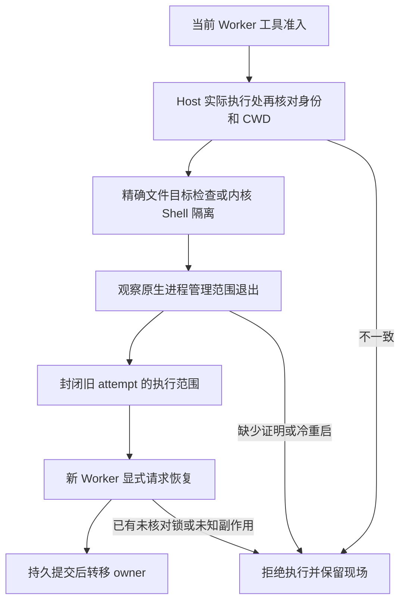

# 工作树执行隔离与停净证明补强

## 背景

647e3ee73115 修复构建的独立审查指出四个未关闭边界：Shell 未落实 task scope、检查与执行之间的 CWD 回退、冷历史不能证明旧作业资源停净、stale lease 回收没有跨进程 CAS，以及基线与 HEAD 缺少祖先校验。

本次问答等待另经只读日志和用户确认：用户只勾选、未提交；两个选项均为暂停。不能把勾选伪造为答复或授权，也不能为“续轮”取消安全门禁。

## 目标与范围

- 在真实 Host 的 subprocess spawn、文件实际写入和 workingDirectory.ensure 边界施加当前工作树/任务 scope 与身份限制。使用受限执行器和字面 argv，不解析 shell 命令字符串判断安全。
- 对支持的 Linux bwrap 执行面建立更窄的文件系统视图：任务 scope 之外只读，CWD 漂移或目录身份变化拒绝；未知后端、缺少边界桥接和无法保护的执行器拒绝开放写权限。
- 把模型 turn 结束与生产者/后代进程停净分开。只有实际观察到的 Host 执行范围退出才能作为当前进程的停净证明；冷历史、证据缺失、producerReported=false 或未结算作业保持受阻。
- 禁止自动删除/回收已有 stale lease；wx 排他创建遇到已有锁即拒绝。并发 release 必须共用一次释放过程。
- 增加有界只读 merge-base --is-ancestor 检查，允许合法后续提交，拒绝无关历史。

## 修改文件与接口

修改 src/util/workspace-lease.ts、src/host-recovery.ts、src/adapters/dsh-host/worktree.ts、src/application/host-guards.ts、src/application/swarm-service.ts、src/application/service-api.ts、src/index.ts；新增 src/adapters/dsh-host/execution-boundary.ts、src/adapters/dsh-host/fence-launcher.ts、patches/dsh-execution-boundary-0.2.2-rc.1.json、同名 .patch 及 scripts/apply-dsh-execution-boundary.mjs。package.json 与 scripts/pack-release.mjs 仅增加发布文件清单，无依赖版本变化。测试进入 tests/*.test.mjs，补充真实临时工作树、进程竞争和隔离 Host 物理写入反例。

不新增私有授权 sidecar，不修改 B0 工程或关闭验收门禁。执行临时资料使用 /tmp，正式产物仍在 release-artifacts；不重新创建长期 .work-* 目录。无业务数据库迁移或模型订阅配置变化。

## 风险与取舍

缺少可靠原语时优先保持阻断。旧锁不会仅因 PID 不存在而删除；旧会话不会仅因 turn/end 或空的进程内 jobs.list 获得写权限。对冷旧现场，不能补造过去未记录的资源停净证明。任务 scope 若无法由受支持执行面精确表达，不扩大到父目录。

Host 桥接仅接受已核验版本/文件摘要，未知版本拒绝安装；未安装桥接时受保护工具失败关闭。测试必须包含真实物理越界写入被拒绝和允许范围内写入成功，不能把决策级断言称为完整 Host E2E。

复查发现 Host 的弱进程组 fallback 也可返回 waitForExit=true，因此在 spawn 前额外要求原生 linux-scope 管理，拒绝弱模式。PTC、持久终端和原生 CLI 私有写入没有同等证明时关闭该执行面；可写委派的自动后端使用 API。Shell 不获宿主网络、IPC 或工程外 Git common-dir 写权限；精确文件 scope 不扩大到父目录。兼容边界详见 docs/3.3.5-DSH-0.2.2适配.md。

## 验证与回滚

验证 A：树外和 scope 外 shell 写入、显式树外 workdir、检查后 CWD/目录替换、嵌套执行逃逸；验证 B：未结算/不可信作业及历史回放不能授写；验证 C：并发进程争用同一旧锁不删除新锁；验证 D：真实 Git 无关历史拒绝、合法后续提交保留。

执行 npm run typecheck、npm test 和适用既有回归，记录每项的实际证据层级。部署前保护未提交问答和活动会话，备份原包、Host 文件与配置。回滚保留新的授权日志与更严格的写入守卫，不能用不识别新证据的旧插件重开旧 owner 权限。

## 实测记录

2026-11-05 完成 typecheck、npm test（53 项 node:test，0 跳过）、既有 Vitest 回归（132 个文件、1704 项通过、14 项既有跳过）。新增恢复、冷历史、真实 Git 祖先关系、两进程锁竞争和内核隔离用例均被实际 runner 收集。

真实 DSH 0.2.2-rc.1 隔离验证三阶段通过：无桥接拒绝委派（0 次模型调用）；同进程正向/物理反例/无损接管（15 次本地 mock 请求、2 个 Worker）；新 Host 进程冷恢复拒绝（2 次本地 mock 请求、1 个 Worker）。强进程范围检查首次暴露测试环境未传递 user-systemd 的 XDG/DBus 地址；只补入这两项非凭据环境变量后重跑通过，未放宽产品门禁。runner 保证失败时覆盖 summary 为 failed，避免旧通过报告残留。

证据位于 ../release-artifacts/v3.3.5-execution-safety/host-evidence/。这些结果不包含外部真实模型，也不代表原 T1 或 B0 验收。用户已提交暂停，服务器已记录答复且确认无活动轮次；后续部署与在役只读核验另存交付报告。原 B0 现场与原 T1 写权限保持原安全边界。
