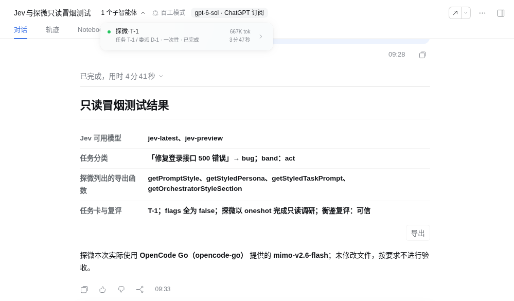
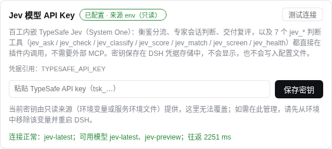
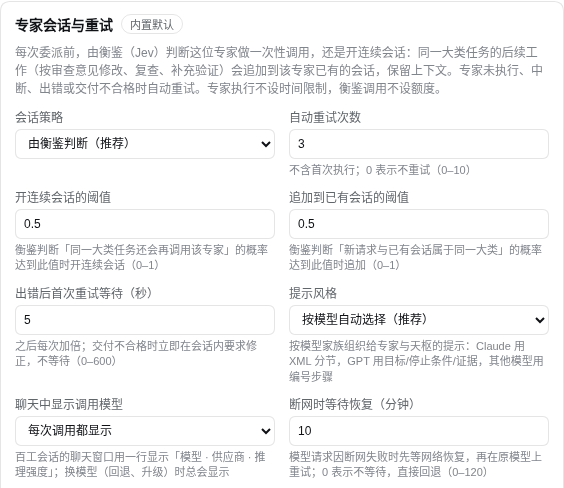
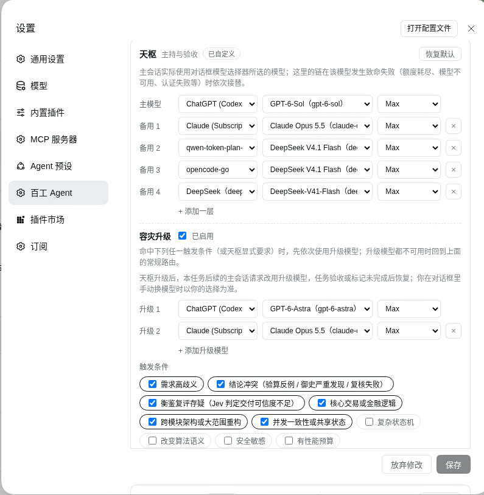

# dsh-agent-swarm

[中文](#中文) · [English](#english)

---

## 中文

DeepSeek Harness（DSH）的多智能体插件：「天枢」主持 12 位中文专家（谋定、枢机、算衡、探微、博闻、观象、铸剑、行舟、疾风、御史、复核、妙笔），用任务卡、门禁和真实证据决定是否验收；模型路由按你的订阅配置多层回退，故障时立即切到可用备用，最后一个可用模型短时故障时在预算内等待恢复。

- 适配 DSH **0.2.0 / 0.2.1**；`0.2.2-rc.1` 的跨模型回退需要安装[版本绑定的宿主桥接](docs/3.3.5-DSH-0.2.2适配.md)，并要求 Node.js 24.9 或更新版本。未安装桥接时百工会在模型调用前明确拒绝。
- 新建会话选「百工模式」即可使用；Jev 可选择 TypeSafe 官方接口，或从 DSH 当前模型目录选择第三方 Jev 兼容模型

### 3.3.5 的变化

- 原子恢复已校验的任务和委派快照，避免将历史记录当作实时状态转换；控制、委派与线程身份仍严格核对。
- 适配新版只读 Session 观察和步骤级工具准入；模型回退桥接在路由变化时重新装配工具和提示词，并保留真实请求记录。
- 子会话首次模型请求等待任务授权绑定；启动取消或宿主退出时等待会被中止。

### 3.3.3 的变化

- 人工在 DSH 模型选择器中选定的模型优先于任务卡风险升级；真实调用失败时仍保留额度、认证、协议和网络 fallback，但自动 fallback 不覆盖人工偏好。
- 旧会话恢复以当前 `agentPreset` projection 重建角色、persona 和工具 scope；角色变化会撤销旧 scope，Router 写入、Worker 权限和 worktree 边界继续由宿主与插件双重限制。
- EventJournal 分块保存 state snapshot/patch/commit，`journalOnly` 模式把 StateStore 当作可删除物化缓存；启用 `events.journal` 后即使本地 `persistence` 缓存关闭，task、delegation、binding、control、context、budget、route health 和 runtime 仍从 Journal 恢复。
- 增加统一 Source adapter、不可变 Trigger、`off/observe/auto` 主动模式决定、Thread 订阅和 durable Outbox。Auto 必须有有效 Mandate；人工 follow-up 绑定为 Ticket 上下文且不重复 Eval；intent 与 enabling fact 同行、经 fsync 落盘并支持有界重试和幂等恢复。

### 3.3.2 的变化

- Windows 状态目录不再因 Node 对目录 `fsync` 返回 `EPERM` 而阻断初始化；文件 fsync 与同卷 rename 保持严格，目录项 durability 明确标记为 Windows best-effort。
- 旧账本中的超大 checkpoint 以字节数、SHA-256 和形状摘要迁入 EventJournal V2，既有 ledger 原始文件不被修改，日志行长限制也不再穿透为模型调用失败。
- 合并 non-event JSON 尾部恢复：`null`、标量、数组和空对象活动尾按无效形状截断，损坏封片保持不可变。
- 任务页和 doctor 增加 DSH 原生 ask-user、todo、time-context、plan-mode、goal、jobs、agent-instructions 和 worktree 集成状态；Swarm 仍只读取宿主权威投影。

### 3.3.1 的变化

- 修正直接 OpenAI API 的 GPT-6 元数据：Astra、Sol、6.1 Sol、Luna 和 6.1 Terra 使用官方 1.05M context，不再把 272K 长上下文计价分界当成容量上限。
- Codex/ChatGPT Work 与第三方兼容网关继续使用各自报告或订阅渠道的限制；公共 API 的 1.05M 不会无条件覆盖它们。
- 新增 profile 检查与安全修复脚本；`--apply` 会先备份，再以原子写入修复当前直接 OpenAI provider 中已存在的模型条目。
- 明确区分上下文与输出容量：1.05M context 不代表 1.05M output，reasoning tokens 与可见文本共享 128K 输出预算。

### 3.3.0 的变化

- 完成 strangler 运行时接管：`service.ts` 成为组合门面，Host Guard、上下文/邮箱/数学/经验查询和 DSH 子智能体适配拆为独立 application/adaptor 模块。
- StateStore 成功提交成为唯一业务状态源；V2 事件在提交后确定性同步，加入备份、manifest、审批/证据映射、投影差分、封片和 10 万事件重放。
- Router 默认禁止直接写入、运行命令和创建工作树；Worker 提交校验 Ticket、revision、input digest 与当前 workspace lease epoch，Watchdog 可隔离未知副作用并从事件恢复。
- 升级到 DSH `0.2.1-rc.5` 与 `pi-ai@1.5.0`。官方 OpenAI 目录仍错误写为 272k，因此继续使用准确的 1050k profile 覆盖；272k 是长上下文计价阈值，不是上限。
- 订阅兼容构建基于 `dsh-plugin-subscriptions@0.9.12`，保留 Claude 空文本块与 Gemini 4 Argon 修补；所有本地 rc.5 插件都显式声明并实测宿主版本。

### 3.2.1 的变化

- 修复超大会话切换到上下文较小模型后只输出 reasoning 并显示“已达到输出 token 上限”。模型派发前现在使用 DSH 原生 `ctx.tokenMeter` 测量会话，并从 `ctx.llm.resolveModelInfo` 读取候选路由的 `contextWindow` 与 `defaultMaxTokens`；超窗路由会被跳过，整条链都不足时明确返回“未调用模型”。
- 3.2.1 当时读取宿主的 `272000` 声明；后续核对确认这是直接 GPT-6 API 的长上下文计价分界，而不是 1.05M 容量上限。3.3.1 已修正直接 OpenAI provider，同时继续隔离 Codex 与第三方目录。
- 明确 3.2.0 是增量重构：Ticket、RouteEngine、Router/Worker、EventJournal V2 和 Watchdog 模块已建立，但全量运行时迁移尚未完成。3.2.1 完成上下文准入和原生 seam 硬化，不虚假宣称全量重构结束。
- 保留宿主对 `ask_user_question`、`todo_write`、`time-context`、`AGENTS.md`、jobs、goal、计划模式和 Git worktree 的所有权；Swarm 只在路由、授权、租约、证据和工作树绑定边界消费其公开接口。

### 3.2.0 的变化

- 模型路由中的专家卡默认全部收起；卡片可独立展开/收起主备链与升级链，错误卡会自动展开。
- Jev 官方与第三方来源互斥。第三方模式从 DSH 当前供应商目录选择供应商、模型和推理强度，不再手工输入模型 ID，也不读取官方 API key。
- 接入 DSH 官方 Git 工作树工具。铸剑和疾风必须先创建隔离工作树才能写入；工作树与任务/委派绑定，不能跨任务复用，重启后保留并标记为需要人工恢复。
- 新增 Ticket 生命周期、统一 RouteEngine、Worker 边界、事件日志和 Watchdog 核心模块，同时保留原有专家角色、额度、认证、模型资格、主备回退与证据门禁。
- 补齐 Antigravity、DSH OpenCode Go、OpenCode 与相关模型家族的资源额度与能力元数据。

### 3.1.8 的变化

- 子智能体「模型与恢复」改为黄色圆角按钮，失败后可从此入口调整模型并安全继续任务。
- 修复模型目录的零参数 RPC 被误传取消信号而失败的问题。供应商、模型和推理强度始终使用下拉框；目录加载失败可刷新，目录外选项无法提交。
- Google Antigravity 的独立模型额度按模型处理并保留实际重置时间。Argon 耗尽不影响仍可用的 Flash，其他模型的 0% 用量不能证明当前模型还有额度。
- 当时保留了自动跨模型回退；DSH `0.2.2-alpha.2` 的真实恢复测试未通过，该版本排除了 `0.2.2`。3.3.5 对 `0.2.2-rc.1` 使用上述版本绑定桥接。
- 本机市场的下载源与 scope 目录误报已单独修复；这些主机配置不随插件包自动安装，详见 [升级与回退](docs/升级与回退.md)。

### 3.1.7 的变化

- 本版是审计与稳定性版本：修复门禁、状态恢复、授权等待、路由恢复与 Jev 端点的正确性问题，并移除从未接入运行时的进化治理任务视图与只读面板。
- 验算门禁只认标注 `proof` 的已证实结论；复核里任何失败命令都会否决之前的通过；性能验收只接受最后一次编辑之后的最新测量，验收复评读取最近的委派。
- 状态恢复会丢弃日志末尾未确认的半条记录；授权准入按需释放、已答复的旧决定按需回收，critical 结算失败会在下一次进入时受控对账；长任务的在途等待不再累加到上限而把任务判为耗尽。
- 所有 Jev 直通工具发送前替换常见密钥格式，复评脱敏改为线性匹配并整体替换认证方案与组合凭据；非 https（本机回环除外）的 baseUrl 会被拒绝；`approvals=deny` 覆盖写入或命令时，原生 Codex/Claude 委派改走 API 并记录原因。
- 控制面板轮询不再清掉失败提示，推理强度变化不再误报为切换模型；移除不可用的 `maxTokens` / `maxCostUsd` 配置。
- 公开仓库 main 恢复“仅插件”形态；3.1.6 的全部修复已并入本版（3.1.6 未单独创建 GitHub Release）。

### 3.1.3 的变化

- 百工设置按五类选项卡组织，备用模型链支持拖拽、按钮和键盘排序。
- 修复订阅耗尽与人工换模竞态，恢复委派会重新取得当前任务的执行身份。
- 真实用户问答进入可恢复等待；服务端验收凭证与全历史结构守卫阻止无证据完成和重复空转。
- 适用范围与存储兼容保持向后兼容；内部实施记录只在源码仓库的 GitHub 历史中维护。

### 3.1.2 的变化

- 原生“任务进度”Tab集中六个图表视角，按需查看任务、版本、节点状态和证据流；rc.3窄屏可从“更多视图”进入。
- 聊天与Tab共享只读读取，支持取消、过期提示、连接隔离和失败恢复；关闭视图不停止长期任务。
- 技能/工具候选保留来源与隔离元数据，不能通过文本复核激活或自动执行。
- 吸收 Ruflo 的工作区、只读投影与来源化候选设计；内部迭代记录不进入发布包。

### 3.1.1 的变化

- 规划审核会话识别为百工子会话，实际模型由宿主请求记录展示；模型与恢复面板区分实际调用和后续选择。
- 一次性审核可选择下一请求模型，当前请求不中断；连续专家保留取消、沉寂确认和安全继续流程。
- 失效上下文引用返回当前任务授权索引，重新选择 ref/digest 即可继续读取；不恢复旧版本权限。
- 文件发现支持相对子目录、有界索引与输出；宿主搜索容量溢出和 Fetch 404 保留原错误并说明恢复方式。
- 已复核经验的适用条件参与有界检索；自我进化按发布说明分阶段提供。
- 真正需要人工决定时，天枢调用 `ask_user_question`，不以重复思考代替授权交互；未答复不表示同意。

### 3.1.0 的变化

| 变化 | 说明 |
|---|---|
| **长会话不再从某条消息后整段消失** | GitHub Issue #1：`swarm-model-call` 在分页或长会话的事件窗口缺少 `request/header` 时不再从 `start()` 返回 `undefined`。它返回继承上一状态的隐藏占位，渲染层丢弃该节点，宿主事件订阅器不会中断；下一条调用也不会误报「切换模型」。普通会话同样受保护。 |
| **thinking 协议错误不再重复命中** | DeepSeek 返回 `The content[].thinking ... must be passed back` 时归类为 `protocol_incompatible`，当前请求立即回退并隔离该路由，避免同一会话反复调用同一不兼容模型。 |
| **目标受阻时给出可执行恢复处方** | `swarm_status` 新增 `blockedRecovery`：区分协议不兼容、路由耗尽、规划服务故障、连续无进展、缺门禁和验证缺口，给出推荐角色与下一步。天枢按处方最多做一次只读诊断或对应专家修复，不靠重复改卡、重复评分或重放业务写入恢复。 |
| **pnpm 11 本地 tarball 安装说明** | 使用 `minimumReleaseAgeIgnoreMissingTime: true`，只跳过 registry 中没有发布时间信息的本地包；`minimumReleaseAgeExclude` 只接受精确版本，不能写 semver range。 |
| **原生 Agent Team 只读镜像（默认关闭）** | 启用 DSH 原生 Agent Team 后，可在会话头部查看已有成员、共享任务、实时状态、owner、依赖和写入范围，并打开成员会话。镜像不创建成员、不修改共享任务、不调用 `spawn_teammate` 或原生 `complete`；百工仍是唯一任务、证据、租约和执行控制器。 |
| **本地 tarball 可直接 link 安装** | 新增 `scripts/install-profile.mjs`，校验并解包发布包后以内容摘要目录和 `link:` 接入 profile，避免 pnpm 回查未发布的 registry 版本。四层自我进化仍只提供分阶段路线，3.1.0 不自动修改提示、工具或工作流。 |

### 3.0 的变化

| 变化 | 说明 |
|---|---|
| **铸剑等专家不再频繁「路由链耗尽」** | 链上没有可切换的模型时，最后一个可用模型的网络/服务端/限流类临时故障按 5 秒起、封顶 60 秒退避重试；其他模型被隔离但即将到期、或正由其他专家探测恢复时等它。发起请求时共用的订阅路由刚被另一位专家的失败隔离，也在预算内等待，不再直接失败。等待与断网等待共用每个请求的 `agents.networkWaitMs` 预算（默认 10 分钟，每个请求最多等 32 次），用尽才结束，并在结果里列出每条路由的状态；等待期间人工换的模型醒来后照用。订阅模型池以 `AUTH` 报告的耗尽按认证失效处理，其他 `AUTH` 按状态码细分；池与认证冷却按宿主恢复时间隔离（至多 30 分钟重探）；重新登录或普通目录/配置更新不会使隔离提前到期。登录后等待冷却，或在已有「模型与恢复」面板请求受控重试；重试仍按策略判定，不能绕过供应商 `resetAt` 或他人持有的半开探测。 |
| **按设置的语言输出** | 支持在专家执行设置中按服务商多选排除默认语言要求，天枢最终汇总保持默认语言。未排除时，每个预设都带 `- **Language**: 强制使用{$language}回答与思考（代码、变量名、命令、路径与专业术语保持原文）。`，运行时替换成「设置 → 百工 Agent」里选的语言，并在系统提示末尾追加用该语言书写的要求；换模型后照样生效。DSH 0.2.1 起专家子会话与原生 Codex / Claude Code 后端也使用按语言生成的委派 persona。已有探测中最终回复按设置语言输出；尽管语言要求已注入，DSH 显示的可见推理仍可能为英文，不能保证其始终遵循设置，见 [docs/使用.md](docs/使用.md#输出语言)。 |
| **工程规范写入全部角色** | 不过度工程化、不过度精简、不盲目重构、安全第一、异常带上下文日志、每项改动附可执行验证；铸剑/疾风另有 C.T.I.V. 流程、命名与测试要求，行舟/复核有终端安全规则，御史按四个维度和固定模板审查。 |
| **任务卡不再因流程草稿被打回** | 天枢给的流程草稿缺少必需门禁（例如资金逻辑要求的 `G_MATH_VERIFY`）时由宿主自动补齐节点，不再报「workflow 缺少必需门禁」；与门禁顺序冲突的草稿依赖被绕过，其余业务先后保留。 |
| **观察模式不再自动规划审核** | 一次长期目标实测中，自动审核耗时与全部专家执行相当且 94 次只通过 2 次；现在只在强制模式自动审核，观察模式按需调用 `swarm_review_plan`。 |
| **规划审核设置可视化** | 「设置 → 百工 Agent → 任务流程与规划审核」可改流程模式、自动审核、`requireJev`、修正轮数、通过阈值与 `planningReview.timeoutMs`（默认 0 不限，正整数毫秒为显式上限，非法值拒绝）。 |
| **长期运行更稳** | 模型错误不再暂停持久专家（取消、打断、回合被拦下仍暂停），续跑期间不提供会打断自动恢复的「继续」；写入正常完成先等本委派登记的宿主后台作业收尾，取消时请求停止并等待确认。结束或释放通知只触发重查，未确认副作用仍保留租约阻断；不保证宿主未跟踪或逃逸的系统进程已经停止，详见 [任务流程与验证](docs/任务流程与验证.md#执行与协作)。 |
| **代码精简** | 移除死代码与重复实现，移除 PRD、规划与证据类文档和一次性脚本。 |

### 安装

装好后重启 DSH（systemd 托管时：`systemctl --user restart dsh-web.service`）。

- **插件市场（dsh-market）**：搜索 `dsh-agent-swarm` 一键安装。
- **预构建包**：
  ```sh
  dsh plugin --profile <profile> add https://github.com/zhairy/dsh-agent-swarm/releases/latest/download/dsh-agent-swarm.tgz
  ```
- **从源码**：
  ```sh
  git clone https://github.com/zhairy/dsh-agent-swarm.git && cd dsh-agent-swarm
  npm install            # prepare 会构建 lib/
  dsh plugin --profile <profile> add "$(pwd)"
  ```

模型 provider、Jev、原生 Codex / Claude Code 与 dsh-llm-fallbacks 共存的设置见 [docs/安装.md](docs/安装.md)。

### 使用

在「百工模式」会话里用自然语言描述目标和验收条件，天枢会：

1. `swarm_task_card` 建任务卡（目标、验收、范围、风险标志、性能预算），生成 Mermaid 流程；规则与衡鉴（Jev）给出硬门禁。
2. `swarm_delegate` 把自包含的子任务交给专家：自动选择模型路由、限制工具权限、校验结构化交付，衡鉴复评交付可信度。
3. `swarm_status` 查看门禁、证据与路由；`swarm_accept` 逐项核对证据后验收，缺证据返回 `blocked`。

另有 7 个 Jev 判断工具（`jev_check`、`jev_classify`、`jev_score`、`jev_match`、`jev_screen`、`jev_ask`、`jev_health`）和 `jev-judgments`、`typesafe-ai` 两个技能，在插件内直接调用，不需要外部 MCP。详见 [docs/使用.md](docs/使用.md)、[docs/角色.md](docs/角色.md)、[docs/任务流程与验证.md](docs/任务流程与验证.md)。

| 委派结果与专家会话 | Jev API key | 专家会话与重试 | 模型设置 |
|---|---|---|---|
|  |  |  |  |

### 设置 → 百工 Agent

| 卡片 | 写入 swarm-core | 内容 |
|---|---|---|
| Jev 模型 API Key | DSH 凭据存储 | 保存、清除、测试连接；密钥不写入配置文件 |
| 百工工具审批 | `approvals` | 继承宿主 / 请求审批 / 拒绝，按写入、Shell、外部 MCP、Jev 工具选择作用域 |
| 专家会话与重试 | `agents` | 默认交付语言、会话策略、重试、提示风格、模型调用显示、断网等待（链尾保持预算）、天枢恢复时间 |
| 任务流程与规划审核 | `workflow`、`planningReview` | 流程模式、自动审核、Jev 要求、修正轮数、阈值、`timeoutMs` |
| 纯函数数学算子 | `math` | 算子组、数值模式与计算规模 |
| 各角色模型链 | `routes` | 每层供应商、模型、推理强度；可升级角色另配容灾升级 |

### 组成

```
宿主层（cordis.patch.yml）
  swarm-core      agentSwarm 服务：任务卡与门禁、委派、路由状态（回退 / 链尾保持 / 首选恢复）、衡鉴、账本、写入守卫
  swarm-codex*    原生 Codex / Claude Code 后端实例（安装官方 bundle 后启用）
预设层（presets/*.patch.yml，13 个）
  百工模式（天枢）：标准工具 + swarm_* 编排工具 + jev_* 工具
  12 个专家预设：按权限裁剪的工具；委派时作为子会话的组合（DSH 0.2.1 起）
  每个预设都挂 runtime 行：改写路由、处理失败回退、解析语言占位符、安装委派 persona
浏览器端（client/ → lib/client.js）
  设置页、聊天中的「调用模型」行、任务流程图、持久专家的模型与恢复控制
```

### 开发（仅源码仓库）

公开源码树包含插件源码、构建脚本和用户文档，不附维护测试、沙箱或同步脚本。

| 命令 | 作用 |
|---|---|
| `npm run build` | 编译 `src/` 到 `lib/` 并生成浏览器端 bundle |
| `npm run typecheck` | 类型检查（仅 `src/`） |
| `npm run gen:presets -- --dsh "$(npm root -g)/@deepseek-ai/dsh/node_modules"` | 以 DSH 的 standard 预设为底重新生成 13 个预设 |
| `npm run doctor -- --profile <p>` | 只读检查本机环境（不输出密钥） |
| `npm run pack:release` | 构建、校验入口依赖闭包并打包发布物 |

升级、回退与卸载见 [docs/升级与回退.md](docs/升级与回退.md)。

### 许可证

MIT，见 [LICENSE](LICENSE)。内嵌的 Jev 工具改编自 jev-mcp 0.2.1（MIT），`skills/typesafe-ai` 收录自 TypeSafe AI（MIT），详见 [THIRD-PARTY-NOTICES.md](THIRD-PARTY-NOTICES.md)。

---

## English

A multi-agent plugin for DeepSeek Harness (DSH). The orchestrator "Tian Shu" leads 12 Chinese-named experts (requirements, architecture, math, code exploration, research, vision, complex implementation, command execution, small edits, independent review, verification, copywriting) and accepts work only on evidence: task cards, hard gates and real command results. Each role has a multi-layer model chain built from your subscriptions; failures switch to a usable backup immediately, and a short outage of the last usable model is waited out within a budget.

- Works with DSH **0.2.0 / 0.2.1**. Cross-model fallback on `0.2.2-rc.1` requires the [version-bound Host bridge](docs/3.3.5-DSH-0.2.2适配.md) and Node.js 24.9 or newer; without the bridge, managed requests fail before generation.
- Start a session in the "百工模式" (Agent Swarm) preset. Jev can use the official TypeSafe API or a third-party Jev-compatible model selected from the live DSH catalog.

### What's new in 3.3.5

- Restores validated task and delegation snapshots atomically while retaining strict control, delegation, and thread identity checks.
- Adapts cold Session observation and step-scoped tool admission; the model bridge reassembles tools and prompts after a route switch and preserves actual request evidence.
- Holds a child model request until its task authorization is bound, with cancellation and shutdown handling.

### What's new in 3.3.3

- A model selected explicitly in the DSH picker now outranks task-card risk upgrades. Real quota, authentication, protocol and network failures still use the bounded fallback chain, without replacing the durable human preference.
- Restored sessions rebind prompts, personas and tool restrictions from the current `agentPreset` projection. A stale child scope is revoked and rebuilt, while Router write denial and Worker/worktree boundaries remain enforced.
- EventJournal state transactions now hold chunked snapshots, encoded changes and commit markers. With `events.journal` enabled, task, delegation, binding, control, context, budget, route-health and runtime state survive even when the local `persistence` cache is disabled or deleted.
- Adds unified Source adapters, immutable Triggers, proactive `off/observe/auto` decisions, Thread subscriptions and a durable Outbox. Auto mode requires a valid Mandate; manual follow-ups become Ticket context without a duplicate Eval; fsynced intents resume through bounded, effect-idempotent handlers.

### What's new in 3.3.2

- Oversized legacy ledger data is migrated as a bounded, redacted, hash-bound summary; non-event journal tails recover without rewriting sealed corruption.
- Windows uses explicit best-effort directory-entry durability while file sync, rename and other permission failures remain strict.
- Read-only task projections expose native DSH todos, time context, plan mode, goals, jobs, ask-user and worktree availability.

### What's new in 3.3.1

- Corrects the direct OpenAI API metadata overlay: GPT-6 Astra, GPT-6 Sol, GPT-6.1 Sol, GPT-6 Luna and GPT-6.1 Terra use the documented 1.05M context instead of the erroneous 272K long-context pricing boundary.
- Keeps provider boundaries: Codex/ChatGPT Work and third-party compatible gateways continue to use their own reported or subscription-specific limits.
- Adds `scripts/repair-openai-metadata.mjs` to inspect an active profile without changes and, with `--apply`, back up and atomically repair existing direct OpenAI model entries.
- Separates context capacity from output capacity in diagnostics: 1.05M context does not mean 1.05M output, and reasoning tokens share the 128K output budget.

### What's new in 3.3.0

- Completes the strangler runtime handoff: `service.ts` is now a facade, while host guards, context/mailbox/math/experience queries and DSH subagent adaptation are separate application/adapter modules.
- The committed StateStore snapshot is the sole business-state source. V2 events are synchronized after commit with backups, manifests, approval/evidence mappings, projection diffs, segmented journals and 100k-event replay.
- The router is write-denied by default. Worker submissions validate ticket revisions, input digests and the live workspace lease epoch; the watchdog quarantines unknown side effects and restores quarantine from events.
- Upgrades the verified host to DSH `0.2.1-rc.5` and `pi-ai@1.5.0`. The upstream OpenAI catalog still reports 272k for `gpt-6.1-sol`, so the accurate 1.05M profile override remains; 272k is a long-context pricing threshold, not the model limit.
- The subscription compatibility build is based on `dsh-plugin-subscriptions@0.9.12` and retains the Claude empty-block and Gemini 4 Argon fixes. Local rc.5 plugin builds declare and test the exact host version.

### What's new in 3.2.1

- Fixed large sessions that switched to a smaller-context model and then returned only reasoning with a length stop. Route admission now uses DSH's native `ctx.tokenMeter`, `contextWindow`, and `defaultMaxTokens`, skips unsafe routes, and fails before dispatch when no candidate can hold the session.
- 3.2.1 initially consumed the host declaration for OpenAI models. 3.2.1 later proved that the host's `272000` value was the long-context price boundary for direct GPT-6 models; 3.3.1 corrects that metadata while keeping Codex and third-party provider limits separate.
- The release states the real 3.2.0 boundary: its core modules exist, but the full runtime migration is not complete. Native ask-user, todo, time context, workspace instructions, jobs, goal, plan mode, and Git worktree remain host-owned.

### What's new in 3.2.0

- Expert cards are collapsed by default and expand independently to show primary, fallback and upgrade routes; invalid saved drafts reopen automatically.
- Official and third-party Jev sources are mutually exclusive. Third-party mode uses catalog-backed provider/model/reasoning selectors, never asks for a model ID and does not read the official API key.
- Managed editing experts use the native DSH Git worktree tool. A worktree is bound to one ticket/assignment, cannot be reused across tickets, survives restart as manual-recovery state, and is never auto-removed.
- Adds Ticket lifecycle, RouteEngine, Router/Worker, event journal and Watchdog cores while retaining the existing experts, quota/authentication/eligibility checks, fallback chains and evidence gates.
- Adds resource and capability metadata for Antigravity, DSH OpenCode Go, OpenCode and the relevant model families.

### What's new in 3.1.9

- Provider checkboxes let expert requests use the model default language while final host summaries follow the configured output language. Explicit task language is preserved.
- Language policy follows the actual provider after fallback and default changes on continued sessions.
- Subscription-pool transport errors retain network recovery semantics; local cooldown messages explain how to refresh subscription usage without claiming current quota exhaustion.
- Missing Gemini tool thought signatures are classified as protocol incompatibility, avoiding repeated requests to the same incompatible route.

### What's new in 3.1.8

- The subagent model and recovery entry is a rounded yellow button with recovery guidance.
- Fixed the zero-argument model catalog RPC receiving an abort signal as a business argument. Provider, model and reasoning effort use catalog-backed dropdowns, with retryable catalog errors and validation before submission.
- Google Antigravity quota failures stay scoped to the affected model and preserve reported reset times. An exhausted Argon route does not block a working Flash route.
- That release retained automatic cross-model fallback and excluded `0.2.2` after `0.2.2-alpha.2` failed recovery tests. Version 3.3.5 uses the version-bound bridge described above for `0.2.2-rc.1`.
- Download-source and npm-scope diagnostic repairs were applied separately on the deployment host; installing this plugin does not change another machine's market configuration.

### What's new in 3.1.7

- This is an audit and stability release: it fixes correctness issues in gates, state recovery, authorization waits, route recovery and the Jev endpoint, and removes the never-wired evolution-governance task view and read-only panel.
- The verification gate only accepts proved claims marked `proof`, any failed command in a review vetoes earlier passes, performance acceptance only accepts the latest measurement after the last edit, and acceptance review reads the most recent delegations.
- Recovery discards an unconfirmed half-written journal tail; authorization admissions are released and old answered decisions reclaimed as needed, successive in-flight waits in long tasks no longer exhaust the task, and a critical settlement failure is reconciled on the next entry.
- Every Jev direct tool replaces common secret formats before sending, review redaction matches in linear time and replaces auth schemes and combined credentials as a whole, a non-https `baseUrl` (loopback excepted) is rejected, and under `approvals=deny` for writes or commands native Codex/Claude delegations use the API tool chain with the reason recorded.
- Control-panel polling no longer clears failure notices, a reasoning-effort change is not reported as a model switch, and the unusable `maxTokens` / `maxCostUsd` settings are removed.
- Public `main` returns to a plugin-only tree; all 3.1.6 fixes are included here (3.1.6 did not get a separate GitHub Release).

### What's new in 3.1.3

- Categorized settings and accessible drag, button and keyboard ordering for fallback routes.
- Safer fallback during quota exhaustion and model changes; resumed delegates acquire a fresh execution binding.
- Recoverable user-decision waits, server-issued acceptance receipts and bounded structural loop detection.
- Runtime-guard scope and compatibility remain backward compatible; internal implementation records stay in the source repository's GitHub history.

### What's new in 3.1.2

- A native Task progress view brings six diagram perspectives together, with task selection and version-bound evidence. On narrow rc.3 layouts it can appear under More views.
- Shared read-only loading adds cancellation, stale snapshots and connection isolation without stopping long-running work.
- Tool and skill proposals remain quarantined metadata; text reviews cannot activate or execute them.
- Adopts Ruflo-inspired workspace, read-projection and provenance principles without adding another runtime; internal iteration records are excluded from the release package.

### What's new in 3.1.1

- Planning-review child sessions display models observed by the host; the controls distinguish actual attempts from next-request selections.
- One-shot reviewers can select the next request model without interrupting the in-flight request. Persistent experts retain cancellation, settlement and safe continuation.
- Obsolete context references return the current authorized index without reviving old permissions.
- File discovery supports bounded relative-directory scans; search overflow and Fetch endpoint failures retain their error status and offer recovery guidance.
- Reviewed experiences can match bounded applicability text. Self-evolution is delivered in stages described by the release notes.
- Tian Shu uses `ask_user_question` for necessary human decisions; silence never grants permission.

### What's new in 3.1.0

| Change | Details |
|---|---|
| **Long conversations no longer stop rendering** | GitHub Issue #1: `swarm-model-call` no longer returns `undefined` from `start()` when a paginated/long event window has no `request/header`. A hidden placeholder inherits the previous state and is dropped by the renderer, so the host event subscription remains intact; the next attempt is not falsely reported as a model switch. Ordinary sessions are protected by the same contract. |
| **Thinking-protocol failures are isolated** | `The content[].thinking ... must be passed back` is classified as `protocol_incompatible`; the current request fails over immediately and the route is isolated instead of being retried repeatedly in the same session. |
| **Blocked goals get a recovery prescription** | `swarm_status` now returns `blockedRecovery` for protocol incompatibility, route exhaustion, planning-service failure, no progress, missing gates and verification gaps. Tian Shu uses the recommended role and next action once, without repeating equivalent cards, scores or business mutations. |
| **pnpm 11 tarball guidance** | Installation docs use `minimumReleaseAgeIgnoreMissingTime: true`, which skips only local packages without registry publish-time metadata. `minimumReleaseAgeExclude` accepts exact versions only and rejects semver ranges. |
| **Read-only native Agent Team mirror (off by default)** | When native DSH Agent Team is enabled, the session header can show existing members, shared tasks, live status, owner, dependencies and write scopes, and open member sessions. It never creates members, edits tasks, calls `spawn_teammate` or native `complete`; the swarm remains the sole task, evidence, lease and execution controller. |
| **Link-based local tarball installer** | `scripts/install-profile.mjs` validates and unpacks a release tarball into a digest-addressed local bundle and wires it with `link:`, avoiding registry lookups for unpublished versions. Four-layer self-evolution remains a staged roadmap; 3.1.0 does not auto-modify prompts, tools or workflows. |

### What's new in 3.0

| Change | Details |
|---|---|
| **No more spurious "route chain exhausted"** | When no other route is available, transient network/server/rate-limit failures on the last usable model are retried with 5 s → 60 s backoff, and isolated routes about to recover — or being probed by another expert — are awaited. A request that starts while a shared subscription route has just been isolated by another expert also waits instead of failing. Waits share the per-request `agents.networkWaitMs` budget (10 min by default, at most 32 waits per request); only then does the request end, listing every route's state. A model you pick during a wait is honoured when it ends. Subscription pool exhaustion reported with `AUTH` counts as an authentication failure, other `AUTH` errors are classified by status; pool and auth cooldowns follow the host's recovery time (capped at 30 minutes before a re-probe). Signing in again or ordinary model-catalog/configuration updates do not expire isolation early. After signing in, wait for cooldown or request a controlled retry in the existing Model & recovery panel; retry eligibility follows policy and cannot bypass a provider's `resetAt` or another request's half-open probe. |
| **Replies in your configured language** | Every preset carries `- **Language**: 强制使用{$language}回答与思考…`; the runtime replaces `{$language}` with the language chosen in Settings → Agent Swarm and appends a rule written in that language, so it survives model switches. On DSH 0.2.1+, delegated experts and the native Codex / Claude Code backends also get a delegation persona generated in that language. Final replies followed the setting in the observed probes; despite the injected language instructions, reasoning displayed by DSH may still be in English, so it is not guaranteed to follow the setting. See [docs/使用.md](docs/使用.md#输出语言) (Chinese). |
| **Engineering rules for every role** | No over-engineering, no over-simplification, no blind refactors, security first, logged I/O errors, runnable verification for every change; implementers get C.T.I.V., naming and testing rules, executors get terminal-safety rules, reviewers a fixed four-dimension template. |
| **Workflow drafts are repaired, not rejected** | Missing required gate nodes (e.g. `G_MATH_VERIFY` for financial logic) are inserted by the host instead of failing the task card; draft edges that contradict the gate order are bypassed while every other business ordering is kept. |
| **No automatic planning review in advisory mode** | In a long-running goal, automatic reviews cost as much time as all expert work and passed 2 of 94 times. They now run automatically only in enforced mode; advisory mode reviews on demand via `swarm_review_plan`. |
| **Planning review settings in the UI** | Settings → Agent Swarm → "Task workflow & planning review" edits the workflow mode, automatic review, `requireJev`, fix rounds, pass threshold and `planningReview.timeoutMs` (0 = no limit by default; positive integer milliseconds keep an explicit limit; invalid values are rejected). |
| **Steadier long runs** | Model errors no longer pause persistent experts (cancellation, interruption and blocked turns still do), and "continue" is not offered while the automatic retry is pending. Normal writer completion waits for the delegation's registered host jobs to settle; cancellation requests a stop and waits for confirmation. End or disposal notifications trigger a recheck, not release; unconfirmed side effects keep the lease blocked. This does not guarantee that untracked or escaped OS processes have stopped. See [task workflows and verification](docs/任务流程与验证.md#执行与协作) (Chinese). |
| **Leaner code base** | Dead and duplicated code removed, as well as PRD, planning and evidence documents and one-off scripts. |

### Install

Restart DSH afterwards (with systemd: `systemctl --user restart dsh-web.service`).

- **dsh-market**: search for `dsh-agent-swarm`.
- **Release tarball**:
  ```sh
  dsh plugin --profile <profile> add https://github.com/zhairy/dsh-agent-swarm/releases/latest/download/dsh-agent-swarm.tgz
  ```
- **From source**:
  ```sh
  git clone https://github.com/zhairy/dsh-agent-swarm.git && cd dsh-agent-swarm
  npm install            # prepare builds lib/
  dsh plugin --profile <profile> add "$(pwd)"
  ```

Providers, Jev, native Codex / Claude Code and coexistence with dsh-llm-fallbacks are covered in [docs/安装.md](docs/安装.md) (Chinese).

### Usage

Describe the goal and acceptance criteria in an Agent Swarm session. Tian Shu then:

1. creates a task card with `swarm_task_card` (goal, acceptance, scope, risk flags, performance budget) and a Mermaid workflow; rules and Jev triage add hard gates;
2. delegates self-contained subtasks with `swarm_delegate`, which picks the model route, restricts tools, validates structured deliverables and has Jev rate their reliability;
3. inspects gates, evidence and routes with `swarm_status`, and accepts with `swarm_accept`, which returns `blocked` with the missing evidence.

Seven embedded Jev judgment tools (`jev_check`, `jev_classify`, `jev_score`, `jev_match`, `jev_screen`, `jev_ask`, `jev_health`) and the `jev-judgments` and `typesafe-ai` skills run inside the plugin without an external MCP server. See [docs/使用.md](docs/使用.md), [docs/角色.md](docs/角色.md) and [docs/任务流程与验证.md](docs/任务流程与验证.md) (Chinese).

### Settings → Agent Swarm

| Card | swarm-core key | Purpose |
|---|---|---|
| Jev API key | DSH credential store | save, clear and test the key; it never enters config files |
| Swarm tool approvals | `approvals` | inherit / ask / deny for writes, shell, external MCP and Jev tools |
| Agent sessions & retries | `agents` | default output language, session policy, retries, prompt style, model-call display, network wait (also the last-route hold budget), Tian Shu model recovery |
| Task workflow & planning review | `workflow`, `planningReview` | workflow mode, automatic review, Jev requirement, fix rounds, threshold, `timeoutMs` |
| Pure mathematical operators | `math` | operator groups, numeric modes and limits |
| Model chain per role | `routes` | provider, model and reasoning effort per layer; escalation chains for upgradeable roles |

### Development (source checkout only)

The public source tree ships the plugin sources, build scripts and user documentation; it does not include maintenance tests, the sandbox or the sync scripts.

| Command | Purpose |
|---|---|
| `npm run build` | compile `src/` to `lib/` and build the browser bundle |
| `npm run typecheck` | type-check `src/` only |
| `npm run gen:presets -- --dsh "$(npm root -g)/@deepseek-ai/dsh/node_modules"` | regenerate the 13 presets from DSH's standard preset |
| `npm run doctor -- --profile <p>` | read-only environment check (never prints secrets) |
| `npm run pack:release` | build, verify the entry dependency closure and pack the release tarball |

Upgrade, rollback and removal: [docs/升级与回退.md](docs/升级与回退.md) (Chinese).

### License

MIT, see [LICENSE](LICENSE). The embedded Jev tools are adapted from jev-mcp 0.2.1 (MIT) and `skills/typesafe-ai` comes from TypeSafe AI (MIT); see [THIRD-PARTY-NOTICES.md](THIRD-PARTY-NOTICES.md).

### 专家默认语言排除

在「设置 → 百工 Agent → 专家执行」的「专家默认语言排除名单」中多选服务商。勾选后，该服务商的专家过程使用模型默认语言；每次实际请求和模型回退都会重新匹配。任务明确指定的语言仍然保留，天枢面向用户的最终汇总继续遵循默认交付语言。此选项不保证模型内部推理使用英语，也不改变供应商的规则或使用限制。

旧配置的排除名单为空；保存后立即作用于新的请求。旧会话里已有的用户指令和历史消息不会被改写；需要完全移除旧的语言要求时，请新建专家委派。
