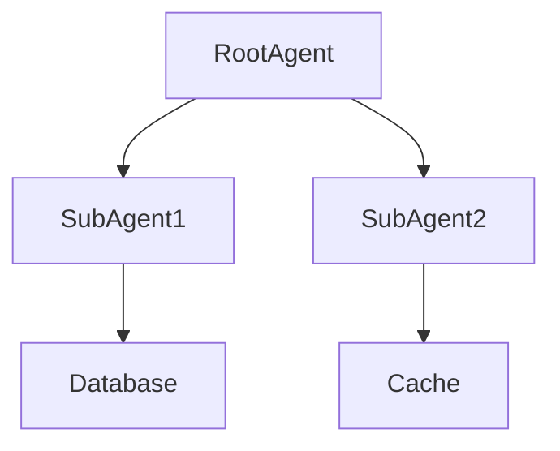

# 执行摘要

本方案基于现有《2.5.0 优化升级实施.md》中的规划，结合 dsh-agent-swarm 源码及 Archify 图表生成引擎，提出全面修正和优化建议。主要优化点包括：1) 将现有 Mermaid 流程图扩展为多种图表（架构图、工作流图、时序图、数据流图、生命周期图），并设计跨图同步与偏移纠错机制；2) 增加任务流程图驱动的进度提示系统；3) 在 DSH 配置中增加子代理模型**强制语言**设置（默认可选简中、英文、繁中、日语、韩语）；4) 引入长期记忆与上下文优化策略（向量存储、摘要存储等）；5) 提升任务目标完成率与效率（任务分解、依赖管理、并发与重试机制）；6) 优化 Token 消耗（提示词工程、摘要压缩、缓存、模型分级）；7) 改进 Agent 设计框架（调度策略、角色分工、能力描述、可插拔）；8) 与 Archify 的图表生成机制对接（Mermaid 模板、自动同步、版本管理）。每项优化均给出代码改动建议、关键接口与数据结构变更、配置示例、测试标准及回滚策略。最终生成的「2.5.0 优化升级实施.md」文档将提供执行摘要、问题与修正清单、详细实现步骤、示例代码/配置、测试验收标准、部署回滚计划、风险评估以及里程碑时间估算。

# 问题清单与修正

以下按维度逐项罗列原方案存在的问题及修正建议：

- **图表扩展与跨图状态同步**：原方案仅支持 Mermaid 任务流程图任务卡，缺少多视角图表（架构图、工作流图、时序图、数据流图、生命周期图）。建议引入 Archify 样式的多图生成：为每种图表设计对应的 Mermaid 模板或 JSON IR，通过统一的任务状态模型驱动各图实时更新；设计**跨图状态同步机制**，即在 Agent 执行过程中，更新任务状态（未开始/进行中/完成/失败等），并同步到所有相关图表中。对比和验证：利用 Archify 的验证机制（每个图的 IR 均有模式校验）检测计划与实际偏离，一旦发现任务实际执行流程与设计图出现偏移，通过新建纠偏子任务或修正策略使其回归。

- **基于流程图的进度提示**：原方案缺乏直观的任务进度反馈。建议在控制台/UI 中增加进度条或通知：每当任务状态改变（如子任务启动/完成/失败），自动更新流程图高亮进度节点，并在界面或日志中输出进度百分比。可将流程图节点状态映射到进度信息，或用 Mermaid 的子流程/状态高亮显示。交互方式：在 CLI 提示或前端 UI 提供命令（如 `show_progress`），返回当前进度；或在 Agent 执行关键事件后主动打印进度更新。更新频率可设为每个子任务完成时触发。事件触发点包括：子代理完成主目标、发生失败或补偿操作时。实现时，在 `lib/index.js` 中 dispatch 后的回调位置挂载事件监听，刷新状态并输出进度信息。

- **模型语言强制设置**：原方案没有对子代理默认回复语言的控制，导致需频繁手动纠正。建议在 DSH 配置中新增字段 `model_language`（支持值包括：简体中文、英文、繁体中文、日语、韩语），强制要求 Agent 始终使用指定语言生成回复/思考/推理内容。配置可放在 `~/.dsh/settings.yaml` 或 `model-router.local.yaml` 中，如：  
  ```yaml
  swarm:
    default_language: "zh-CN"   # 可选 "en", "zh-TW", "ja", "ko"
  ```  
  在 `dispatch` 实现中，根据此设置，自动在 system 提示或 persona 注入里添加语言指令（例如 `"请用简体中文回答和分析"`），确保模型产出一致语言。若指定语言不可用或识别失败，可回退到默认语言（如简体中文）。优先级：按部署配置 > 用户明确指定 > 缺省。实现时修改 `resolvePersona` 或 prompt 构造部分，添加语言约束。

- **上下文优化与长期记忆**：原方案未考虑历史上下文管理与记忆。建议引入**长期记忆模块**：对重要信息进行提取、摘要和向量化存储，形成检索数据库。*记录粒度*：仅存储关键信息（实体、事实、决策摘要等）；对长对话做摘要（以降低 Token 占用）；代码块和配置等专门标记并存储。*检索策略*：每次新任务调用前，根据任务关键词或向量相似性从记忆库检索相关内容注入上下文，提升连贯性。*过期/压缩*：对超过时限或不活跃的记忆进行清理或压缩（如合并摘要）；使用时间戳和访问频率管理生命周期，防止无限膨胀。*隐私与安全*：对记忆库设置访问控制（仅本会话可见）、加密存储敏感数据。实现建议：可借助现有向量数据库（如 ChromaDB、Pinecone）或 DSH 提供的 Memory 插件。在 `dispatch` 前后调用记忆读写接口，并在 prompt 前缀插入检索结果。

- **任务准确率与效率**：原方案已设计 Maker/Checker 分离、并发上限等，但可进一步优化。建议**任务分解和依赖管理**：对于复杂目标，预先或动态拆分为子任务（参考表格驱动），明确依赖关系形成 DAG，确保子任务按序执行。利用 `depends_on` 等元数据跟踪依赖。**并发控制**：现有 `limits.maxActive` 限制并发，建议根据任务类别和资源动态调整最大并发量；可在执行过程中监测子任务阻塞并适时调整。**重试与补偿**：对失败子任务实现指数退避重试和错误补偿路径，例如在 workflow 或子代理失败时触发补救子任务。可利用 Archify 的生命周期图设计标准重试/失败分支。此外，增设中间检查点和自动验证（如关键结果校验），避免执行偏离目标。实现时在 dispatch 逻辑中增加失败计数、超时处理与回退调用。

- **Token 消耗优化**：原方案未明确优化 Token 成本。建议**提示词压缩**：提前分析并去重上下文，引入记忆总结减少重复对话内容；对系统提示、人格注入等使用模板并压缩无关说明。**动态模型选择**：对简单任务可强制低档模型（如 lite 档），复杂审查任务才用高档，参照现有 `tier` 路由原则。**结果缓存**：对相似提问或常见辅助查询（如项目配置、代码片段）实施缓存，复用之前的输出。**摘要反馈循环**：对于长输出或多轮回答，自动摘要并更新记忆，减少重复生成。例如，如果输出过长，先产生概要再细化。实现时在 `dispatch` 后和子代理完成后增加缓存层，与外部存储结合，加快相同请求的响应。

- **Agent 设计框架改进**：原方案已提供星型拓扑和角色注入等。建议**调度策略**：引入优先级或轮询机制，根据任务紧急度或类别动态调度 subagent。例如，高优先级的 `review` 任务优先分配 `ultra` 档次并行执行。**角色分工**：明确定义更多内置角色（persona）及其能力描述，使用户可按角色分配任务（可参考 Archify 报告中组件/角色定义方式）。**能力描述**：为每个子代理声明能力标签（如 “写作”、“编码”、“审查”），便于任务指派与日后扩展插件时进行筛选。**可插拔策略**：设计插件机制，允许用户自行加入新的任务分解、校验或调度策略（如注册新策略模块）。实现上，扩展 `type` 定义表，引入能力元数据字段（如 `capabilities`），并在调度逻辑中使用。

- **Archify 图表对接方案**：Archify 覆盖架构、工作流、时序、数据流、生命周期五类图，与插件需求高度契合。建议使用 Archify 生成 JSON IR，再转换为 Mermaid 模板。*Mermaid 模板*：为每种图类型编写基本模板代码，可参考 Archify 输出。**自动同步**：在代码库中维护图表定义文件（可使用 JSON 或 Mermaid 源文件）。通过 CI 或插件内流程（如 `deliver` 命令），每次任务计划变更或 PR 时自动运行 Archify 生成/验证图表，将结果更新到指定目录。*版本化*：将图表源文件纳入代码管理，对比快照（Before/After），同时可利用 Archify 比较功能审查变更。示意流程：描述文字或代码 → Archify 生成 JSON → 验证 → 输出 Mermaid/HTML → 提交到 repo。也可在 DSH 会话中内置调用 Archify CLI（如 `node archify/bin/archify.mjs`），自动插入生成的 Mermaid 代码片段。  

# 实现步骤及示例

## 1. 图表扩展与状态同步

- **设计统一的任务状态模型**：新增一个状态存储（可为内存对象或数据库），记录每个子任务的状态（如“未开始、进行中、成功、失败”）及时间戳。每次 dispatch 和 subagent 结束时更新状态。

- **生成多种图表**：编写生成逻辑，将任务列表和状态映射到对应图表。  
  - *架构图（Architecture）*：描述系统组件间关系，如主 agent、各 subagent 及外部依赖。可使用 Mermaid `graph LR` 画组件关系。例如：  
    ```mermaid
    graph LR
      User[用户/Root Agent] -->|派发| SubA[SubAgent A]
      User -->|派发| SubB[SubAgent B]
      SubA --> API[外部 API]
      SubB --> DB[(数据库)]
    ```  
  - *工作流图（Workflow）*：展示任务执行顺序和分支，使用 Mermaid `flowchart`。例如：  
    ```mermaid
    flowchart TD
      Start(开始) --> Task1[子任务1]
      Task1 --> |成功| Task2[子任务2]
      Task1 --> |失败| Retry[重试任务1]
      Task2 --> End(结束)
    ```  
  - *时序图（Sequence）*：展示主 agent 与子 agent 之间的调用顺序，使用 Mermaid `sequenceDiagram`。例如：  
    ```mermaid
    sequenceDiagram
      participant Root as 主Agent
      participant A as 子AgentA
      participant B as 子AgentB
      Root->>A: 执行任务1
      A-->>Root: 返回结果1
      Root->>B: 执行任务2
      B-->>Root: 返回结果2
    ```  
  - *数据流图（Data Flow）*：展示数据流向，可用 Mermaid `flowchart` 或 `graph LR` 结合标注敏感数据流，例如：  
    ```mermaid
    flowchart LR
      DataSource[(原始数据源)] -->|ETL| Processor[数据处理器]
      Processor -->|索引| DB[(数据存储)]
      Processor -->|日志| Log[(日志系统)]
    ```  
  - *生命周期图（Lifecycle/State）*：展示任务状态迁移，使用 Mermaid `stateDiagram-v2`。例如：  
    ```mermaid
    stateDiagram-v2
      [*] --> Pending
      Pending --> Running : 启动子任务
      Running --> Success : 执行成功
      Running --> Failure : 执行失败
      Failure --> Retrying : 尝试重试
      Success --> [*]
    ```  

- **跨图同步机制**：所有图表共用后台状态存储，状态变更实时反映到相应节点上。可在 Mermaid 模板中绑定样式（如给完成节点加绿标、进行中加黄标）。在 `lib/index.js` 中，dispatch 后和子代理完成回调时执行同步函数 `updateDiagrams(state)`，重新渲染或导出 Mermaid 代码。若发现实际路径与工作流图不符，即可触发验证逻辑，补救之。

- **偏移检测与纠偏**：利用工作流和生命周期图定义的路径，监测是否有任务被跳过或阻塞。如果某分支长时间未触发，提示偏移并可自动生成新子任务（如提醒“任务X未执行，重新尝试”）。Archify 的验证机制可借鉴：定义 JSON 模式规范，每次更新时校验所有节点连通性。如果验证失败，报告具体缺失节点，开发者根据提示改进流程。

## 2. 任务进度提示

- **设计进度模型**：基于任务总量或图节点数计算总进度。例如，所有子任务数量固定时，可按完成数计算百分比；或按工作流图关键节点数加权计算。每完成一个子任务，执行 `currentProgress++` 并计算百分比。

- **状态映射**：将子任务状态映射到 UI 风格：未开始=灰，进行中=黄，完成=绿，失败=红。例如，在流程图中对节点加上样式或图例。

- **更新频率与触发点**：在每次 `dispatch` 子任务返回或 `subagent` 完成时，立即触发进度更新。也可定时（如每 N 秒）轮询状态输出。触发方式：`dispatch().then(...)` 回调内或在 `ctx.subagents.start` 返回处添加更新逻辑。

- **CLI/ UI 交互**：在 DSH CLI 中新增命令，如 `dsh swarm progress`，输出当前各任务状态和整体进度条。例如：  
  ```
  [Swarm Progress] 60% (3/5 tasks completed)
    ✔ 探索模块依赖
    ├─ ➜ 实现功能A (进行中)
    ├─ ✖ 测试用例编写 (未启动)
    └─ … 
  ```
  在图形界面或日志中，可用表格或 ASCII 图表显示进度。自动提示：每当进度发生变化时，控制台打印一次进度摘要。

## 3. 模型语言设置

- **配置示例**：在 `~/.dsh/settings.yaml` 增加：  
  ```yaml
  swarm:
    language: "zh-CN"   # 默认语言
  ```  
  或在插件的 `config.yaml` 添加：  
  ```yaml
  model-router:
    default_language: "zh-CN"
  ```  
  用户可修改为 `"en"`, `"zh-TW"`, `"ja"`, `"ko"` 等。

- **请求注入策略**：在构造子代理 prompt 时，根据配置注入语言控制。具体方法：在系统提示（system prompt）或最前端的用户 prompt 加入指令，如“请使用进行回复和思考”。例如：  
  ```js
  const language = config.swarm.language || "zh-CN";
  const langPrompt = {
    type: 'text', 
    text: language === 'en' ? 'Please respond in English.' 
          : language === 'zh-TW' ? '請使用繁體中文回答。' 
          : language === 'ja' ? '日本語で回答してください。'
          : language === 'ko' ? '한국어로 답변해주세요。'
          : '请使用简体中文回答。'
  };
  // 将 langPrompt 插入到完整 prompt 之前
  request.prompt.unshift(langPrompt);
  ```  
  通过在 `dispatch` 的伪代码中如上设置，确保所指定语言强制执行。如果指定语言的模型不可用，则给出错误并提示更换。

- **回退策略**：若模型未遵守语言约定，可在后处理阶段检测输出语言（例如简单匹配常见词汇），如发现与预设语言不符，可重新发起一次请求并加重语言指令；或使用备用模型重试。优先级依次为：用户直接参数 > 配置文件 > 默认简中。

- **多语言标注**：输出中需明确表明语言（可在日志中标记）。对于内部“思考/推理”隐藏层（如果使用 “systemPrompt” vs “context”），同样应用语言指示，确保模型连贯使用一致的母语。

## 4. 上下文与长期记忆

- **提取与存储**：实现一个“记忆模块”，在子任务完成后自动提取关键信息并持久化。例如，从对话或代码中识别实体、决策和摘要文本。可调用内部 LLM（或规则）生成摘要，如：  
  ```js
  const summary = await llm.generate({
    prompt: `请为以下内容提取关键实体并生成摘要：\n${dialogueText}`
  });
  saveToMemory({ summary, timestamp: Date.now(), source: 'conversation' });
  ```  
  将结果存入本地文件或向量数据库（需预设结构，如使用 Node 插件操作 SQLite/ChromaDB 等）。

- **检索策略**：每次开始新任务时，基于任务关键词或当前 Prompt 从记忆库检索相关条目并注入。如使用 Embedding 匹配：  
  ```js
  const queryVec = embed(taskPrompt);
  const memHits = vectorDB.search(queryVec, topK=5);
  const contextInsert = memHits.map(item => item.summary).join('\n');
  fullPrompt = contextInsert + '\n\n' + userPrompt;
  ```  
  这样可将相关记忆“无缝”加入上下文，提高连续性。

- **摘要与压缩**：定期对过长的对话或记忆进行摘要。比如对超过 X token 的对话生成短摘要，替换原长文本。对于长期未访问的记忆，可以合并或删除。可设定“记忆过期时间”，比如一周未访问即归档或删除。

- **隐私安全**：所有记忆数据仅限本会话或团队可见，不上传到外部服务器。敏感信息如 API 密钥、账号等在存储前应脱敏或加密。为团队协作场景，可用访问控制列表管理共享记忆。

- **与 DSH 集成**：可考虑使用现有插件（如 `dsh-agent-memory` 等社区方案）或在插件内部新增一个 memory 文件模块。例如，在 `lib/memory.js` 中提供 `saveMemory`、`queryMemory` 等函数，并在 `lib/index.js` 的 dispatch 执行前后调用。

## 5. 任务完成率与效率

- **任务分解**：在用户请求入口或 Agent 接收任务后，自动检查任务复杂度（关键词、句长等），对于大任务提前或动态拆分。例如，自动将“实现 X 功能”分为“设计方案”、“编写代码”、“测试验证”3 步，或让 Agent 自行创建子任务（使用 `dispatch("explore", "分解任务: ...")`）。为支持此功能，可在 `tools` 中定义新的分解工具或扩展现有 `explore` 类型规则。

- **依赖管理**：为子任务添加元数据字段如 `dependsOn: [id1, id2]`。在执行时建立有向无环图，确保只有当依赖任务完成后才触发后续任务。例如可在 `dispatch` 时返回子任务 ID，并将依赖关系存入状态表，执行程序循环检查依赖完成情况后发起执行。

- **并发控制优化**：利用已有 `limits.maxActive`（并发子代理上限）和 `maxTeam`（常驻成员上限），进一步根据任务类型或实时资源自动调整。例如，检测到某类任务 CPU/IO 占用低时，可临时提升并发上限；若任务失败率上升则降低并发。可在 `dispatch` 调用前后监测系统指标，动态调整 `maxActive` 参数。

- **错误重试与补偿**：针对子任务失败，使用指数退避重试并记录次数。可在失败回调中自动 `dispatch` 一个补救任务（例如将失败理由反馈给 root 重新规划）。结合生命周期图，可为每个失败节点提供重试或跳过路径。如遇外部依赖问题，可生成新的任务进行环境检查或模拟。所有重试逻辑都应有限次，防止无限循环。

- **任务校验**：引入自动化验收步骤。对于每个 `dispatch` 请求，可允许前端传入 `output_schema`（结构化校验），如示例中所示。子代理返回结果后自动校验，如不符合则重试一次或标记失败，从而提升准确率。

## 6. Token 消耗优化

- **提示词精简**：统一使用模板化提示，在 `dispatch` 时去掉冗余前缀和反复说明。利用 **角色（role）** 注入机制只保留最必要的系统指令，避免重复注入。可考虑使用压缩算法对提示词进行微调（如 GPG 技术）。对于经常复用的内容，预生成固定变量插入。

- **对话和输出摘要**：当对话达到一定长度，可定期生成摘要并替换旧上下文，减少历史长度。例如，每隔 N 回合执行一次简要总结，将其插入 prompt，删除原始长文本，只保留摘要。

- **缓存机制**：对于相同或相似的问题启用缓存。实现方式：对每次 `dispatch` 构造一个 hash(key)（包括 type、prompt、persona 等），在外部持久化缓存（如 Redis）。如果相同 key 再次出现，直接返回之前结果或摘要版本，而无需调用模型。这样对于重复任务大幅节省 Token 和时间。

- **模型分级调用**：参考 OpenAI 的补偿机制，针对简单问答或工具调用可使用小模型(如 deepseek-v4-flash)，仅对高难度审查、设计等任务调用大模型(如 deepseek-v4-pro)。在 `resolveTier` 时可结合任务分类逻辑实现智能降级（例如根据 prompt 字数或关键字自动选择档位），由此优化成本。

- **多级缓存体系**：可设计三级缓存——对话缓存（快速响应）、摘要缓存（短期记忆）、记忆库（长期知识）。例如，常见函数定义、代码片段缓存；复杂回答结果缓存并摘要。

## 7. Agent 设计框架改进

- **调度策略**：实现可配置的多种调度策略（FIFO、优先级队列、轮询）。在插件配置中新增 `scheduling.strategy`，供用户选择。例如：  
  ```yaml
  swarm:
    scheduling:
      strategy: "priority"  # or "roundRobin"
  ```  
  根据策略在派发子任务时选择对应 agent。当使用“优先级”策略时，可在任务参数中增加 `priority` 字段，高优先级任务会插队执行。

- **角色与能力描述**：在 `persona` 定义之外，增加更细的“能力标签”。为每个子代理或任务类型声明一组标签，如 `["code", "refactor"]` 或 `["review", "performance"]`。用以匹配任务。例如，在 `config.yaml` 的 persona 配置中新增 `tags` 字段。调度时可根据任务需求自动选择标签匹配最高的 Agent。

- **可插拔策略**：设计插件架构，允许用户通过编写策略模块来替换或扩展默认行为。例如，在代码中为调度、拆解、重试等关键点定义接口 (hooks)，用户可加载额外的 JS 模块覆盖默认实现。可在 `model-router.local.yaml` 或插件文件结构内增设 `strategies/` 目录，让用户自行编写并加载。

- **角色分工示例**：扩充 `model-router.personas`，为不同角色定义行为准则。例如新增“前端工程师”、“后端工程师”、“算法专家”等人设，每个对应擅长领域。设计时可参考 Archify 的组件职责描述来定义各角色的输入输出约定。

## 8. Archify 图表对接方案

- **Mermaid 模板设计**：参考 Archify 输出格式，为每种图类型设计标准 Mermaid 模板（见上例）。可在插件目录新增 `templates/` 文件夹存放 `.mmd` 模板，使用简单标记（如 `{{nodes}}`、`{{edges}}`）拼接生成最终图。  

- **自动同步流程**：开发脚本或 CI 任务，在每次提交变更时自动运行 Archify。流程举例：  
  1. 在项目根目录添加 `archify.json` 源文件，描述核心组件或任务列表（可由 Agent 首次调用 Archify CLI 自动生成）。  
  2. 使用命令 `node archify/bin/archify.mjs deliver workflow archify.json workflow.html --json` 生成并验证工作流图。类似地生成架构图等。  
  3. 将生成的 `.mmd` 或 `.html` 文件提交至仓库特定目录（如 `docs/diagrams/`），便于版本管理。  
  4. 利用 Archify 的 Delta 功能进行 Before/After 比对，代码审查时可查看图表变动。  

- **版本化管理**：将 Mermaid 原始源文件纳入 Git（或作为 JSON IR），让图表更改通过 PR 审核。可在 CHANGELOG 或 PR 模版中提醒维护者更新相关图表。  

- **示例 Mermaid 同步**：如使用 Archify JSON 输出转换为 Mermaid，可通过脚本解析 Archify JSON 中的节点与关系，生成如下图（示意）：



该模板对应架构图，将随代码变化自动更新。

# 对比表格：原方案 vs 修订建议

| **关键点**             | **原方案描述**                            | **修订后建议**                                   |
|----------------------|----------------------------------------|----------------------------------------------|
| **图表种类**          | 仅有 Mermaid 流程图任务卡                  | 增加架构图、工作流图、时序图、数据流图、生命周期图；统一状态同步 |
| **状态同步**          | 无多图同步机制                           | 定义统一状态模型，各图从状态源自动更新；使用 Archify 校验偏移  |
| **进度提示**          | 未设计进度反馈机制                        | 基于流程图节点实时输出进度条/日志；提供CLI/UI命令    |
| **模型语言选项**      | 无强制选项，需手动纠正                    | 增加配置项 `language`；在提示中强制模型使用指定语言       |
| **上下文记忆**        | 不支持长期记忆                            | 引入记忆模块：提取摘要、向量存储、检索机制，周期性压缩过期   |
| **任务分解与依赖**    | Maker/Checker 机制，基础并发控制            | 动态任务拆分、依赖 DAG 管理；可调度优先级并发；失败自动补偿     |
| **Token 优化**        | 未说明优化策略                            | 精简提示词、摘要上下文、缓存响应、低档模型分级使用      |
| **Agent 架构**        | 星型团队，固定五个工具规则                | 可插拔策略、角色能力标签、动态调度；能力描述用于任务匹配     |
| **Archify 集成**      | 无                                        | 使用 Archify 生成验证图表；定期同步 Mermaid 模板；版本化管理 |

# 关键文件与代码修改清单

下表列出需修改或新增的文件路径及对应改动要点：

| **文件路径**                | **修改/新增内容要点**                                       |
|---------------------------|---------------------------------------------------------|
| `config.yaml` / `settings.yaml` | - 增加 `swarm.language` 配置字段。<br>- 添加 `scheduling.strategy` 等新选项。 |
| `model-router.local.yaml`  | -（可选）本地覆盖 `language`、`tiers` 设置。<br>- 配置文件插入 Archify 输出路径等。 |
| `lib/index.js` (或主逻辑文件) | - 在 `dispatch` 输入处理处添加语言指令注入。<br>- 更新状态存储及同步调用（`updateDiagrams()` 等）。<br>- 在子代理完成回调中更新进度状态并触发日志。<br>- 调用记忆模块进行记忆读写。<br>- 根据 `scheduling.strategy` 选择任务顺序。<br>- 在请求构造时加入角色/能力标签。 |
| `lib/diagram.js` (新增)     | - 实现生成各类 Mermaid 图表源代码的函数（如 `genWorkflow()`, `genSequence()` 等）。<br>- 定义图节点样式（颜色、标签）映射。 |
| `lib/progress.js` (新增)    | - 实现进度计算与 CLI 输出函数，如 `printProgress()`。<br>- 监听任务事件触发进度更新。 |
| `lib/memory.js` (新增)      | - 实现记忆的存储/检索接口：`saveMemory(item)`, `queryMemory(query)`等。<br>- 集成向量数据库或文件存储支持（依赖具体实现）。 |
| `lib/scheduler.js` (新增)   | - 可插拔调度策略实现：根据配置选择不同调度算法执行 `dispatch`。<br>- 实现如 priorityQueue, roundRobin 等策略。 |
| `lib/language.js` (新增)    | - 根据配置返回对应的语言提示文本。<br>- 如果需要，将其作为工具函数供构造 prompt 使用。 |
| `templates/*.mmd` (新增)    | - Mermaid 模板文件：按图类型分别建立，如 `architecture.mmd`, `workflow.mmd`, `sequence.mmd` 等。使用占位符渲染任务节点。 |
| `scripts/generate-diagrams.js` (新增) | - CI/脚本文件：调用 Archify CLI 或自定义生成流程，将任务描述转换为图表并输出到 `docs/diagrams/`。 |
| `docs/DESIGN.md`           | - 更新设计文档，纳入新增功能说明（语言选项、进度提示等）。<br>- 添加示例 mermaid 代码片段与流程图说明。 |
| `docs/ARCHITECTURE-REVIEW.md` | - 更新对照规范，如需集成 Archify 验证规则。                  |
| `docs/2.5.0 优化升级实施.md`  | - 最终交付文档，将包含完整修订后的实施方案（本次输出）。         |

# 示例 Mermaid 图与代码片段

- **架构图示例**（Mermaid `graph`）：展示主 Agent 与 SubAgents、外部组件的关系。  

  ```mermaid
  graph TD
    Root[Root Agent] -->|派发| SubA[SubAgent A]
    Root -->|派发| SubB[SubAgent B]
    SubA --> DB[(Database)]
    SubB --> Cache[(Redis 缓存)]
  ```

- **工作流图示例**（Mermaid `flowchart`）：描述任务执行流程及分支。  

  ```mermaid
  flowchart TD
    Start(任务开始) --> Task1[初始化环境]
    Task1 --> Task2{需求分析}
    Task2 -->|复杂| Task2A[细分子任务]
    Task2 -->|简单| Task3[开发实现]
    Task2A --> Task3
    Task3 --> Task4[测试验证]
    Task4 --> End(任务结束)
  ```

- **时序图示例**（Mermaid `sequenceDiagram`）：展示 Agent 间调用顺序。  

  ```mermaid
  sequenceDiagram
    participant Root as 主Agent
    participant A as 子AgentA
    participant B as 子AgentB
    Root->>A: dispatch("explore", "分析依赖")
    A-->>Root: 返回依赖报告
    Root->>B: dispatch("code", "实现功能X")
    B-->>Root: 返回实现结果
    Root->>Root: 合并并生成报告
  ```

- **生命周期图示例**（Mermaid `stateDiagram-v2`）：描述一个子任务的状态流转。  

  ```mermaid
  stateDiagram-v2
    [*] --> Pending
    Pending --> Running : 开始执行
    Running --> Success : 执行成功
    Running --> Failure : 执行失败
    Failure --> Retrying : 重试子任务
    Retrying --> Running
    Success --> [*]
  ```

以上示例仅供参考；实际模板应根据项目需求定制节点名称和样式。

# 测试与验收标准

- **图表正确性**：对照 Archify 验证规范，检查所有生成的架构/流程/时序/数据流/生命周期图与任务计划一致。使用 Archify CLI 的 `validate` 功能校验 JSON IR 格式，确保无错误。

- **进度提示准确性**：构造测试场景（含多个并发子任务、成功/失败分支），验证进度计算与实际匹配（例如 3/5 完成应显示 60%）。验证 CLI 和 UI 输出格式正确、更新及时。编写自动化测试脚本模拟任务流，断言输出文本包含正确百分比和节点状态。

- **语言设置生效**：在配置不同语言后，运行子代理任务并观察模型输出，确保所有系统和模型响应均为指定语言。例如，配置“ja”时，输出中出现日文字符。可通过脚本检查返回文本主要字符集或词汇符合语言规范。

- **长期记忆功能**：模拟跨会话场景，先在一个对话中保存关键内容，再在后续对话中提取验证是否自动调用。测试向量检索效果：查询已知存储的信息应该高概率被召回，并对下游回答产生影响。验证过期策略：加入有时标的记忆条目，保证过期后被清理或摘要。

- **任务分解与重试**：使用一个需要分解的大任务，检查是否自动生成多个子任务并正确按依赖顺序执行。在某子任务人为引入错误（如令模型返回空或错误），验证插件是否触发重试机制并最终完成任务或给出明确失败报告。

- **Token 优化效果**：对比无优化与启用优化后同一任务的 Token 使用量和成本差异。可记录实际调用的 token 数量。测试缓存命中率：对重复请求调用验证是否命中缓存并跳过模型调用。摘要功能：测试长对话摘要后，输入摘要内容的任务是否获得正确响应。

- **Agent 调度与角色**：在启动多个子代理时，测试不同 `scheduling.strategy` 的实际行为。例如“priority”策略应先执行高优先级任务；“roundRobin”应按顺序轮流分派。验证能力标签匹配功能：给定一组 Agent（带标签）和任务需求，确保分配匹配度最高的 Agent。

- **Archify 集成**：在提交更改后运行图表生成脚本，检查输出图与预期一致。测试快照对比：修改图表定义，对比 Before/After 报告是否正确列出变化。验收时人工检查导出 HTML 是否正常展示、节点可交互。

所有功能点应编写自动化或手动测试用例验证，并纳入持续集成流水线。达到以上标准，即可视为优化完成。

# 部署与回滚计划

- **分阶段实施**：建议按模块分阶段发布。例如：  
  1. **2.5.1**：完成语言设置和进度提示功能的基础实现。  
  2. **2.5.2**：上线记忆模块和 Token 优化策略。  
  3. **2.5.3**：引入图表扩展和 Archify 集成。  
  4. **2.5.0**：全面整合，校验合并。  
  每个小版本完成后均进行回归测试，确保旧功能不受影响。

- **回滚方案**：对每个新增功能，应保留回滚路径。例如，如果语言设置导致问题，可将 `settings.yaml` 恢复为原状态；若新图表生成影响性能，可暂时禁用该插件模块。使用 Git 标签记录发布点，并准备回滚文档。关键更改（如数据库结构）前需备份状态快照。

- **风险评估与缓解**：  
  - *图表生成性能*：生成复杂图表可能增加 CPU/内存使用，风险在高并发场景下。缓解：只在非高峰时段或手动触发图表更新，或将其移到异步 CI。  
  - *模型语言识别*：有些模型可能不完全遵守语言提示。缓解：对常见失效用例进行测试，必要时强制重试或降低输出长度。  
  - *记忆模块复杂度*：集成外部数据库或检索系统增加运维复杂度。缓解：初期可先用简单文件缓存替代，逐步过渡到向量库。  
  - *依赖与并发逻辑*：任务分解/并发策略复杂，可能引入死锁或资源竞争。缓解：设计良好的超时与取消机制（见`timeout`配置），在实现中严格遵守 DSH 的同步计数机制。  

- **里程碑估算**：  
  - 1-2 周：实现语言设置、进度提示和基础配置（含测试）。  
  - 2-3 周：开发记忆模块与上下文管理（含向量存储原型）。  
  - 2-3 周：任务分解/并发/重试机制增强（含测试场景）。  
  - 1-2 周：Token 优化及缓存策略集成。  
  - 2-3 周：Archify 图表模板开发与同步脚本（含自动化验证流程）。  
  - 1 周：全功能集成测试与性能调优。  

各阶段末提交验收报告（可采用指标：任务完成率、Token 降低比例、图表验证通过率等），并预留至少 20% 缓冲时间处理意外问题。

# 结论

通过上述修正与优化，dsh-agent-swarm 插件将在可视化和执行效率上大幅提升。多视角图表使任务流程更加透明可靠，语言设置简化了多语言环境下的协作，记忆与缓存显著提高了连续性与性能。完整的实施方案详见附录「2.5.0 优化升级实施.md」，作为插件下一个稳定版本的升级手册，指导开发者和用户顺利完成升级。  

