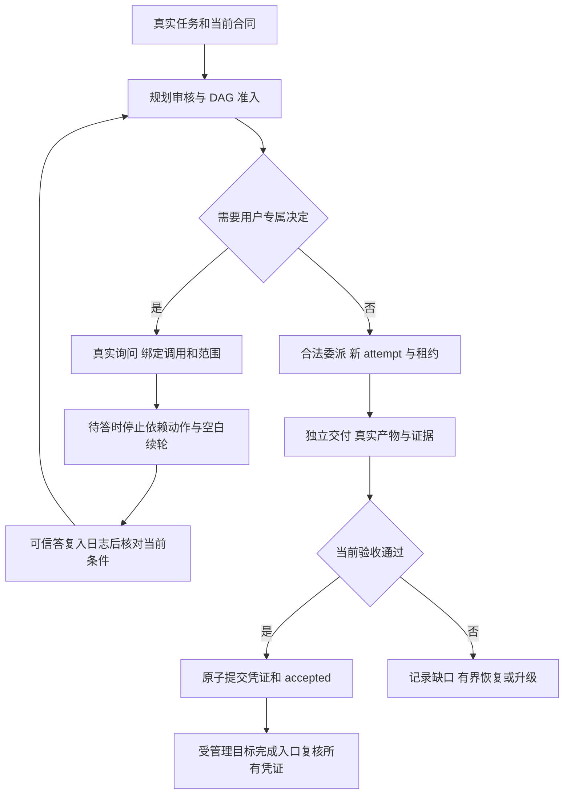

# 3.1.3 运行守卫与路由恢复

百工设置分为「概览与 Jev、模型路由、专家执行、规划与审批、数学工具」五页，共用一份待保存草稿。备用模型支持拖拽、按钮与 Alt+方向键排序；主模型固定，不能跨专家或跨链拖动。未管理的配置字段继续保留。

订阅池耗尽、限流与人工换模竞态按真实请求归属处理；可用的后备模型无需等待原池恢复。旧失败不能污染后来手动选择的路由。连续专家通过「模型与恢复 → 安全继续任务」重新预约当前合同和新 attempt，保留同一子会话；原生直接续发不重新授予已撤销的身份，也不会再先调用模型然后反复加载被拒技能。

## 用户决定与完成

真实 `ask_user_question` 调用登记来源、范围与版本。未回复、pending、无应答者、取消、跳过都不会批准依赖动作；无独立就绪工作时，通过宿主公开 disarm 抑制自动续轮。晚到答复只允许匹配的真实输入先入日志，再结算决定；人工暂停、停止或替换目标不因旧答复被重新激活。用户选择不能替代宿主工具权限审批，不能复活旧规划批准。

`swarm_accept` 在服务器上核对当前版本、实际产物、独立委派交付与既有门禁，通过后同次提交验收凭证与 accepted。重复提交幂等；伪造、错任务、过期凭证及提交失败不会产生有效完成。阶段通过和有延期事项的通过不表示整个目标完成。

`update_goal action=complete` 的受管理工具入口要求所有必需任务的当前凭证，读取真实文件并串行检查合同。**原生 SDK/Remote 的直接 GoalService.complete 没有公开前置钩子，不在此插件守卫覆盖范围内。**本版没有猴补宿主，也不宣称全宿主所有入口不可绕过。

## 反空转与性能边界

同一可追溯用户来源的任务保留稳定谱系；改卡版本、节点标签和引用编号不清空历史。规范 DAG 结构、真实产物和只读观察内容摘要作为结构进展。A→B→A 等周期保留全史签名，同一结构与动作第三次命中时停止自动轨迹；停滞不是验收成功。真实在途工作、用户等待与传输重试不作为新业务计算轮。

每谱系历史最多 1024 项，每页 32 项；自动激活上限 4096，恢复和结构重规划各 4 次。达到容量显式停止并保留诊断，不淘汰历史后继续宣称全历史检查。无真实宿主来源的直接 SDK 声明仅保留任务级谱系，不推断不同任务同源。内存态没有可验证交接时不能宣称跨重启保留历史。

索引平均查找 O(1)；规范图、内容摘要仍随输入大小变化，DAG 投影保留依赖顺序语义。变更签名更新单个页，空间 O(H)；提交仍包含既有完整交叉引用校验，不能把整次提交宣称为 O(1)。嵌入距离、因果权重与相似度阈值不作为许可，不新增向量服务。经验加权、自动剪边和 Canary 治理留给 3.1.4 独立评测。

任务进度页继续使用 3.1.2 的可见时轮询及同源读取，新增只读运行守卫、等待和历史验收标识。公开提交序号来自真实存储，未引入另一条推送事实源或新的常驻服务。

## 兼容与升级

没有新增生产依赖。继续支持声明的 DSH 版本；新增问答自动等待/恢复依赖实际宿主公开能力，缺失时明确 unsupported，不能伪造恢复。普通会话不受百工守卫管理。

旧 schema 1 / layout 1、2 状态保留完整校验后迁移为 schema 2 / layout 3；新安全集合登记于分段存储。旧 accepted 保留历史身份，不能当新凭证。旧写者无法理解新 schema 时拒绝接管。持久化策略保持用户配置，未秘密启用磁盘保存。

回滚前停止新派发，保全当前问题、凭证、租约与检查点；不能直接让旧版忽略活动守卫状态后继续执行。源码、候选包、隔离 SDK 测试和正式宿主加载分别核验；没有把短时夹具通过扩张为所有长期业务必然完成。
