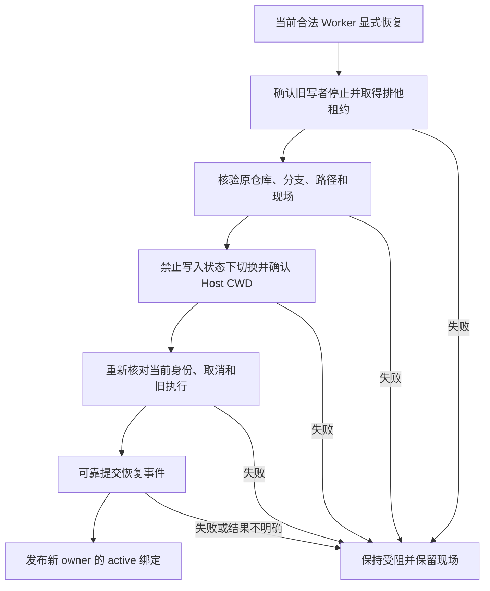

# 3.3.5：持久会话恢复与 DSH 0.2.2

## 持久会话

经过完整状态校验的快照一次性恢复任务和委派索引，不把快照中的历史记录重新当成实时状态迁移。委派、控制和线程身份仍需逐项核对；未确认的运行或副作用仍进入恢复核对，不自动重放。

## DSH 0.2.2-rc.1 模型桥接

官方 `0.2.2-rc.1` 在工具和提示词装配前冻结每个步骤的模型；`agent/request` 不能更换模型，原生重试也固定原选择。若需要百工的跨模型即时回退，须对该确切版本的 `@deepseek-ai/dsh-agent-loop` 安装随包附带的本地桥接补丁。未安装桥接的新版宿主不会静默改路由：百工在模型调用前返回明确错误。旧版宿主保持既有路由路径。

桥接在首次装配前让百工选择路由；模型调用失败且宿主允许重试时，若路由变化，先重新解析工具准入并重新装配提示词，再开始新的模型尝试。工具只在模型返回完整工具调用后执行，先前步骤已经完成的工具不重跑。自动切换不写入 `model/selection` 人工选择事件；实际请求由 Host 的 `request/header` 和 attempt 记录。

补丁仅适用于 SHA-256 已知的 `0.2.2-rc.1` 原版文件。安装、检查和回滚需在停止该 DSH 实例或使用独立副本时执行；以下路径指向独立 npm 安装根，其下包含 `node_modules/@deepseek-ai/dsh`：

```bash
node scripts/apply-dsh-step-bridge.mjs --dsh-root /path/to/dsh-install --check
node scripts/apply-dsh-step-bridge.mjs --dsh-root /path/to/dsh-install
node scripts/apply-dsh-step-bridge.mjs --dsh-root /path/to/dsh-install --restore
```

未知版本、未知摘要、备份不一致时脚本拒绝修改。升级 DSH 后必须重新核验；不得把其他版本当成已适配。

## 宿主接口与范围

新版去掉 `sessionController.inspect()` 时，使用 `sessionQuery.observeSession()` 的只读快照并及时释放；旧接口仍保留。新版工具按步骤选择执行器并根据模型解析条件工具，桥接重新装配时沿用宿主准入机制。子智能体首次启动须等待所属任务的权限绑定完成，取消或释放会中止等待。

本插件适配不等于已验证整个 DSH profile。其他第三方插件、原生 Codex/Claude 组合包、模型提供商及用户自己的配置必须分别验证；账号模型目录可见也不代表额度或真实请求可用。

## 保留工作树的显式恢复

模型或角色恢复不等于工作树写权限恢复。新的合法可写 Worker 先调用 `swarm_context_read`，从当前任务的 `worktrees` 列表取得 `worktree_id`，再调用 `swarm_restore_worktree({worktree_id})`。工具不接受路径、仓库、分支或 owner 参数。`create_worktree` 继续只负责新建；任务已有工作树时不能靠重试创建解决恢复问题。

恢复核对任务版本、node、attempt、delegation、旧执行及后台作业停止事实，并取得排他工作树租约；通过 Host 的文件与只读子进程能力检查原仓库、Git common-dir、注册工作树、分支及目录身份。允许基线之后的合法提交，保留 index、已暂存、未暂存、未跟踪文件和报告。成功切换 Host CWD、重新核验并可靠写入 EventJournal 后，才激活新 owner；原 owner 的索引和迟到写入权限失效。



重启重放只恢复最新 owner 的记录，状态始终为 `recovery-required`。本修复不从冷历史生成停净证明：即使 `turn/end`、作业完成事件及当前进程的空作业列表均存在，也不能替代原 Host 对进程管理范围退出的实际观察。重启后丢失该证明的旧 owner 保持受阻，需要后续可信的宿主核对通道；不能删除锁、手改绑定或重试创建绕过。

同一 Host 进程内，旧 attempt 的执行范围已被确认停止且封闭后，才允许新的合法 Worker 显式恢复。旧版本记录没有目录物理身份指纹；Git 注册、仓库、分支和路径核验也不能证明升级前从未发生目录替换，更不能补齐停净证明。目录指纹存在时必须匹配，且 `baseCommit` 必须是核验所得 HEAD 的祖先。缺少 Host 能力、未确认副作用、旧写者活动、审批拒绝或日志异常时均拒绝开放写入。此能力不改变任务验收、独立复核或 D14 等既有缺陷状态。

新增回归使用 `node:test`，通过现有 `npm test` 执行，包含真实临时 Git 工作树的无损接管。额外的隔离 Host 验证驱动位于 `tests/integration/driver/worktree-restore.mjs`；它验证宿主接口，不代替真实工程任务的验收。

## 工作树执行边界补强

本修复构建还要求安装独立的执行边界桥接。它与上文的模型桥接用途不同，二者应同时保留。仅支持摘要匹配的 DSH `0.2.2-rc.1`，当前受保护执行面为 Linux、本机文件系统、`bwrap` 和 Host 的原生 `linux-scope` 进程管理；不满足条件时拒绝执行。原来的版本兼容声明不代表旧 Host 已具备此新增能力。

Shell 在实际 subprocess spawn 处重新校验任务版本、委派、attempt、租约、Host 策略和 CWD，并使用内核挂载隔离把工作树中的 task scope 设为可写，其余目录保持只读。脚本中的 `cd`、绝对路径和嵌套 `bwrap` 都不能扩大该范围。文件工具在 Host 实际写入/删除处检查目标；工作目录丢失时拒绝执行，不能回退到源目录。执行器使用字面 argv，不通过解析 shell 字符串作安全裁决。

每个 attempt 的执行范围只有在工具/后台作业结束、Host 确认原生管理范围退出后才能封闭。弱进程组 fallback、`producerReported=false`、缺失或不完整的作业历史不构成停净证明。已有跨进程锁不自动回收：再次读取后删除并非 CAS，当前以拒绝接管消除竞态。

以下限制是明确的兼容边界：

- 可写 Worker 使用 API 工具执行面；显式原生 Codex/Claude CLI 写入被拒绝，自动后端选择固定为 API。这里不影响通过 API 接入的订阅模型路由。
- PTC `run_code` 和持久终端尚未接入同等执行边界，受保护调用拒绝执行。
- 只读角色的 Shell 使用独立临时目录，不能写真实工程；隔离进程不继承宿主网络及 `/run` IPC 写入通道。
- Shell 的 scope 必须可精确挂载，不会把尚不存在的路径扩大为父目录。Git common-dir 在工作树之外时仍只读，不会为 `git add/commit` 擅自开放额外写权限。

在停止目标 DSH 实例后执行，`--dsh` 接收 `node_modules` 路径。脚本先核验全部文件、版本和备份摘要，再原子替换三个 Host 模块；未知摘要拒绝修改。

```bash
node scripts/apply-dsh-execution-boundary.mjs --dsh /path/to/dsh-install/node_modules --check
node scripts/apply-dsh-execution-boundary.mjs --dsh /path/to/dsh-install/node_modules
```

`--restore` 可恢复该桥接文件的原始字节。新插件与桥接须成套部署；移除桥接后新插件拒绝受保护委派。回滚不得恢复旧授权日志或让缺少边界的旧插件继续写入旧工作树。

可重复的真实 Host 隔离测试入口如下。它复制 SDK，使用本地模拟模型、临时仓库和假配置，不调用外部模型，不修改传入的原 Host，不操作用户的 B0。

```bash
node tests/integration/run-execution-boundary.mjs --dsh /path/to/dsh-install/node_modules --out /path/to/evidence
```

测试覆盖未打桥接时拒绝启动、真实允许/越界文件与 Shell 写入、实际调用处的 CWD 漂移和文件目标替换、同进程 A→B 无损交接，以及新 Host 进程冷恢复拒绝授写。用户工程恢复、外部真实模型和完整业务验收需分别取证。

## 开源路由器参考

隔离审查了 [dsh-model-pool](https://github.com/JiahaoXxX/dsh-model-pool/tree/a3415e739a2550160921bd824799306d7cbe3b60) 与 [dsh-llm-fallbacks](https://github.com/omdsh-dev/dsh-llm-fallbacks/tree/ed4f91aed84430881203472a8650238193d6cb64)。两者提供模型池、故障分类与冷却，但所查版本仍依赖在 `agent/request` 中应用切换。使用未打补丁的 0.2.2-rc.1 和本地 mock QUOTA，两个项目的模型切换均被宿主冻结检查拒绝；所查 model-pool 的虚拟入口也未在该场景中绕过限制。结果只覆盖上述版本和场景，不代表其他版本必然如此。
