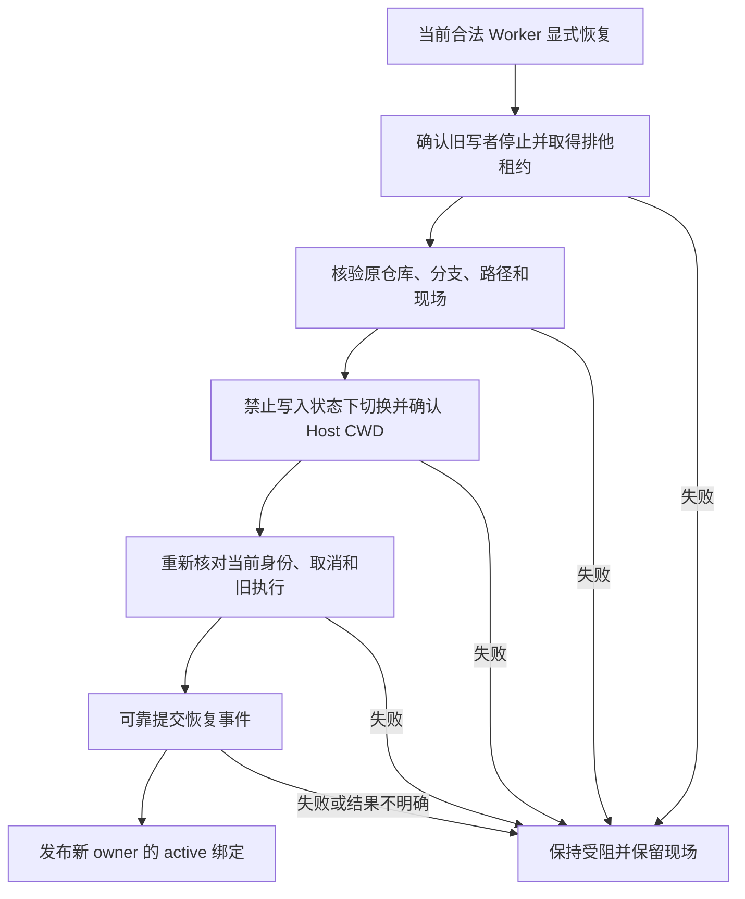

# 3.3.5：持久会话恢复与 DSH 0.2.2

## 持久会话

经过完整状态校验的快照一次性恢复任务和委派索引，不把快照中的历史记录重新当成实时状态迁移。委派、控制和线程身份仍需逐项核对；未确认的运行或副作用仍进入恢复核对，不自动重放。

## DSH 0.2.2-rc.1 模型桥接

官方 `0.2.2-rc.1` 在工具和提示词装配前冻结每个步骤的模型；`agent/request` 不能更换模型，原生重试也固定原选择。若需要百工的跨模型即时回退，须对该确切版本的 `@deepseek-ai/dsh-agent-loop` 安装随包附带的本地桥接补丁。未安装桥接的新版宿主不会静默改路由：百工在模型调用前返回明确错误。旧版宿主保持既有路由路径。

桥接在首次装配前让百工选择路由；模型调用失败且宿主允许重试时，若路由变化，先重新解析工具准入并重新装配提示词，再开始新的模型尝试。工具只在模型返回完整工具调用后执行，先前步骤已经完成的工具不重跑。自动切换不写入 `model/selection` 人工选择事件；实际请求由 Host 的 `request/header` 和 attempt 记录。

补丁仅适用于 SHA-256 已知的 `0.2.2-rc.1` 原版文件。安装、检查和回滚需在停止该 DSH 实例或使用独立副本时执行；以下路径指向独立 npm 安装根，其下包含 `node_modules/@deepseek-ai/dsh`：

```bash
node scripts/apply-dsh-step-bridge.mjs --dsh-root /path/to/dsh-install --check
node scripts/apply-dsh-step-bridge.mjs --dsh-root /path/to/dsh-install
node scripts/apply-dsh-step-bridge.mjs --dsh-root /path/to/dsh-install --restore
```

未知版本、未知摘要、备份不一致时脚本拒绝修改。升级 DSH 后必须重新核验；不得把其他版本当成已适配。

## 宿主接口与范围

新版去掉 `sessionController.inspect()` 时，使用 `sessionQuery.observeSession()` 的只读快照并及时释放；旧接口仍保留。新版工具按步骤选择执行器并根据模型解析条件工具，桥接重新装配时沿用宿主准入机制。子智能体首次启动须等待所属任务的权限绑定完成，取消或释放会中止等待。

本插件适配不等于已验证整个 DSH profile。其他第三方插件、原生 Codex/Claude 组合包、模型提供商及用户自己的配置必须分别验证；账号模型目录可见也不代表额度或真实请求可用。

## 保留工作树的显式恢复

模型或角色恢复不等于工作树写权限恢复。新的合法可写 Worker 先调用 `swarm_context_read`，从当前任务的 `worktrees` 列表取得 `worktree_id`，再调用 `swarm_restore_worktree({worktree_id})`。工具不接受路径、仓库、分支或 owner 参数。`create_worktree` 继续只负责新建；任务已有工作树时不能靠重试创建解决恢复问题。

恢复核对任务版本、node、attempt、delegation、旧执行及后台作业停止事实，并取得排他工作树租约；通过 Host 的文件与只读子进程能力检查原仓库、Git common-dir、注册工作树、分支及目录身份。允许基线之后的合法提交，保留 index、已暂存、未暂存、未跟踪文件和报告。成功切换 Host CWD、重新核验并可靠写入 EventJournal 后，才激活新 owner；原 owner 的索引和迟到写入权限失效。



重启重放只恢复最新 owner 的记录，状态始终为 `recovery-required`，必须重新核验。旧版本记录没有目录物理身份指纹，首次显式恢复依据其已有 Git 注册、仓库、分支和路径核验，并记录当前指纹；不能凭空证明升级前从未发生目录替换。后续恢复同时核对该指纹。缺少 Host 能力、未确认副作用、旧写者活动、审批拒绝或日志异常时均拒绝开放写入。此能力不改变任务验收、独立复核或 D14 等既有缺陷状态。

新增回归使用 `node:test`，通过现有 `npm test` 执行，包含真实临时 Git 工作树的无损接管。额外的隔离 Host 验证驱动位于 `tests/integration/driver/worktree-restore.mjs`；它验证宿主接口，不代替真实工程任务的验收。

## 开源路由器参考

隔离审查了 [dsh-model-pool](https://github.com/JiahaoXxX/dsh-model-pool/tree/a3415e739a2550160921bd824799306d7cbe3b60) 与 [dsh-llm-fallbacks](https://github.com/omdsh-dev/dsh-llm-fallbacks/tree/ed4f91aed84430881203472a8650238193d6cb64)。两者提供模型池、故障分类与冷却，但所查版本仍依赖在 `agent/request` 中应用切换。使用未打补丁的 0.2.2-rc.1 和本地 mock QUOTA，两个项目的模型切换均被宿主冻结检查拒绝；所查 model-pool 的虚拟入口也未在该场景中绕过限制。结果只覆盖上述版本和场景，不代表其他版本必然如此。
