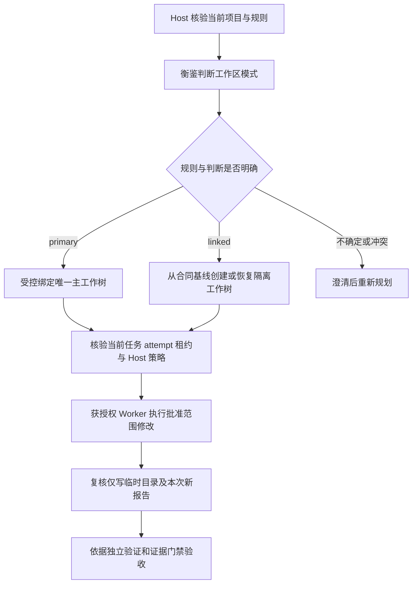

# v3.4.1 主工作区与执行观测

项目规则由 Host 只读核验，鉴衡规划接收模式、依据和摘要。明确要求唯一主工作树的项目使用 primary；无该硬限制时保留 linked；冲突规则必须澄清。规划不授予写权，最终仍校验当前 Worker/attempt、任务 scope、Host 策略与物理排他租约。

primary 使用 swarm_bind_primary_workspace，参数仅 expected_head，不接受任意 owner/path。该入口不建工作树，不改 HEAD/index/源码。已有绑定使用 swarm_restore_worktree；主树 HEAD 漂移时须先读实际状态再显式提供 expected_head。恢复后的历史记录默认 recovery-required，不凭旧记录自动恢复写入。

普通文件和 Shell 禁写主仓库 .git；使用 swarm_git_save 提供精确相对文件、提交说明和 expected_head，保留范围外暂存。部分失败保留现场及围栏，不重发。所有工作树的内容在失败和任务结束后保留。linked 新分支固定派生自任务计划的 HEAD；任务不能迁移主分支或基线，同一任务已有工作树时使用恢复入口。

Notebook 显式 nb_save 保存 .ipynb 并记录私有数据快照；重启后恢复 cell/源码/输出为只读视图，不恢复活内核或变量、不自动执行。继续计算需新建授权 Notebook 或显式打开已保存文件，重新选择可信内核。

路由观测为有界、进程内的只读事实：请求/attempt 关联、失败类型、预算、重试/等待时刻及终态。重启后清空，不保存账号、凭据或原始错误正文。供应商返回 429/401/网络拒绝仍按实际事实处理，界面余量不替代真实请求。

完整验收命令与覆盖范围见兼容矩阵；本地测试、真实 Host、浏览器和供应商探针分别记录，不把其中一项当作全系统保证。

复核可调用 swarm_prepare_verification，仅当当前 task scope 覆盖 var/tmp 和 var/reports/swarm 时准备本 attempt 的新报告目录。普通 Shell 默认只读；准备成功后只允许这两处输出写入，源码和 Git 元数据仍只读。旧报告不可覆盖，目录身份变化、取消、租约结束或服务重启后写域失效。

源码产物摘要排除 .git 及这两个固定测试输出域：验证报告按本次运行单独保留，不能因合法缓存/报告写入使源码证据失效；该排除由服务器固定，模型不能自选排除源码。对实际源码的更改仍使原验证失效。

复核输出目录仅接受可核验的普通文件和目录；符号链接、多链接文件或超过有界扫描容量时拒绝准备和执行。不自动删除这些文件，也不改变源码、旧报告或 Git 元数据来绕过拒绝。快照默认上限 16 MiB、4096 cells；超限需显式保存文件并核对提示，不能把快照失败当成可恢复成功。

