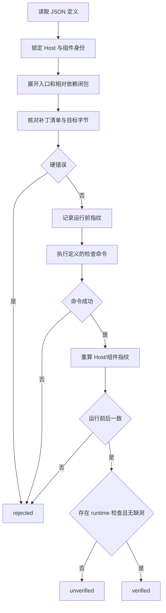

# 3.4.1 兼容矩阵自动化

本页对应 C1：自动生成并校验精确 Host、组件、补丁和真实检查证据。矩阵定义位于 `compat/v3.4.1-matrix.json`，执行入口为 `scripts/verify-compat-matrix.mjs`。

## 结论边界

- `0.2.2-rc.3` 是本机目标，声明范围为 `v3.4.1-local`。
- `0.2.2-rc.1` 只保留 `rc1-retained-only` 范围，不能填充 rc.3 的检查，也不能据此声称 v3.4.1 全矩阵通过。
- `package.json` 和组件 `package.json` 只用于身份与入口声明；metadata 检查本身不能产生运行兼容结论。
- 当前正式定义要求 swarm、Notebook、Subscriptions 同时进入 rc.3 矩阵。没有提供必需组件或没有执行 runtime 检查时，结果是 `unverified`，不是通过。
- v3.4.1 打包版本尚未写入当前 `package.json` 时，正式矩阵应明确返回 `rejected`。这是版本保护，不应通过放宽定义绕过。

## 组件精确修订

| 组件 | 当前目标版本 | 固定计划 | 关键边界 |
| --- | --- | --- | --- |
| Notebook | `0.4.2+rc3.sandbox.9` | `patches/dsh-notebook-0.4.2-rc3-snapshot.json`，SHA `435b15e4...ad7b` | 精确 tgz SHA `36a518ed...a353`；要求 package/index/client/runtime/host-context/snapshot bridge 的 `.9` after SHA 与当前候选一致 |
| Subscriptions | `0.9.13+rc3.transport.2` | `compat/subscriptions-0.9.13-rc3-transport.2/subscriptions.json`，SHA `3707bd4f...bc17c5` | 精确组件 tgz SHA `79955b8e...da41d`；package.json after 固定为 `243f7131...ffd5` |

旧 Notebook `runtime` 与 Subscriptions `transport` phase 计划只保留历史用途，不再作为正式 v3.4.1 组件通过与失败依据。正式矩阵要求 plan 的 `targetVersion`（若声明）与组件完整版本精确一致。

精确 tgz 通过 `--artifact <component-id>=<tgz>` 传入。Notebook、Subscriptions 继续校验固定 `distributionSha256`；Swarm 在 rc.3 声明 `requiredArtifactForHosts`，必须传 `--artifact swarm=...`，记录本轮实际 tgz SHA，不硬编码自身包摘要。必需 artifact 缺失只能得到 `unverified`。

提供任何组件 artifact 后，脚本使用标准 Python 3 `tarfile` 安全读取 gzip/tar member，不解包、不运行包脚本、不调用 npm 生命周期。归档仅允许 `package/` 下的普通文件/目录，拒绝越界、重复路径、symlink、hardlink、特殊类型及包内 `.git`/`node_modules`；成员数量上限 50000，文件总大小上限 512 MiB。逐一比较完整归档文件清单与实际 Host 候选目录的路径、类型、size、SHA-256，并在 `components.<id>.distribution.files` 保存完整文件证据，检查前后均复核。

采用完整目录清单比对，范围覆盖 README、CM vendor、动态资源以及未进入 import/patch 闭包的文件。缺失、修改或额外文件均 `rejected`。只排除候选根目录的 `node_modules`、`.git` 和未入归档的安装锁文件 `package-lock.json`/`pnpm-lock.yaml`/`yarn.lock`；其他额外文件也拒绝，因此须传纯解包候选，不能用含开发文件的源码树代替精确包。该门禁不需要新增 npm 依赖；缺少 Python 3 或读取失败也拒绝。

## 必需检查

| 检查 | 级别 | 说明 |
| --- | --- | --- |
| `rc3-step-model-host` | host-runtime | rc.3 精确 Host 模型桥接与不重放行为 |
| `primary-live-boundary` | host-runtime | `run-execution-boundary.mjs --primary --bundle ${component:swarm}`，真实 primary Host live/cold 边界 |
| `linked-verification-boundary` | host-runtime | `run-execution-boundary.mjs --verify-linked --bundle ${component:swarm}`，真实 linked 验证输出与 gitdir 保护 |
| `notebook-js-browser-host` | host-runtime | `verify-notebook-host.mjs`，保留 Notebook、JS/TS 与 browser 原工具功能 A/B 真 Host 回归；使用受检 Swarm/Notebook 目录，Python 环境变量与双 boot 相同，超时 660000ms |
| `notebook-double-boot-host` | host-runtime | `verify-notebook-snapshot-host.mjs --swarm ${component:swarm} --notebook ${component:notebook}`，真实 rc.3 Host 保存后停净、第二次 boot 只读恢复；Python 由 `DSH_NOTEBOOK_CONTROLLER_PYTHON` 注入 |
| `notebook-snapshot` | offline | Notebook 源码/快照纯测试；不代表真实 Host 已通过 |
| `route-observability-offline` | offline | 服务端与客户端路由观测纯测试 |

检查命令、`env` 与 `cwd` 共用同一展开上下文，支持 `${sdk}`、`${sdkPath}`、`${repositoryRoot}`、`${evidenceRoot}`、`${evidenceRun}`、`${env:NAME}` 与 `${component:ID}`。组件占位符只取 `InspectComponent` 检查后的实际目录，来源为 `--component ID=path` 或矩阵默认值；环境变量不能替代组件路径。未知占位符、未知组件或没有受检目录的组件引用均在启动任何检查前返回 `rejected`，禁止保留原字符串或回退到源码树。`cwd` 仍须位于项目内；组件目录可以位于项目外，并以 argv 传给夹具。

`requiredEnv` 缺失时执行模式直接拒绝，metadata-only 模式保持 `unverified`。运行记录保存展开后的实际 argv，不保存未替换命令。选择解包候选后，primary/linked 的 `--bundle` 和双 boot 的 `--swarm`/`--notebook` 均使用对应受检候选；`${sdk}` 及既有 SDK realpath 绑定不变。默认 Swarm/Notebook 目录仍为仓库和 `third_party/dsh-notebook`；使用默认值只证明这些候选，精确解包候选实测须显式传入两个 `--component`。

原工具功能 A/B 回归与 snapshot 双 boot 都是 rc.3 必需真 Host 检查。两项夹具均须在所选精确包上成功；夹具适配或运行失败时，矩阵保留非零退出码并拒绝，不回退源码目录，也不把本轮离线门禁/传参回归当成 Host 通过。

## 状态与退出码

| 状态 | 退出码 | 条件 |
| --- | ---: | --- |
| `verified` | `0` | Host、组件、入口闭包、补丁和全部必需检查均通过，且检查前后字节指纹一致 |
| `rejected` | `1` | 精确版本不符、未知摘要、缺入口、混合/未知补丁状态或真实命令失败 |
| `unverified` | `2` | 身份可能有效，但缺少组件、没有执行检查、只有 metadata/offline 检查，或补丁尚未达到要求状态 |



## 自动化内容

每次执行会：

1. 校验 `@deepseek-ai/dsh` 的精确版本、CLI 入口，以及 runtime 依赖中 `@deepseek-ai/dsh-*` 包的精确版本。
2. 校验组件包名、版本、`main`/`types`/`exports`/`dsh.bundle.patch` 声明，并递归检查组件内相对导入闭包。
3. 生成各入口和闭包文件的实际 SHA-256，不接受未知或未列入闭包的文件作为已验证证据。
4. 校验补丁清单、补丁文件 SHA，以及 Host/组件目标文件处于清单定义的 original、patched 或 allowed 状态。
5. 在 evidence run 目录保存每个检查的 stdout、stderr、退出码、耗时和输出 SHA-256，再写 `compat-matrix.json`。
6. 检查完成后重算 Host 和组件指纹。检查期间身份或字节变化会使整轮结果变为 `rejected`。

正式定义还把 rc.3/rc.1 Host 检查绑定到对应 `.sandbox/dsh-<version>/node_modules` 的 realpath。传入其它 SDK 时该检查会拒绝，避免“矩阵验一个 SDK、夹具实际运行另一个 SDK”。

脚本只读检查 Host/组件并执行定义中的命令，不应用补丁、不启动服务、不修改 profile。检查产生的持久文件仅位于显式 `--evidence` 目录下的新 `runId` 子目录。

## 定向测试

主代理在最终集成包上先完成项目既有构建，使 `package.json` 版本和 `lib/` 入口进入 v3.4.1 候选状态。本轮矩阵实现自身不修改 `package.json` 或既有构建产物。

```bash
npm run build
```

先跑矩阵合同与既有归档兼容测试：

```bash
node --test tests/compat-matrix.test.mjs tests/release-compat.test.mjs
```

测试覆盖 rc.3 成功、metadata-only、未执行检查、未知 Host、未知组件版本、缺入口、未知补丁、未应用补丁、检查失败、rc.1 retained 隔离、检查期间漂移和 CLI 退出码。另用真实 Node 子进程验证树外自定义 Swarm/Notebook 目录（含空格、中文）确实进入 primary/linked/双 boot 参数，检查 `env`/`cwd` 展开一致，以及未知/缺失占位符在任何命令启动前拒绝；这部分是命令传参回归，不代表真实 Host 夹具通过。

artifact 门禁红绿：修改实现前 19 项矩阵测试中 4 项失败，复现 CM vendor 篡改、文本假 tgz 被误接纳及 requiredArtifact 缺口；修复后矩阵与既有归档测试 24/24 通过。测试使用真实 gzip/tar，覆盖 README/CM vendor 修改、目录缺失、归档遗漏、额外运行文件、危险 member 和无固定 SHA 的 Swarm artifact。原工具功能 A/B 检查亦纳入定义及真实子进程传参回归。Notebook `.9` 的 tgz、snapshot plan 和 patch 固定 SHA 保持不变。

## metadata-only 检查

以下是只读结构检查。它会返回 `unverified` 和退出码 `2`，不能作为 CI 兼容通过：

```bash
node scripts/verify-compat-matrix.mjs --definition compat/v3.4.1-matrix.json --host 0.2.2-rc.3 --sdk .sandbox/dsh-0.2.2-rc.3/node_modules --component swarm=/path/to/extracted/swarm/package --component notebook=/path/to/extracted/notebook/package --component subscriptions=/path/to/compatible-subscriptions --artifact swarm=/path/to/swarm.tgz --artifact notebook=/path/to/notebook.tgz --artifact subscriptions=/path/to/subscriptions.tgz --evidence /path/to/private-evidence --metadata-only
```

## rc.3 完整验证

完整矩阵运行环境需提供 Notebook 私有 venv；公开文档只固定变量名：

```bash
export DSH_NOTEBOOK_CONTROLLER_PYTHON=/path/to/notebook-venv/bin/python
```

先把 `SWARM_TEST_EVIDENCE_DIR` 由矩阵脚本自动指向本轮 evidence 目录。`step-model-rc3` 使用本机精确 rc.3 沙箱和确定性模型，不调用外部供应商；`--sdk` 必须与正式定义绑定到同一 realpath：

```bash
node scripts/verify-compat-matrix.mjs --definition compat/v3.4.1-matrix.json --host 0.2.2-rc.3 --sdk .sandbox/dsh-0.2.2-rc.3/node_modules --component swarm=/path/to/extracted/swarm/package --component notebook=/path/to/extracted/notebook/package --component subscriptions=/path/to/compatible-subscriptions --artifact swarm=/path/to/swarm.tgz --artifact notebook=/path/to/notebook.tgz --artifact subscriptions=/path/to/subscriptions.tgz --evidence /path/to/private-evidence
```

只有退出码 `0` 且输出 `status: "verified"` 才能进入 rc.3 兼容通过结论。退出码 `1` 或 `2` 都必须保留原始原因。

## rc.1 保留检查

```bash
node scripts/verify-compat-matrix.mjs --definition compat/v3.4.1-matrix.json --host 0.2.2-rc.1 --sdk .sandbox/dsh-0.2.2-rc.1/node_modules --evidence /path/to/private-evidence
```

rc.1 定义只要求归档闭包和精确桥接安装检查，没有 rc.3 host-runtime 检查，因此正常结果应为 `unverified`，声明范围仍为 `rc1-retained-only`。这不是 v3.4.1 全矩阵失败，但也不能作为 rc.1 完整运行兼容或 v3.4.1 全通过证据。

## CI 建议

```bash
node --test tests/compat-matrix.test.mjs tests/release-compat.test.mjs
node scripts/verify-compat-matrix.mjs --definition compat/v3.4.1-matrix.json --host 0.2.2-rc.3 --sdk .sandbox/dsh-0.2.2-rc.3/node_modules --component swarm=/path/to/extracted/swarm/package --component notebook=/path/to/extracted/notebook/package --component subscriptions=/path/to/sealed/subscriptions --artifact swarm=/path/to/swarm.tgz --artifact notebook=/path/to/sealed/notebook.tgz --artifact subscriptions=/path/to/sealed/subscriptions.tgz --evidence /path/to/ci-evidence
```

CI 只接受第二条命令退出码 `0` 作为 rc.3 通过证据；`--metadata-only`、旧 evidence 目录中的历史 JSON、仅退出成功的 metadata 命令均不能满足该门槛。
