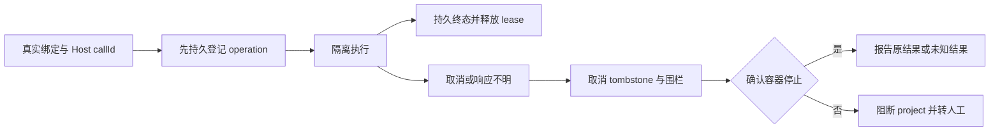

# 3.4.2：alpha.2 宿主与独立执行服务

版本 3.4.2。宿主目标固定 0.2.3-alpha.2，Node 要求 24.22.3 的 24.x 或 >=26.13.1；不会通过 allow-version 豁免插件兼容检查。

## 宿主适配合同

| 故障 | 原因与行为 |
|---|---|
| 非人工轮次 create_goal | Host 限制合法；按真实 open turn 隐藏人类限定操作并移除不适用提示，不伪造来源 |
| 天枢直接 Shell | 执行守卫存在，根工具 scope 缺失；在模型解析前裁剪工具，并对 Router 局部固定 native executor |
| peer response 被拒 | 当前合同和产物没有可核验 frozen blind 初审；按真实版本、产物摘要和 ready 终态检查，缺证据必须先 blind |
| glob 遍历无权备份 | 搜索范围过宽；默认源码索引排除 var/缓存，失败保留原始错误并指导缩小范围，不 chmod、不提权 |
| alpha.2 冻结后换模型 | 官方缺少冻结前可变模型 Hook；精确版本和字节绑定桥在冻结前重选，回退时重建工具集/提示词，不重放工具 |
| Notebook 历史上下文 | 改用公开 readSession 单切面，按 workspace-root/change 还原目录，不依赖已删除 inspectSession |
| linked 工作树创建 | 官方 alpha2 仅提供 enter/exit，百工保留自己的受控 create-only 合同，调用 Host create API；不隐式接管已有树 |

`create_worktree` 仅挂在有权 Worker 的工具组合，路径和 owner 不由模型指定，from 固定为合同 HEAD；失败结果不明则隔离任务，成功仍经原登记、物理身份、排他租约和可靠落盘后才激活。已有工作树继续使用 `swarm_restore_worktree`。官方 `enter_worktree/exit_worktree` 不进入百工 Worker allowlist，不修改官方 bundle 清单。

alpha2 的 workspaceRoot 跟随 CWD。只有受控 create/restore/primary-bind 可同步这一字段，必须与实际物理 CWD 一致、在原仓库内，且仅单个目标；模式、额外写域与其它策略字段仍须完全不变。普通文件/Shell 调用没有该通行条件，不能借此回源或扩大写域。

## 执行服务

`scripts/swarm-execution-daemon.mjs` 独立于 dsh-web user service。Unix 控制 socket 0600、目录 0700。容器无宿主项目挂载、默认断网、只读根文件系统、能力清空、no-new-privileges，并限制内存/CPU/PID/墙钟。Python 与 Node 各有 owner/project 分区的有界预热池。

Worker 工具 `swarm_kernel_execute` 仅接受 `{language:"python"|"node",code:string}`。Host 从当前真实 agent/task/attempt/版本和工作目录生成 scope，执行前再次核验；模型不能指定 owner、路径或提升权限。Notebook 文件保存仍使用已有 nb_save 授权。本工具的输出不是自动写入 Notebook 标签的 cell，不宣称已经替换 Notebook 原内核后端。

Python print 与 Node console 的 stdout/stderr 返回有界文本，每流最多 256KiB；不覆盖任意原生子进程 FD。代理响应按流读取并限制大小和总时限；daemon 每连接只接收一个有界请求帧。

DSH 重启不停止独立 daemon 或其容器。相同有效身份重连会旋转 fence，旧调用不能继续执行；新 attempt 不自动继承旧内核的权限。整机重启不承诺恢复活进程，禁止将状态登记表等同于变量快照。

独立执行登记使用 `state.json` v2：cell 在执行前可靠记录 operationId 与输入摘要，终态可只读查询，同 ID 不重跑。取消、响应丢失或超时先登记围栏，再确认容器及其进程停止；停止不明阻断整个 project。启动时核验遗留记录，不能把未知运行认作空闲。旧 v1 开发登记显式拒绝；升级时应保留原登记并在维护窗口核对，不能将格式不符当成空闲状态。

正常 cell 结算释放 lease 并保留 warm 变量。容量压力只逐出已停止执行的 LRU warm 内核，清理前先确认物理停止，不能回收 claimed/running 或未知执行；因此变量不是无限保存承诺。结果有界保留，过期结果只能报告缺失，不能重跑旧 ID。操作登记达到上限显式转维护，不静默丢弃取消/未知记录。

凭据代理按 scope、origin、path、method、TTL 绑定短令牌，真实凭据不进入容器。默认无凭据配置即不开放任何外部模型请求；已实现代理协议和受限转发不代表已经代理全部生产模型流量。microVM 先探测后使用，缺少运行器显式不可用，不回退为宿主裸执行。

## 配置与回滚

- Host 精确补丁：`patches/dsh-host-0.2.3-alpha.2-bridges.json`，通过 `scripts/apply-alpha2-bridges.mjs --dsh <node_modules>` 应用，`--check` 只读校验，`--restore` 恢复原始快照。必须在目标进程停止时修改，不原地改在役 Host。
- 执行服务可用 `DSH_SWARM_EXECUTION_SOCKET` 指定私有 socket；缺省为 DSH_HOME/swarm-execution/v3.4.2-alpha2/control.sock。
- 升级前冻结旧 profile、服务配置和内容摘要，保留原 rc.3 与 v3.4.1 安装目录。失败回退旧组合；不删除历史、不 reset/clean 项目、不重放业务任务。
- 插件安装不自动去重或迁移第三方 worktree/MCP 配置；宿主 SDK 与第三方包由各自维护流程管理。

## 验证层级

单元/回归、真实 alpha.2 Host 探针、精确 tarball 闭包/静态资源、隔离完整 profile、实际服务与 UI、活内核跨 DSH 重启分别记录。环境不具备的 microVM 和没有真实凭据的上游转发只能记为未实测，不用 import/源码标记替代运行验收。

本版本的 engines.dsh/minVersion/testedVersions 精确限定 0.2.3-alpha.2，防止未验证宿主误载新增合同；旧 rc.3 的回滚组合保留 v3.4.1，不将历史测试版本列表当成本轮全部兼容证明。

## 可选执行服务的部署要求

执行服务是可选功能，不随插件安装自动启用。管理员需提供可信、包含 Python 3 和 Node.js 的容器镜像，并显式使用 `--image <image-or-digest>`；发行包不含本机 LayerFS 镜像或任何预置凭据。systemd 模板中的 `@REPO_ROOT@`、`@NODE_BIN@`、`@RUNTIME_IMAGE@` 均需替换为实际路径与镜像。没有容器运行时或镜像时保持不可用，不降级为宿主裸执行。
