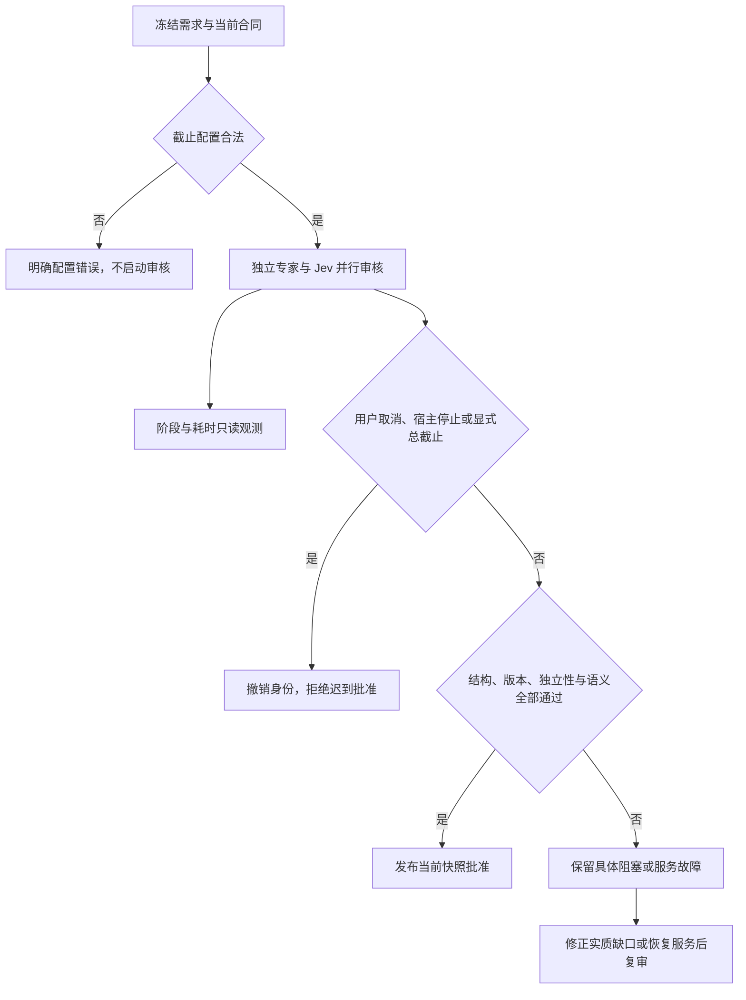

# 代码审查报告

## 1. 总体评价

- **评分**：⭐⭐⭐⭐☆（4/5，仅本次局部修复）。
- **摘要**：真实日志证明，原来的 180 秒审核总截止中断了仍在输出的审核模型，其中两轮正在生成 `structured_output` 参数。因此，将总截止改为可配置且默认 `0`（不限总时长），同时保留主动取消、宿主关闭、迟到子会话隔离、版本比较和负结论缓存，是合理的局部修复。它不等于已经实现自动停滞识别，也不证明所有长期目标必然完成。
- **结论**：当前实现有限通过，未发现剩余代码阻断项。此前复现的异步问答校验失败回落问题已修复，已直接对源码与编译产物复查，见第 2.5 节。缺失概率误称低分的诊断问题也已修复。主维护会话已完成本机部署及五个本地兼容副本切换；本审查的最后只读复核及历史版本更正见第 4.1 节。原业务 T-2 尚未通过，不因部署成功而视为完成。
- **范围**：本机修复、隔离测试及后续本机部署；不推送或发布 GitHub。本审查未修改生产源码、未重启服务，仅创建本报告。
- **证据边界**：代码取自候选工作树 `.work-local-recovery`；真实故障取自用户提供的会话导出。运行配置值由主维护会话通过宿主 settings 核对；本审查未读取或输出凭据。本报告未重复运行主维护会话已执行的定向测试，不能据此宣称全量回归或最后部署已完成。

## 2. 详细审查

| 级别 | 位置 | 问题描述 | 改进建议／当前判断 |
| :--- | :--- | :--- | :--- |
| 🔴 严重，候选已修 | `src/service.ts`：`runReviewPlan`；原版 `timeoutMs` 默认 180000 | 总墙钟时间包含规划模型的多轮读取、推理与结果生成；只要整体超过 180 秒，即使持续输出也被取消。原版 `0` 仍回退为 180000，无法配置不限总时长。 | 默认改为 `0`；只在正数时安装总截止。保持主动取消、shutdown 和旧结果不得放行的检查。真实日志支持此修改。 |
| 🟡 警告，候选已修 | `src/config.ts`：`planningReview.timeoutMs`；`runReviewPlan` 参数检查 | 非法值不能静默变成不限；大于 Node 定时器上限的正数可能被压缩为极短延迟。 | Schema 上限为 2147483647；服务拒绝负数、小数、NaN、Infinity 及超大正数，不启动审核模型。有效 `0` 和显式正数语义分开。 |
| 🟡 警告，候选已修 | `src/planning-recovery.ts`：`getPlanningRecovery` | 原候选仅以 `blockers.length > 0` 判断“同时存在语义低分”，全部答案缺失时也会出现此说法。 | 已改为只对 `probability !== null && probability < threshold` 称低分；直接调用编译产物确认缺答案时不再误报。缺答案仍不等于通过。 |
| 🟡 警告，明确能力边界 | `src/service.ts`：`PlanningRunView`、`reviewProgress`、`getStatus` | 当前只有阶段、耗时、审核子会话和模型路由观测，没有逐 token／工具事件的活动心跳；`reviewing` 不证明仍有进展，也不证明已经停滞。 | 保留为进程内只读诊断，不写入批准。不得把该字段宣传为自动空转识别。后续如需心跳，仅保存事件时间、计数和阶段，不保存推理正文。 |
| 🟡 警告，已改善 | `src/context-store.ts`：`Read`；`src/task-tools.ts` | 原默认页上限为 8000 UTF-16 单元，但 schema 仅声明 number，错误未给上限。真实审核尝试 10000 后失败，并再次用更小值请求。 | 候选对合法超大整数收缩为上限，返回 `requestedLimit/effectiveLimit/limitClamped/nextCursor`；负数、非整数仍拒绝。分页边界保全代理对，实际返回可能多 1 单元，应以返回游标为准。 |
| 🔵 建议，候选保持 | `src/service.ts`：`ReadContext`；`src/context-store.ts`：版本与摘要检查 | 旧需求绑定材料不能因用户想继续而自动重标成新版本。否则会把旧材料或旧批准当成新授权。 | 保留拒绝；错误明确发布版本、当前版本、重新审核与重新获取引用的步骤。不能读取私有状态来绕过。 |
| 🔴 严重，候选已修 | `src/task-model.ts`：`getHumanIntentMessages` | 初审时，异步问答包 outcome、callId 或答案校验失败后仍成为 `source=host` 的最新意图。 | 当前已识别的结构化问答信封校验失败即排除，并要求匹配真实提问及问题合同；合法旧版无元数据自由文本继续兼容。源码及 lib 的原反例已复查通过，详见第 2.5 节。 |
| 🔵 建议，保留限制 | `src/planning-review.ts`：`getPlanningReviewRecord` | 服务未取得结果不等于作者自审；但取得结果后仍必须证明审核者身份、只读性及独立性。 | 候选仅去掉缺结果时的误导性身份告警；有结果仍完整校验，未降低通过条件。 |

### 2.1 真实日志根因与行号

日志根目录：

`/home/zhairy/下载/dsh-session-session-fa90985f-43fe-4fa4-a4d6-49fd878606d1`

下表根日志均指该目录的 `session.v4.jsonl`；子日志均指 `subagents/<完整子会话 ID>/session.v4.jsonl`。时间为 Asia/Shanghai。未输出源码、密钥或业务推理正文。

| 子会话 ID | 根调用／结果行 | 子流记录／首次结束行 | 首轮耗时 | 取消前最后可见流活动 |
| :--- | :--- | :--- | :--- | :--- |
| `a13166b8-f857-47a4-9ca7-2b9df956fe33` | 1797／1799 | 96／98 | 179391 ms | 19:48:20.238 仍有推理流；距 19:48:20.933 父取消仅 695 ms |
| `8e635f9a-2c3d-48cd-b028-bdd14f90a9c6` | 1803／1805 | 91／93 | 179054 ms | 19:51:52.043 仍在输出 `structured_output` 参数；距父取消仅 75 ms |
| `c11cbe4b-419c-48b6-b330-eafd95533c80` | 1848／1850 | 79／81 | 179401 ms | 19:58:04.806 仍在输出 `structured_output` 参数；距父取消仅 79 ms |
| `3925580b-9446-43c9-805c-6db61a035d96` | 1855／1857 | 94／96 | 179099 ms | 最后流片段在 20:00:56.065，距父取消 43.440 s；不能据此断言永久停滞 |

归因依据：

1. 四轮首次结束均为 `turn/end.reason.kind=aborted`，原因 `parent`；根结果包含 `规划审核超时（180000ms）`。子会话从创建起计时约 179 秒，略短于总截止，是因为计时器早于子会话创建。
2. 根日志 1805、1857 的结果明确为 `status=unavailable`、`questionVersion=4`。前者绑定需求／合同／流程 9／10／13，后者为 9／11／14。
3. 四轮分别完成 25、25、18、25 次工具调用。在首次结束前，未发现供应商 `finish:error`、供应商重试或额度失败事件。此结论仅覆盖这四轮，不排除会话其他时段发生独立供应商故障。
4. 请求头位于四份子日志各自第 15 行，记录 Codex `gpt-6-sol` 或 `gpt-6.1-sol`、`xhigh`、`maxTokens=128000`。最后一个参数是单次模型输出上限，不等于本插件任务累计预算或已实际使用 token 数。
5. `8e635f9a-…` 第 26、27 行传入 `swarm_context_read.limit=10000`，第 30、31 行返回页大小错误；第 41、42 行改为 2000，第 48、49 行成功。`3925580b-…` 第 33 行的 10000 请求在第 36 行失败，第 46 行改为 4096，第 52 行成功。
6. 第一轮没有工具错误仍被总截止取消，说明分页错误会增加返工，但不是总截止误杀的必要条件。
7. `3925580b-…` 第 99–103 行再次唤醒后被“专家已取消或宿主停止，延迟模型请求被拒绝”挡住。这是取消身份隔离发挥作用，不能通过清空旧 signal 让旧审核身份复活。

流片段时间按宿主记录格式还原：普通片段直接取 `time`，压缩片段最后时刻为 `time0 + sum(dt)`。该计算只读取时间与片段类型，不输出 `texts` 或工具参数正文。

### 2.2 当前限制是否合理

以下运行值由主维护会话通过宿主设置核对；代码默认值与本机值分开说明。

| 控制层 | 当前行为／运行值 | 审查判断 |
| :--- | :--- | :--- |
| 规划总时长 | 原版默认 180000 ms；候选默认 0；显式正数仍截止 | 审核会多次读取并持续推理，总时长不等于空闲。默认不以总时长误杀合理，用户仍可设置上限。实际部署须确认显式旧配置已按授权调整。 |
| 规划自动修正 | `maxFixRounds=2`，默认首次加两次自动审核；达到上限不禁止编辑和显式复审 | 避免自动无限循环；不能靠新增同义任务或改标题规避明确负结论。 |
| 规划执行预算 | 独立 `planningBudget`，不消耗实施调用预算 | 控制面与实施预算分离合理，避免在实施前耗尽唯一调用额度。 |
| 实施预算 | 本机 `execution.profile=legacy`，calls／tokens／cost 为 0，不限 | 不能把 0 解读为已耗尽；也不能由此声称供应商订阅额度不限。 |
| 角色委派数 | 默认任务／角色／铸剑均为 0，不限；原生后端默认每会话 3 次 | 普通专家与原生后端是不同限制，诊断必须分开呈现。 |
| 专家网络等待 | 本机为 180000 ms；代码默认 600000 ms | 这是网络恢复等待，不是规划总截止；不要一起删除或混淆。 |
| 并发与层级 | 本机插件并发 8／排队 128；宿主 maxActive=8、maxDepth=1 | 属于资源和递归边界，应保留。队列等待、模型调用和业务执行不是同一个计时阶段。 |
| 提供方流空闲 | 两个 DeepSeek 提供方运行值为 300000 ms；pi-ai 代码默认 300000 ms，具体覆盖值仍未知 | 空闲 watchdog 与总截止不同。正常流片段应刷新空闲观测；不能把工具长调用或等待人工反馈误当成模型空闲。 |
| 上下文读取 | 默认有效页上限 8000 UTF-16 单元，按返回游标读取 | 限制单次输出合理；候选通过显式收缩及元数据修复易用性，不取消摘要、版本和任务隔离。 |
| 工作流模式 | 本机 `advisory`，四份真实故障快照也均为 `advisory` | 不应宣称宿主当时以 enforced 硬拦截。候选新增真实 `workflowMode` 输出并修正提示，没有修改准入分支或用户明确的先审要求。 |

### 2.3 数学判据与安全不变量

设审核包含启动耗时 `s`、多轮模型耗时 `m_i`、工具耗时 `t_i`、清理提交耗时 `c`；Jev 与专家并行时，整体至少受较慢分支制约：

\[
T = s + \max\left(\sum_{i=1}^{k}(m_i+t_i),\ T_{\mathrm{Jev}}\right)+c.
\]

因此 `T > 180 s` 不推出审核无进展。空闲量应另外定义为：

\[
I(t)=t-t_{\mathrm{last\ observed\ activity}}.
\]

第二、三轮分别在取消前 0.075 s、0.079 s 仍输出结果参数，直接构成“总耗时超过阈值即判为失去响应”的反例。但连续输出也不自动证明语义进展或最终正确，因此不能把 `I(t)` 很小当成批准。

本次应保留的不变量：

- `timeoutMs=0` 仅表示没有插件总截止；不改变审核概率门槛，也不允许复用陈旧批准。
- 显式 `D>0` 时仍保留总截止；`D` 必须是 `[0, 2147483647]` 内整数，非法值不能默认为不限。
- 用户取消、宿主关闭、任务版本变化之后，迟到结果不得发布为当前批准。
- 相同快照的明确负结论不重新抽样；Jev 图表达等维度仍低于当前阈值时，必须修正实质流程并重审，不能以延长等待或模型健康替代通过。
- 只有持久化与本地清理操作可返回的条件下，才可把模型等待阶段的取消测试解释为端到端可取消性；本报告没有证明永久阻塞的磁盘 I/O 可被 JavaScript signal 强制终止。
- `reviewProgress` 只保存进程内观测，不是批准、持久检查点或宿主长期目标的完成状态；当前没有活动心跳，更没有数学证明的无穷循环检测器。



### 2.4 与其他故障的边界

OpenViking 没有可用后端或连接失败是独立的记忆服务问题。用户已授权新建后端，并选择本地 embedding、复用既有 DeepSeek 官方 API 做摘要，主维护流程另行处理；不能把尚未接通后端当成上述四轮由父 signal 在 180 秒取消的根因，也不能声称记忆已经同步。

旧材料绑定拒绝、确认选项缺失和 Jev 图低分需要各自的证据与回归。移除误杀截止不自动修复这些问题；真实本机验收应保留尚未通过的图判断，不能把“模型能完成请求”写成“业务任务已获准完成”。

### 2.5 最终来源复核：初审阻断已解除

在统一构建完成后，通过只读 `node --input-type=module` 导入候选 `lib/task-model.js`，构造初始用户要求“只做诊断”和两个合成异步问答消息，没有操作生产会话或修改测试源文件。

| 合成输入 | 初审返回 | 应有结果 |
| :--- | :--- | :--- |
| `source.kind=user-question-reply`、`outcome=cancelled`，正文仍带 `answer_to_pending_question`／选项答案 | `sourceRef=reply-1`、`source=host`，无效包成为最新需求 | 忽略该结构化确认包，不能把未验证的选项答案提升为需求来源 |
| `outcome=answered`，但 `source.callId=call-1`、正文 `callId=call-2` | 同上 | 拒绝调用身份不匹配的结构化确认包 |

初审机制是验证失败后没有结束该消息分支，继续落入 `human.push(message)`。该反例证明当时授权输入边界不完整，**不等于已经证明生产中发生了绕门禁执行**。

最终源码已加入结构化信封识别、失败即排除及真实提问合同配对。直接只读调用 `src/task-model.ts` 和 `lib/task-model.js`，两份实现各执行四个案例，结果一致：

- `cancelled` 包保留原 `human-1`，没有提升为确认。
- 调用 ID 不匹配包保留原 `human-1`，没有提升为确认。
- 合法 `answered`、匹配调用与原问题合同的包成为 `reply-1`。
- 无结构化元数据的旧版自由文本回复仍保留为 `legacy-reply`。

另外直接调用 `lib/planning-recovery.js`，确认全部 Jev 答案缺失时不再出现“同时存在语义低分”。以上共九个直接调用核查均通过。同步问答匹配、逐条来源保留、旧版聚合来源标记和持久化字段校验未发现剩余阻断项。授权来源阻断在本次复核中解除。

### 2.6 四份故障快照的模式与恢复范围

四份子日志的第 7 行 `agent/inbox/spliced` 都包含实际发给审核者的快照，均为 `questionVersion=4` 且 `snapshot.executionPolicy.workflowMode=advisory`：

| 子会话 | 需求／合同／流程 | 快照 SHA256 |
| :--- | :--- | :--- |
| `a13166b8-f857-47a4-9ca7-2b9df956fe33` | 9／10／13 | `d2be65e42d5e376aab65e4d40ce8e73b10803a94ff8487d2fa9f11ef0b35f4ae` |
| `8e635f9a-2c3d-48cd-b028-bdd14f90a9c6` | 9／10／13 | `d2be65e42d5e376aab65e4d40ce8e73b10803a94ff8487d2fa9f11ef0b35f4ae` |
| `c11cbe4b-419c-48b6-b330-eafd95533c80` | 9／11／14 | `e6dd0475ce8d0b92197b062e8c979e39b7a89f10233a0447c7694834afd59fe8` |
| `3925580b-9446-43c9-805c-6db61a035d96` | 9／11／14 | `e6dd0475ce8d0b92197b062e8c979e39b7a89f10233a0447c7694834afd59fe8` |

原恢复提示无条件称规划未批准时不能开始执行，而宿主派发准入分支仅在 `workflow.mode === 'enforced'` 时强制当前规划通过，存在提示与配置不一致。这可能诱发主持者把建议模式误称为宿主硬拦截，但不能据此推断用户授权已取消，也不能认定这就是全部停止原因：四轮总截止取消已有独立日志证据，用户明确要求先审后执时仍必须遵守。

当前只增加任务卡／状态的真实 `workflowMode`，提示区分 `enforced` 与 `advisory`，并保留用户明确先审要求；没有修改阈值、实际派发准入、角色权限、版本或验收门禁。该修正是事实与提示对齐，不是绕过审核。

主维护会话确认 20:58 重启由用户手动发起，内存模式根任务当前为空。本次拟恢复的是可信旧检查点，并从用户导出的最新成功任务卡经公开 API 重新登记；**不能宣称保留了最新完整状态或全历史**，不能将旧批准直接升级为当前批准，也不能自动重放历史副作用。DSH 仅保留 `/usr/lib` 安装、清理另一安装及 OpenViking 后端接入由主维护流程分别核对，本报告不替代这些宿主操作的验证。

## 3. 优化后代码示例

候选的核心边界如下；这是对已实现方向的摘录说明，不是要求覆盖整个服务函数：

```typescript
const timeoutMs = deps.getConfig().planningReview.timeoutMs
if (!Number.isSafeInteger(timeoutMs) || timeoutMs < 0 || timeoutMs > 2147483647) {
  throw new SwarmError('INVALID_ARGS', 'planningReview.timeoutMs 必须为 0 到 2147483647 的整数毫秒')
}
const timer = timeoutMs === 0
  ? undefined
  : setTimeout(() => controller.abort(new SwarmError('RECOVERY_REQUIRED', '达到明确配置的总截止')), timeoutMs)
```

该分支必须与现有取消 signal、撤销身份和提交版本检查一起使用，不能仅删除 `setTimeout` 后移除其余保护。

对诊断措辞，候选已使用以下条件判断存在真实低分：

```typescript
const hasSemanticLowScore = blockers.some(
  (item) => item.probability !== null && item.probability < item.threshold
)
```

这项建议只影响错误说明，不允许用缺失概率作为高分或批准。

## 4. 验证建议

主维护会话最终报告：全量单测 1115 通过、2 跳过，三个兼容宿主各 42 项集成通过；超过 180001 ms 仍可完成、`0` 可取消／关闭、显式正数仍截止及五类非法值均已覆盖。该计数是主流程执行结果，本审查未重复执行全套；本审查独立完成了上述源码与 lib 的九个直接核查。测试通过不等于最后生产恢复已完成。

可复现定向命令：

```bash
npx tsc -p tsconfig.json --noEmit
npx vitest run tests/unit/planning-liveness.test.ts tests/unit/planning-review.test.ts tests/unit/planning-recovery.test.ts tests/unit/context-store.test.ts tests/unit/task-intent.test.ts tests/unit/config.test.ts
```

本机部署前后应确认：

1. 有持续模型／工具活动，或正在生成 `structured_output` 的审核跨过 180001 ms 后不会被默认总截止误杀。
2. 完全不返回的启动或结果 Promise 仍能通过用户取消结束等待；取消、shutdown、旧版本结果和迟到 child 都不能放行。
3. 0、正常正数、负数、小数、NaN、Infinity、2147483648 分别符合明确语义；错误不会静默变成不限或 1 ms 截止。
4. 10000 页请求返回最多有效页上限及必要代理对补偿，携带收缩说明，按 `nextCursor` 可无丢失地读完；非法页参数、越权任务、旧版本和错误摘要仍被拒绝。
5. 真实问答确认的选项能进入来源记录；未选项、普通工具文本、失败问答或不匹配调用身份不能被当作新授权。
6. 读取旧材料时明确提示重新审核、重新列索引；不自动改写旧引用的版本或伪造当前批准。
7. 用最终本机已加载代码执行独立只读样例并检查有效审核结果；如果 Jev 图维度仍低，保留拒绝及真实分数。不要把该样例验收扩充为原业务长期目标已完成。
8. 部署保全当前内存任务和配置；普通内存模式仍非持久化存储。本报告未执行重启或恢复操作。

### 4.1 最后只读复核：本机部署与五个兼容副本

本轮只读查看五个副本、既有 32 项 calculator／finance 收据及 17 项 browser／quant 收据，并在独立内存 Cordis 与真实 rc.2 ToolRuntime 中执行 16 个合成数值反例。未读取用户行情数据、未调用行情 API、未发起交易，没有再修改插件源码或重新启动服务。

#### 宿主版本的历史更正

**此前 v2.9.2 记录中，仅凭终端 `dsh --version` 为 rc.2 就将 production host 写为 rc.2 的做法不准确。主维护流程后续查明，当时 Web／`/usr` 实际宿主仍为 `0.2.1-alpha.4`，终端的另一份 CLI 不能证明 Web 服务版本。** 因此，旧 `docs/evidence/planning-liveness-2.9.2/verification.json`、`production-verification.json` 的宿主版本字段不能继续作为当时生产 rc.2 已获验证的依据；这不否定实际使用独立 rc.2 沙箱执行的测试。

当前本审查独立读取到：

- `dsh-web.service` 为 `active/running`，MainPID 为 **1990786**。
- 该 PID 执行文件为 `/usr/bin/node`，命令行包含 `/usr/bin/dsh`；后者解析到 `/usr/lib/node_modules/@deepseek-ai/dsh/lib/bin.js`。
- 当前 `/usr/lib/node_modules/@deepseek-ai/dsh/package.json` 的版本为 **0.2.1-rc.2**。

主维护会话另完成同一 3080 服务的 UI 版本核对、真实 Codex GPT-6.1 路由（low）固定标记请求、8 项模型目录（包含该模型）、宿主 MCP health 成功及第二次切换后的 7 项任务保留；临时维护入口已清理。这些请求与 UI 证据由主维护会话取得，本轮没有重复发起真实模型请求。进程、入口、UI 与请求共同构成当前宿主验证，不能用其中一个终端版本替代其余环节。

“第二次切换保留 7 项任务”仅指这次受控切换前后的检查点一致，不改变第 2.6 节“20:58 手动重启后最新全历史未完整恢复”的事实。

#### 五个本地副本与相互影响

| 副本 | 本地版本 | 核查结果与边界 |
| :--- | :--- | :--- |
| subscriptions | `0.9.9+local.rc2.1` | 上游业务 JS 未改；运行依赖独立，SDK 来自 `/usr/lib`；原严格宿主拒绝、候选加载／模型目录／工具与 Agent 生命周期对照已通过。包名与 OAuth namespace 保留。 |
| calculator | `0.0.1+local.rc2.1` | 主求值源码和编译产物摘要与基线一致；仅对被 rc.2 删除的 invariants 伴随服务作可选兼容，不删除表达式校验。 |
| finance-data | `0.3.2+local.rc2.1` | 纯函数 `lib/finance.js` 摘要与基线一致；工具封装省略 undefined、用 null 表达不可用 Sharpe，并修复百分比显示重复缩放。具体数值核查如下。 |
| browser-playwright | `0.1.1+rc2.local.1` | 收据记录运行时代码摘要不变；17 项共享测试覆盖本地浏览器、截图附件、所有者隔离及禁用 evaluate。此处不扩充为外部网站或模型 extraction 已验证。 |
| quant | `0.90.0+rc2.local.1` | 收据记录运行时代码摘要不变；59 个工具注册，合成 SMA／EMA 等例子通过；未调用外部行情、社区接口或交易。 |

五个副本均声明精确的已测 rc.2 范围。composition 行分别使用 `llm-subscriptions`、`tool-calculator`、`finance-data`、`quant-indicators` 及 browser 三个既有行；calculator、finance_data、quant_*、browser_* 与订阅工具未发生此次新增的命名碰撞。订阅工具保留原有碰撞别名处理。主维护的五包共同激活结果与本轮局部调用未显示新增相互牵连，但不能据此保证所有插件的任意业务组合均无缺陷。

#### calculator invariants 核对

已读取 [上游确切提交的 invariant.ts](https://raw.githubusercontent.com/omdsh-dev/dsh-tool-calculator/b2007a13f06bcf75bf07b9d277ee8d434a316490/src/invariant.ts)，SHA256 为 `432af494d869d4d43c0ce3733f8f6fde379f87f3be9110f427b82f927d77a53d`，与适配清单记录的原文件一致。原伴随模块注册的是空安装回调，没有实际运行时断言被删除。

候选仍在旧服务存在时注册同名伴随项，不存在时不强依赖已移除的包。真正的安全检查仍在未变的求值器：白名单标识符、参数个数、长度上限、语法检查及最终有限数判断。本轮独立验证 `2 ** 3 ** 2 = 512`、`-2 ** 2 = -4`、`15 + 27*sqrt(9) = 96`；除零、负数平方根和 constructor 链均拒绝。

#### finance 数值与 JSON 边界

原 `computeRatio` 对 ROE／ROA／毛利率／净利率返回百分数值，而 `formatNumber(percent=true)` 接收小数比例。因此正确显示应先把返回值除以 100 再交给格式化器；机器返回值仍保持原单位。

| 合成输入／反例 | 独立实测结果 |
| :--- | :--- |
| ROE：净收益20、权益100 | 数值 `20`，显示 `20.00%`；没有变成 `0.2` 或 `2000%` |
| ROE：净收益-20、权益100 | 数值 `-20`，显示 `-20.00%` |
| ROA：净收益20、资产200 | 数值 `10`，显示 `10.00%` |
| 毛利率：营收100、成本60 | 数值 `40`，显示 `40.00%` |
| 债务权益比：债务20、权益100 | 数值 `0.2`，显示 `0.20`；非百分比比率未被缩放 |
| 收益 `[0.1, 0.1, 0.1]` 与 `[0, 0, 0]` | `stdev=0`、`sharpe=null`；不存在浮点均值误差制造的虚假巨大 Sharpe |
| 收益 `[0.1, 0.100000000001]` | 标准差约 `7.0710e-13`，仍大于0；真实微小差异未被按容差归零 |
| 收益 `[-0.1, 0.1]` | 样本标准差为 `sqrt(0.02)`，Sharpe为0，与手算一致 |
| format：`value=0.2, percent=true` | `20.00%`；没有需要返回的 value／values 时直接省略相应字段 |

这属于表示层修复及恒定输入的明确退化处理，不是更换金融算法。`null` 表示不可用，不能当成数值0；纯函数直接导出的原有行为保持不变。当前32项收据、17项收据与本轮16个反例存在覆盖重叠，不应合并宣称为65个独立业务场景。

#### 原任务与交付边界

本机修复后的原 T-2 复审运行约 249118 ms，已超过原误杀阈值而正常返回，但仍包含合法 `changes_requested`、一个无定位 finding 及 Jev 图维度约0.71；不能宣称原任务审核通过或原业务目标已恢复实施。独立样例约155063 ms 获得规划通过、两专家读取／上下文闭环及验收，只证明该样例与修复链路有效。

最后一项反馈小修复经只读复核有限通过：结构不合格的已返回审核明确区别于等待超时，最多提取12条发现、每个说明字段600字符，并将缺定位照实标记为诊断材料；通过状态中的非阻断建议不再被说成服务故障或要求重复审核，判定、阈值、缓存与执行准入均未改动，此结论不替代主维护会话正在重跑的最终构建和测试。

本次均为本地部署和审查，无 GitHub 发布。最新宿主与五包接入、MCP 成功以及样例通过，不构成用户原业务全部正确或完成的证明。

**最终边界**：本次针对有证据的误杀截止、分页、来源验证、模式提示及五个本地兼容副本提出有限通过，未发现新增部署阻断。活动心跳、任意磁盘挂起、最新完整历史保全及所有长期任务终止性均不在已证明范围内；原 T-2 的合法规划问题继续保留。
