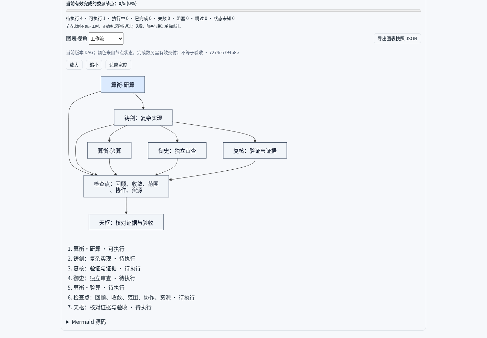
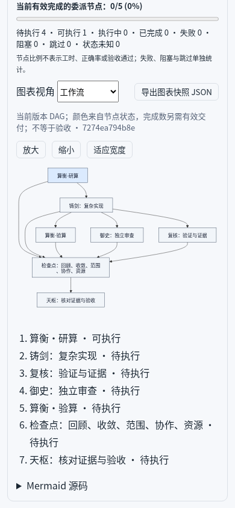
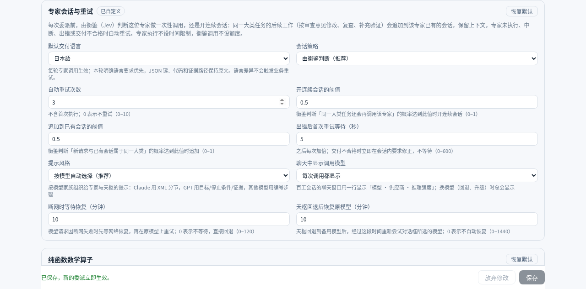

# 2.5.0 优化升级验证

本版按用户原始 MD 实施，并以正反专家互驳修订接口、执行与证据边界。实现及逐项映射见 [实施修订](../../superpowers/plans/2026-10-14-v2.5.0-implementation.md)。

- [多图与 Archify](task-diagrams-review.md)：五图单快照、进度/偏移、离线导出和真实上游契约。
- [记忆与调度](memory-scheduling.md)：同 owner 已复核参考、依赖准入、有界队列与时间/空间复杂度。
- [反方审核](adversarial-review.md)：已复现缺陷、修复和独立关联回归。
- [真实 Jev 辅助复审](jev-review.json)：只判断提供的证据，不构成正确性证书。
- [浏览器五图](browser-task-diagrams.json) / [语言设置](browser-settings.json)：真实候选服务与宿主 React；配置保存只发生在受控 QA。
- [Archify 收据](archify-verification.json)：五类 validate/deliver 均通过 standard 基础检查；dataflow 一条微线段 warning，未宣称 showcase 或上游 visual-check。

真实宿主直接通过 `Llm.prepareCall` 与候选同源语言指令调用 DeepSeek 官方 API 五次，简中、英文、繁中、日文、韩文均返回对应语言短句，零业务工具。这只证明本次提示与供应商输出；专家工具、继续会话及审核路径由真实 DSH SDK 场景另行覆盖，不宣称任意模型始终遵循语言，也不因语言差异重放任务。

原始设计提到 Archify 的接口已按 [官方 CLI 源码](https://github.com/tt-a1i/archify/blob/58ab0b98d2d0def8e49dced705c7b566936723ec/archify/bin/archify.mjs) 验证，未复制上游运行时到生产包；本机预览默认使用已有 Mermaid 11.12.0。离线入口：`node node_modules/dsh-agent-swarm/scripts/export-task-diagrams.mjs --input snapshot.json --output new-directory [--archify /path/to/archify.mjs]`。

最终全量计数、本机维护、源文件指纹、独立安装与 GitHub 资产以同目录最终验证记录和 Release manifest 为准。合法大状态仍受原4MiB/512材料等容量限制；本次不承诺无限历史保留或固定端到端性能/Token收益。

最终 **917 项单元测试、39 项真实 SDK 集成测试、类型检查通过**。本机单一 `dsh-web.service` 已为2.5.0；真实额度源返回22个窗口，采样时间仍未知。原用户补丁与46个expert-mode文件字节/权限保持一致，停机前无非空内存owner。本次出现一次提前热加载，随后已重新检查、导出并受控重启，范围与限制如实记录于 [完整验证清单](verification.json)。
