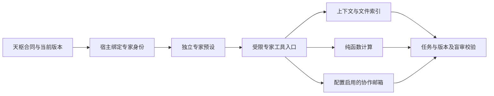

# 2.9.2 规划空转与等待恢复验证

2026-10-18。生产公开接口核对到原报告中的 T-5：需求/合同/流程版本 6/6/7，旧题目版本 1，Jev 需求覆盖 0.35、执行边界 0.79，状态 review_required。该维护任务确实未获得执行准入；不是额度耗尽或状态容量超限（约335 KiB，内存模式）。

## 修复链路

原始需求与真实补充 → 阶段合同与具体交付映射 → 版本化冻结快照 → 结构检查 → 独立只读 Agent / Jev → 当前批准 → 就绪节点 → 阶段验收。

- 题目、身份、策略、版本统一绑定；由旧快照重建时去掉旧输出摘要。
- 明确负结论复用，即使 bypass_cache 也不能刷分；实质修订、题目升级或可恢复服务故障另行审核。
- 模型启动/结果、parser、Jev 等待由取消与截止保护；迟到 child 先封锁权限再清理，shutdown 取消现有审核。
- 阶段合同保留原文和延期，coverage 可明确每个交付对应的验收与节点；禁止延期全局安全限制。
- 委派、上下文、交付复评、验收均传递阶段边界。多条补充一起汇集，纯继续不重置；历史读取失败不沿用旧授权，压缩历史缺口如实保留。
- 关键需求保留直接原文，仅出处中的重复原文改为精确引用。40000字符合成输入由124302降至84381字符（32.12%），见 [体积测量](payload-size.json)；不是通用Token收益或整体O(1)承诺。

## 独立审查与 Jev

[代码审查报告](code-review.md)记录正反两路发现、修复及算法边界。完整源码外发的 MCP 请求被自动审批拒绝，因此没有源码 Jev 通过结论；改用用户要求的脱敏机制结论与测试摘要，见 [原阻断记录](jev-review-blocked.json)、[实际七类请求与响应](jev-conclusions-review.json)。

七类工具均实际调用，模型为 jev-1.14.0，前后 health 正常。判断支持有限机制结论；screen 返回 review（risk 0.34），保留此结果，人工核对未发现窃密、命令执行或角色冒充内容。不能将工具调用成功、health正常或概率集中程度当作正确性证明。

三次合成案例均保留，输入有实质修订，不对同一输入重复抽签：

| 案例 | 结果 | 实质内容 |
| --- | --- | --- |
| [第一版](jev-phase-case.json) | 未通过 | 提出部署和双审，却没有对应流程节点 |
| [第二版](jev-phase-case-v2.json) | 未通过 | 补节点，但执行标志和逐项覆盖仍不足 |
| [第三版](jev-phase-case-v3.json) | 七维均≥0.8 | 修正执行标志，提供逐项映射；设计充分为0.80，恰好达标 |

以上是合成材料的语义检查，不是原 T-5 的执行许可。第三版之后回归又修正了旧快照摘要参与重建的缺陷；最终生成器以机器回归为准，不拿外部案例分数构造宿主批准。

## 真实测试追加修复

生产只读测试发现默认节点仅写“需求与方案”、未提供合法引用目录的问题；后续修复了动态Schema共享数组污染unresolved的缺陷。最终Schema把合法引用和阻塞说明分开，并保留真正未解决事项禁止通过的规则。

协议4按完整/阶段任务生成需求覆盖判据，不要求完整任务提供不存在的延期项，也不要求只读任务具有代码实现节点。实际题目保存在审核记录中。恢复直接需求文本后仍有低分，因此没有将低分归因于textRef。具体读取及独立重读流程通过一次真实官方API/Jev双审；缺少明确核验的简化流程仍被拒。

## 专家上下文接线

真实只读闭环首次成功后，专家仍报告 `swarm_context_read` 缺失。根因为新宿主独立预设没有继承天枢工具。最终新增独立专家入口并复用受任务绑定约束的定义；全部宿主实测自身合同可读、跨任务拒绝、治理工具不可见。旧start受控继承中的既有Jev能力保留，新入口不注册全局Jev。

## 测试与部署

最终测试、安装包及部署收据记录于 `verification.json`。本机升级前先确认无执行任务，并通过受控维护入口导出状态；原文、密钥及完整内存快照只保存在用户私有备份，不进入 GitHub。

内存模式的一次性交接不是持久化开关。文件系统永久挂起、服务自身故障、自然语言规划的充分性仍有边界；本版修复已定位的版本、缓存、上下文与模型等待问题，不宣称完整交易系统已经实现。
