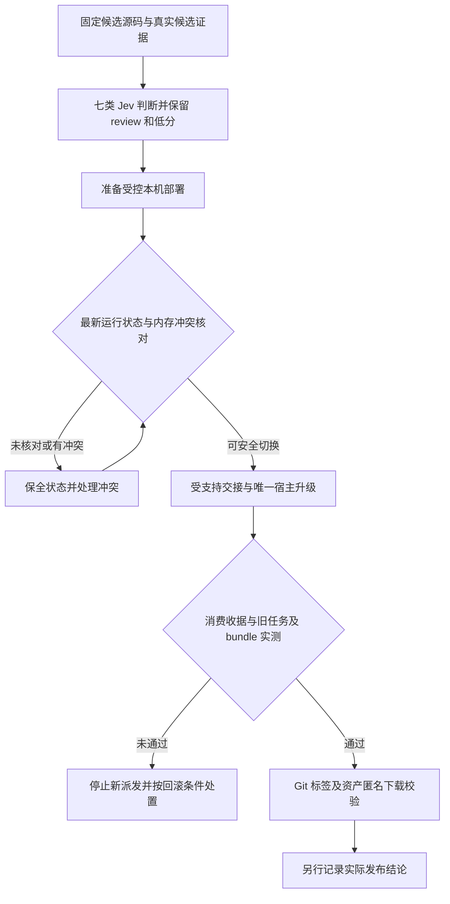

# 代码审查报告

## 1. 总体评价

- **摘要**：本轮 Jev 七类工具实际调用及首尾健康检查已完成。当前候选证据支持准备受控本机部署，不能声明生产升级、交接消费或 GitHub 发布已经完成。
- **固定对象**：提交 `68a9391a43f8d284f20d2bb2fb248ea363c30fe7`；`lib/client.js` SHA-256 `c579841b6fac0731b8b480f1e670581eab3c3662762e89b5de162711170dd811`。调用后复算 19 个源码/构建对象，摘要均一致。
- **证据成熟度**：Jev Score **3.0/4.0，normalized=0.75**；最高档要求真实生产部署、最新状态交接和发布校验，当前尚未满足。该分数不是正确率、权限或完成证明。
- **范围**：固定 Ruflo 提交设计吸收、六视角只读任务页、共享 Store 三项 P1 修复、真实根冷目录、不可执行工具候选及受限维护交接。Jev 只读取显式 payload，没有访问生产原文、用户会话或凭据。

完整问题、共享 state、每次输入及原始响应见 [jev-candidate-review.json](jev-candidate-review.json)。共享 state 以 `#/payload` 引用，可无损展开为实际请求；规范 JSON SHA-256 为 `6d98c9199fde8231782757df4d87857f92c045d72bcb31395a45f6adbe3d1746`。每次展开输入和响应也分别记录摘要。

## 2. 详细审查

| 工具 / 级别 | 实际结果 | 解释与处置 |
| --- | --- | --- |
| `jev_health` 首尾 | 均 ok；配置别名 jev-latest，语义响应模型 jev-1.14.0 | 服务可调用，不等于审查结论成立 |
| `jev_ask` | 只读边界 0.87、三项 P1 证据 0.88、候选隔离 0.97、维护边界 0.94；选择 prepare_controlled_deployment | 支持候选范围，不补写缺失的生产验收 |
| `jev_check` | 版本旧终态修复 0.93、历史卡被动缓存 0.92、恢复不能证明未来状态 0.95、性能口径 0.96 | 保留每条原始概率 |
| `jev_check` 低分 | “生产发布已经证明” **0.03** | 明确保留，不能宣传为已部署或已发布 |
| `jev_classify` | candidate_ready_for_controlled_deployment_preparation，confidence=1 | 只是闭集标签判断；返回 band=act 不授予执行权限 |
| `jev_match` | 匹配受限只读投影与隔离候选；exists=0.95，1 窗口 | 不匹配自动工具执行或已完成生产发布描述 |
| `jev_score` | 3.0/4.0，normalized=0.75 | 不补刷最高档 |
| 🟡 `jev_screen` | **review**；risk=0.41、risk_confidence=0.59、addresses_agent=0.83 | 文本包含面向 agent 的约束和维护步骤；保持被审资料身份，不转为指令，不记作 screen pass |
| 🔵 输入错误留痕 | 首次 screen 返回 400：text 应为字符串 | 实际传入的是序列化 JSON 字符串；只追加普通文本前缀修正一次封装，保留原输入/响应与修正输入/响应；未重试评分 |
| 🟡 后续门槛 | 当前生产仍 rc.2 / 插件 3.1.1，尚未 stage | 正式切换前复核新状态及冲突；交接、部署后旧任务/39 bundles、GitHub 资产另行实测 |

三项历史 P1 分别是 compact 历史卡抢占活动缓存、目录版本 4 而迟到旧版本 3 accepted 冻结刷新、桌面鼠标命中宿主宽度手柄。前两项有独立模块负向重放；第三项有固定最终 client 的真实鼠标同坐标命中 BUTTON 与详情出现，不能用无脚本错误或键盘通过代替。

最终候选的 97 文件 / 1333 单测、rc.2 与 rc.3 各 44 集成及 rc.3 最终 44 集成已记录；集成供应商为显式 fixture。真实 rc.3 浏览器覆盖六图逐一单 SVG、跨根同名 T-1、聊天/普通/御史预设/隐藏后的零新增 RPC、390 宽 More 与无横溢出。真实原生 Claude/Codex 生成和完整盲审子会话原生导航没有因此变成已验证。30 个小图夹具样本 p95=67.1ms、p99=67.4ms 是 SVG 替换加两帧稳定，不能称 INP、容量或 CSS 因果加速。

最终 tarball 的 SHA-256 `32cb1913c337f0ca8d93d8c2c2d5c11de237c86a0475a2afc2f6ae3980dacb69`、1339511 字节已复算；独立 npm 安装、4 个服务器 ESM 导出加载、81 编译 JS 一致与浏览器注册检查通过。Node 没有执行浏览器 factory；真实执行由浏览器证据承担。四个本地兼容包仅修改 manifest 兼容约束，两个官方 native rc.3 完成隔离装配，不代表真实模型任务通过。

维护误操作重启及非隔离 help 触及 profile 均已披露。反方确认完整恢复态与事故前 canonical SHA 一致，4 任务 / 33 委派 / 53 材料不是从聊天摘要猜测；该收据仍不能证明切换前没有新增状态，不能恢复旧模型进程、租约或 active binding。

## 3. 设计边界与后续流程

本轮仅写审核证据，不修改代码、宿主、版本或资产。候选 metadata 固定 evaluation=unavailable / executionEnabled=false；promote 强拒绝、memory 排除与 V1 恢复校验继续承担确定性边界，Jev 不能替代它们。



## 4. 验证方式

```bash
python3 -m json.tool docs/evidence/release-3.1.2-2026-10-25/jev-candidate-review.json > /dev/null
git diff --check
```

摘要绑定、原始回答、首次 screen 错误及修正后的 review 均在 JSON 中保留。本轮未新增 Jev 限流或使用/费用预算，没有对相同评分重复抽样求通过。

方法依据：[TypeSafe Noul](https://docs.typesafe.ai/primitives/noul)、[Confidence](https://docs.typesafe.ai/confidence)。概率描述模型对所给资料的判断，confidence 描述分布集中程度，均不能作为执行权限或生产完成证明。
