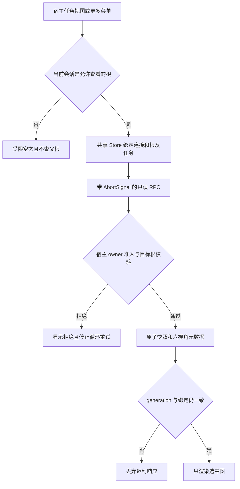

# 代码审查报告

## 1. 总体评价

* **评分**：⭐⭐⭐⭐☆（4/5，宿主契约与方案阶段，不代表 UI 验收通过）。
* **摘要**：官方 DSH `0.2.1-rc.3` 已安装到现有沙箱，CLI 和独立 profile 可用。rc.2→rc.3 的 RPC、session、goal、agent-loop、subagent 核心实现未变化；新增任务视图可以继续使用公开 `conversation.view`。生产 profile 的精确 rc.2 pin 已有一项真实拒装复现；四个替代副本与两个官方 native rc.3 已在独立 profile 完成装配验证，正式生产切换由根线程处理。两项 UI P1 已经修复并独立解除；本报告的 UI 重放不是浏览器验收。

本审查不修改生产 DSH、profile、运行会话、插件版本或 client/server 源码，不重启服务、不发布。证据只含公开包、接口和 profile 包元数据，不含配置正文、用户会话、账号用量或凭据。需求留痕由 [3.1.2 PRD](../../../PRD/2026-10-25-ruflo-adoption-and-3.1.2.md) 及 [实施计划](../../plans/2026-10-24-v3.1.2-progress-tab-and-tool-candidates.md) 承载。

官方依据：[rc.3 发布](https://github.com/deepseek-ai/deepseek-harness/releases/tag/dsh-v0.2.1-rc.3)、[rc.2→rc.3 比较](https://github.com/deepseek-ai/deepseek-harness/compare/dsh-v0.2.1-rc.2...dsh-v0.2.1-rc.3)、[官方 npm 包](https://www.npmjs.com/package/@deepseek-ai/dsh)。官方 tag 是 `dsh-v0.2.1-rc.3`，不是 `v0.2.1-rc.3`；这是预发布版本，发布提交 `1f81c04`。结构化比对和完整性摘要见 [host-rc3-compatibility.json](host-rc3-compatibility.json)。

## 2. 详细审查

| 级别 | 位置 | 问题描述 | 改进建议 / 已核对边界 |
| :--- | :--- | :--- | :--- |
| 🔴 严重 | 生产 profile 包版本约束 | 隔离 rc.3 安装 `@deepseek-ai/dsh-tool-calculator@0.0.1+local.rc2.1`，因 `engines.dsh=0.2.1-rc.2` 真实拒绝，退出 1、未安装任何包。仅升级全局 DSH 不构成完整兼容部署。 | 不开 exact-version exemption；为本地兼容包准备经验证的 rc.3 副本。其它精确 pin 只作元数据发现，不宣称均已实际拒载。 |
| 🟡 警告 | 官方实验/native bundles | 当前 profile 39 bundles；calculator、finance-data、subscriptions、browser-playwright 有 rc.2 精确约束，profile 原生 Codex/Claude 子后端也固定 rc.2 及精确 core peers。内置官方实验 bundle 与独立 profile 安装的包不是同一种解析路径。 | 官方独立包优先使用同宿主 rc.3 版本；内置项由 rc.3 core 提供；逐项检查真实解析与装配。`package.json` 未导出或当前 require 不可达，不等于 bundle 缺失。无真实 Claude 请求。 |
| 🟡 警告 | `conversation.view` 的 rc.3 header | slot、session scope、openView/viewRequest/completeViewRequest 未移除；新增全局内存 pin、宽度折叠与“更多”菜单。因此 order=20 不保证按钮始终在 tablist 可见。 | 桌面/窄屏同时验证正常 Tab 和“更多”入口；不强制 pin、不改宿主 DOM，不把宿主折叠当插件失败。选择隐藏视图不改变 pin 状态。 |
| 🟡 警告 | 只读 RPC 与身份 | rc.3 `connection.fetch` 精确路由只接受 owner Peer，非 owner 为 403；未认证准入为 401。目标根检查不是细粒度跨租户 ACL。 | owner 可正常切换多个授权根；普通/盲审子会话不得自动映射父根。新增目录与正文要分别测试实际认证层及目标根拒绝。 |
| 🟡 警告 | 取消与共享 Store | 客户端 `rpc.call(channel, endpoint, payload, signal)` 签名及实现与 rc.2 一致。取消读请求不等于停止 Agent、goal、同步派生或已经运行的 Mermaid。 | 覆盖迟到响应、连接重建、隐藏 Tab、永久挂起、不合作 transport；旧请求未终结时不能超时解锁后不断增开请求。 |
| 🟡 警告 | 旧会话与 v1 | core session/goal 声明和入口实现与 rc.2 字节一致，未发现本次新增格式迁移。rc.3 新会话恢复复用空白会话及草稿；相同 id 的活空白会话可能保持创建时 composition。 | 不把空白会话当 fresh composition；不用任务目录读取激活旧会话或 goal。v1 五图保持可读，缺编排项显示未记录；新可选候选字段不得赋予执行语义。 |
| 🔵 建议 | 工具候选 metadata | 本轮候选固定 evaluation=unavailable、executionEnabled=false，repository promote 拒绝工具候选，memory 召回排除，恢复拒绝 validated 工具候选；方向符合没有安全执行器时先隔离的要求。 | 继续验证真实根身份、取消、版本改动、容量拒绝和并发去重；元数据中的路径只是引用，不等于获准读取或执行的真实工件。此项当前为源码核对，最终测试结果后补。 |

公开类型比对共核对 10 个包：connection、session、goal、api-remotes、agent-loop、subagent、tools、session-projection 无 `.d.ts` 变化；session-controller 仅一处空白会话复用注释变化。conversation 包新增 view-pins 及 header actions 等类型；上述 9 个非 conversation 包的 `lib/index.js` 与 rc.2 字节一致。该结论不覆盖其它第三方包或 native 内部行为。

## 3. 设计与代码核对

本阶段不新增实现示例，不改变产品。最小安全调用边界如下：



隔离宿主路径为 `.sandbox/dsh-0.2.1-rc.3/node_modules/@deepseek-ai/dsh/lib/bin.js`，独立 home 为 `.sandbox/home-0.2.1-rc.3`，测试 profile 为 `swarmtest`。`.work-v3/.sandbox` 是指向主工作树沙箱的软链接，后续测试应复用此安装，不再并发安装同一目录。

## 4. 验证建议与当前结果

已执行：

```bash
node --input-type=module -e "import('./scripts/sandbox.mjs').then(m => console.log(m.ensureProfile('0.2.1-rc.3')))"
SWARM_DSH_VERSION=0.2.1-rc.3 npx vitest run --config vitest.integration.config.ts tests/integration/quota-math-host.test.ts
```

rc.3 CLI 返回 `0.2.1-rc.3`；基础真实 SDK 用例 **6/6 通过**，覆盖实际 Connection/ToolRuntime 接线、认证拒绝、只读额度与纯计算。该轮使用已有编译插件基线 `3.1.1`，供应商为显式 fixture，不代表新增进度 UI、全部 39 bundles 或真实付费模型已经通过。

后续必须补：新任务目录与候选 action 的身份/副作用回归；新 Store 的取消、乱序和容量边界；rc.3 实际浏览器中的“更多”入口、六视角、普通/盲审空态、隐藏后零周期请求，以及冷恢复不激活业务。生产升级和 3.1.2 发布仍由根线程统一执行。

## 5. 实施后独立反方复验

结构化收据见 [independent-negative-results.json](independent-negative-results.json)。以下复验没有修改 client/server 产品代码、生产 profile 或正在运行的服务。

| 范围 | 原反例 / 必须守住的边界 | 独立结果 |
| --- | --- | --- |
| UI P1：历史卡轮询与容量 | 紧凑 TaskFlowRow 原先主动订阅，8 个历史任务占满缓存，第9个任务不可读 | **解除**。实际 TaskFlowRow + Store 在隔离 observable hook harness 重放，8张历史卡周期请求为0，第9任务状态live；passive observer不分配、不锁缓存、不发RPC。 |
| UI P1：迟到旧终态 | 目录版本4已知后，旧版本3 accepted迟到，原先标live并停止正文读取 | **解除**。旧accepted被stale拒收，结算后经有界退避重新读取，最终目录4/正文4且live。最初55ms观测窗口不足以等待实现的2秒退避，调整等待窗口后通过，未把探针等待不足算成额外产品问题。 |
| 候选登记与副作用 | 根身份、禁用执行、取消、并发、版本与容量 | 11项负检查通过：12次公开service并发登记只留一条；取消不写、非法启用/未知command拒绝、普通会话拒绝；16次repository并发去重；容量拒绝保持state和sequence；文本复评不能晋升工具，memory不召回工具候选。并发合同改版实际返回STALE_EVIDENCE，网络/模型调用0。 |
| 冷目录与旧状态 | 不能凭字符串激活父会话或goal，也不能把子会话当根 | 实际持久状态重新装载后，只有getAgent返回的已加载根可恢复目录；任意根ID和具有parentSession的天枢预设子会话均拒绝；目录不带goal/card正文，版本/待审状态保持，父激活和网络调用均0。Host身份来源为隔离fixture，不扩称完整浏览器冷启通过。 |
| 兼容副本 | 原本地修复不能因宿主升级丢失，不能靠exemption | 四包原业务payload逐文件哈希不变，9个core入口字节一致；四包及官方Codex/Claude native rc.3共六项隔离安装与实际装配通过。calculator=14，财经stdev=0/sharpe=null及ROE10.00%保留，订阅五provider和浏览器17工具注册。未运行真实native任务或启动浏览器。 |

交给UI作者的重放脚本为 `.omc/release-312/compat-bundles/replay-ui-negative.mjs`；候选、冷目录脚本分别为同目录 `candidate-negative-probe.mjs`、`cold-directory-probe.mjs`。该目录的生产接入提案已更新为根线程准备的四个版本化新目录及两个官方rc.3依赖；SDK始终指向唯一 `/usr/lib/node_modules/@deepseek-ai/dsh/node_modules/@deepseek-ai`，不把沙箱SDK带入生产，保持原39 bundles顺序和配置。

## 6. 维护事件恢复材料独立核对

本项对应 [维护事件报告](maintenance-incident.md)，不是3.1.2产品缺陷或宿主release问题。仅读取指定旧备份、重建文件、事故前check-only收据和已安装3.1.1的恢复代码，没有附加inspector、修改备份或重启进程。

- 直接提取受信任安装模块的 `recover` 原文，其函数体SHA-256为 `35ecd2c9ff6c93974ce5cf31cce312b154b4dee9130120102b25f4ac98f8af91`；候选模块相同函数原文字节一致。
- 用该旧函数重新处理保留备份，结果与重建state的规范JSON **逐字节相同**，并非只比较数量。重建state的canonical SHA-256与事故前handoff-summary checksum均为 `9503c14a1ddc3edfbf4d880cfc2b6fe878232048695acba25a00b13961a39cb3`。
- 旧版真实 `validateFeatureState` 通过：1根、4任务、33委派、53材料；原文文件0600、目录0700、当前UID、单链接、非软链接均成立。原文、根会话ID、workspace和用户内容不进入报告。
- **可恢复边界**：这证明与事故前收据相同的完整可信状态可用于受支持的受限交接；不证明之后没有新增状态，不恢复旧模型进程、执行租约、active binding或goal执行。正式交接消费、新宿主状态与Web只读核对仍由根线程另行记录。

本次已发现的两项UI P1解除；当前本审查范围无剩余必须修改的P1。正式生产兼容、发布资产与浏览器交互结论不能由本报告替代。
