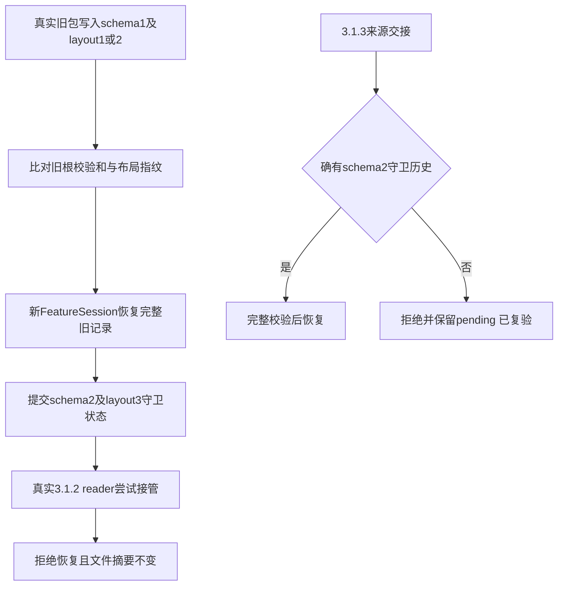

# 代码审查报告

## 1. 总体评价

- **评分**：⭐⭐⭐⭐☆（4/5，限本次独立工程审查范围）。
- **摘要**：反方独立检查根线程新增的进展守卫、验收凭证及 schema/layout 迁移；没有把本人编写的路由恢复代码作为独立审核对象。首轮四个缺口和 ready 节点免计数缺口已修复并复验；真实旧包迁移四种组合通过。内容摘要截断误停、新版本交接丢历史及不同目标凭证互相阻断均已修复。最终5份定向测试54/54通过，其中17项对抗/真实旧包迁移测试全部通过；本专项范围内未发现尚未解除的P1。

本专项仅使用自建临时目录和已安装 3.1.2 的只读代码，不读取生产任务状态、不发送模型请求、不重启或发布。真实 Host 的问答等待由其他专项执行，本报告不替代该专项证据。

## 2. 详细审查

| 级别 | 位置 | 问题描述 | 改进建议或复验结果 |
| :--- | :--- | :--- | :--- |
| 🔴 已解除 | `src/service.ts` 的 `normalizeRuntimeObservation`，当前第1368行 | 数组仅保留前128项，随后用截断结果决定真实内容是否变化。实际读取129项JSON，仅第129项依次变化A/B/C，第三次被 `LOOP_DETECTED` 误停 | 已增加完整数组摘要、有界preview和深层剩余整体摘要；原始反例通过。完整内容摘要按输入字节计成本，不能称为常数时间。回归见 `runtime-safety-adversarial.test.ts` 的 `new real read evidence after the array preview limit` |
| 🔴 已解除 | `src/feature-session.ts` 的交接加载→`recover`，当前第463–467行 | 声明来源3.1.3、实际schema1且完全缺失三类守卫集合的有效校验和交接仍被接纳；`recover`补空集合，无法区分真正旧状态与新版本丢失历史 | 已在创建store之前校验来源版本；3.1.3/schema1拒绝且pending字节未变，真实3.1.2/schema1迁移四组合保持通过。回归见 `runtime-migration-adversarial.test.ts` 最后一项 |
| 🔴 已解除 | `BeforeManagedTool(update_goal complete)` 的 required 集合及 `goalTasks` | T-1在旧goal A已有合法完整receipt；同会话换为不同goal B，T-2也已有当前合法完整receipt。完成B仍把T-1当必需任务，用B的goalBinding核对A的receipt，必然 `STALE_EVIDENCE` | 已由服务器在真实建卡/首次接受时绑定稳定 `runtimeGoalId`，签入receipt的证据摘要；只排除明确属于不同goal id的历史任务。同一目标的所有必需完整任务仍逐个校验。同goal修订使旧凭证失效、无归属legacy不跳过、不同goal历史不阻断三项反例均通过；旧卡不能直接换属当前目标 |
| 🔴 已解除 | 根模型步骤中 `runtimeWorkInFlight` + ready分支 | 一项工作在途、另一项ready时，曾连续8次模型准入却计数0 | 根线程已将ready分支纳入 `observeTaskProgress`；原反例独立复跑通过。真正安静等待仍免激活 |
| 🔴 已解除 | `BeforeManagedTool(update_goal complete)` | 曾只验证任意一个accepted凭证，或在真实文件读取期间允许合同修订先行提交 | 当前逐一校验全部必需accepted任务，并持taskLock串行保护；两项原反例通过。真实文件变更仍导致 `STALE_EVIDENCE` |
| 🔴 已解除 | 实际读取内容的规范摘要 | 递归删除领域 `id` 曾把真实JSON数据变化误作重复 | 嵌套领域ID保留，实际A/B/C读入不误停；不能据此扩称所有数组/深度边界已解决 |
| 🔴 已解除 | 持久进展写失败后的诊断工具 | 写失败后 `authorizationContext` 再写绑定，曾使 `swarm_status` 诊断也失败 | 原始日志被安全symlink陷阱拒写后，status仍可用，陷阱内容未变；失败状态不发布新工作 |
| 🔵 已验证 | 新旧状态、布局与旧writer | 使用真实发布3.1.2的 `state-store.js`、`state-chunks.js` 和完整 `inspectFeatureState`，无替代或放宽validator | layout1/2各自日志/快照共4组合：旧分片根校验和、布局指纹一致；两条历史委派完整保留；schema2/layout3写入后，真实旧schema校验拒绝，旧writer返回 `RECOVERY_REQUIRED`，前后文件摘要完全一致 |
| 🔵 已验证 | 实际 `runtime.apply` 注册的 `agent/request` | 不能只证明纯守卫返回错误，还需确认先于下游模型准备 | 独立回归捕获实际注册handler；三次无新结构后stalled，请求钩子抛 `RECOVERY_REQUIRED`，下游next调用次数0 |

## 3. 优化后代码示例

本专项遵守独立审核边界，没有修改根线程的守卫、codec或service实现。只新增/扩展两份可执行反例：

- `tests/unit/runtime-safety-adversarial.test.ts`：实际service、真实临时文件、并发合同修订、真实持久写失败、并行ready与实际runtime请求接线。
- `tests/unit/runtime-migration-adversarial.test.ts`：真实旧包写入/读取和旧schema校验、旧指纹、新schema拒旧writer，以及3.1.3交接来源边界。真实旧包测试仅在显式设置 `SWARM_OLD_READER_DIR` 时执行，缺少发布包不伪装通过。



## 4. 验证建议

本轮独立结果：原32项定向回归通过；随后新增实际模型前接线通过。最终5份定向测试 **54/54通过，0失败、0跳过**：独立公共运行守卫对抗12项、真实旧包/交接迁移5项、progress15项、schema/layout11项、receipt服务11项。其中阶段→最终完整验收场景由根线程新增，本专项独立重跑；其余自建对抗用例均保留原始断言。类型检查通过。机器结果与报告时源码摘要见 [engineering-independent-results.json](engineering-independent-results.json)。上述结果分批运行，不把其他Agent报告的1433项作为本人独立全量实测。

```bash
SWARM_OLD_READER_DIR=/home/zhairy/.dsh/local-bundles/dsh-agent-swarm-v3.1.2-32cb1913c337 npx vitest run tests/unit/runtime-safety-adversarial.test.ts tests/unit/runtime-migration-adversarial.test.ts tests/unit/progress-guard.test.ts tests/unit/runtime-guard-feature-state.test.ts tests/unit/verification-receipt-service.test.ts
npm run typecheck
```

全部已解除反例保持在测试中，不删除或放宽断言。本专项源码/测试修改冻结；后续若改动这些守卫或迁移入口，应重新执行对应回归。整组真实Host兼容、真实300秒等待和最终构建/发布由根线程及对应专项提供，不能由本次54项定向结果替代。旧发行包缺少src sourcemap引发警告，不影响实际JS执行；未为消除警告修改发布包。

边界：该守卫证明有界的精确结构/内容历史判断，不证明语义等价、数学正确性或Lean证明。原生 `GoalService.complete` 的直接SDK/Remote路径缺少公开前置hook，未在本插件模型/工具门禁覆盖范围内；不能用工具 `update_goal` 已阻断扩称整个宿主完成入口已封闭。纯状态读不消耗activation，但用模型自动反复执行同类读取仍应受到执行轮次限制。旧accepted无新receipt只保留历史身份；恢复不能自动重放未知副作用或复活旧执行权限。
