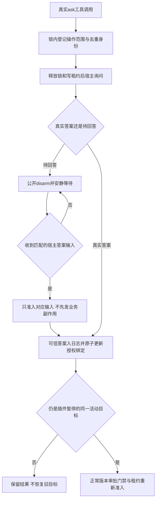

# 3.1.3 反方审核：宿主能力、授权等待与完成旁路

日期：2026-10-26。阶段：实现前能力核对；待主线代码完成后追加独立负向复验。只读检查源码及本机已安装包，未启动、重启或修改生产宿主，未实际发问、审批或发布。

## 1. 总体评价

- **评分**：本节不为尚未实现的方案打运行质量分。
- **摘要**：DSH 0.2.1-rc.3 公开能力可以实现受管理天枢的真实问答、阻止无答复续轮，以及工具路径的完成硬守卫。关键风险是钩子顺序、迟到答复尚未入日志时的恢复死锁，以及原生目标直接服务/远程完成没有前置门禁钩子。实现不能把“工具入口已拦”扩张为“整个宿主所有入口不可绕过”。

本次实际包路径：`/usr/lib/node_modules/@deepseek-ai/dsh/node_modules/@deepseek-ai/`。主包与本节检查的 agent/tools/goal/user-questions/tool-ask-user/tool-goal 均为 `0.2.1-rc.3`。下文宿主相对路径均以该目录为根。

## 2. 严重发现与最小修正方向

| 级别 | 位置 | 问题描述 | 最小修正/验收条件 |
| --- | --- | --- | --- |
| 🔴 严重 | `dsh-goal-round-driver/lib/index.js:326` | 下游 pre-step 返回 reject 时，goal 仍 active/armed 会被驱动器直接标 `blocked: prompt-rejected`。单加一个“待用户→reject”钩子会制造新的目标受阻 | 待用户时先用真实 `goals.disarm(liveRoot)`撤销自动权，再拒绝对应自动步骤；真实集成检查没有新增goal round、模型请求或 `goal/change:block` |
| 🔴 严重 | `dsh-user-questions/lib/index.js:552`、`dsh-agent-loop/lib/index.js:1052` | 晚到答案先 `agent.steer` 排队，只有准入后才写 user/message；若所有待用户 pre-step/request 无条件拒绝，就永远无法把答案写入日志，形成恢复死锁 | 允许真实匹配question/call来源的答案进入一次输入消费路径，普通消息/伪造来源不获得批准；授权结算在可信答案真正入日志或可信宿主返回结果后进行，不能把“已排队”当“已授权” |
| 🔴 严重 | `dsh-goal/lib/index.js:500`、`:706` | `GoalService.complete`直接/Remote调用不经过tools，且实现没有 pre-complete waterfall。`goal/changed`在append后才发出，监听它不能阻止完成 | `update_goal action=complete`通过tools.guard拒绝；百工service接受统一receipt。直接原生/Remote complete只能声明不受此插件门禁管理，或禁用相应适配，不能猴子补丁改写宿主方法，也不能事后回滚宣称从未完成 |
| 🟡 警告 | `dsh-user-questions/lib/index.js:185`、`:267` | 公开userQuestions投影只登记timed schema的调用（PTC仅保留pending子调用）。直接ctx.userQuestions.ask不会凭空创建tool/call记录，legacy阻塞也没有同等持久晚答复目录 | 优先包裹真实ask_user_question工具执行并保留宿主调用日志；legacy重启无法核对时进入reconcile，不假称具备timed恢复能力 |
| 🟡 警告 | `dsh-goal/lib/index.js:622`、`:686` | disarm只撤销进程内自动权，不改持久phase/revision；resume会增加修订并能恢复paused/blocked，不能任意晚答复调用 | 保存被插件disarm的goal id/ref和原activation；只对同一仍active/disarmed目标且真实答复消费后的合法恢复考虑rearm；人工pause/stop/替换、额度耗尽始终优先 |
| 🟡 警告 | 现有内存态任务/FeatureSession | 没有持久状态或可靠交接时，重启后不能恢复全历史、未决问题和receipt消费事实 | 新状态携带guardPolicyVersion/capability要求；未知旧读者只读或拒绝接管；不把丢失记录当空集合自动续跑，不秘密开启持久化 |

其中前三项是实现/声明的发布阻断条件；并非要求修改DSH或扩大本次宿主权限。

## 3. 真实公开钩子与时序

### 3.1 预步骤与模型请求

`dsh-agent-loop/lib/index.js:902`的preStep先claim输入、组装system prompt，再经过`agent/pre-step`。返回reject时在`:960`结束本轮为blocked，但尚未进入step、尚未发模型请求。该turn结果不等于持久goal.phase已blocked；两者需分别断言。

`:1043`的step先在`:1052`调用prepareRequest，随后`:1061`起写system/message与user/message，最后buildRequest。`agent/request`waterfall在`:1191`：它早于本步骤user/message入日志和模型准备。因此在该位置等待也可以阻止模型与goal round提交，但抛一般异常会被当运行失败；仅在此处读取deriveMessages也看不到本轮尚未入日志的晚答复。不能把该钩子当作完整输入恢复状态机。

目标round计数由`dsh-goal/lib/index.js:277`读取真实`user/message source.kind=goal`增长。`dsh-goal-round-driver/lib/index.js:80`仅驱动active/armed；`:285`–`:346`在pre-step前后重复核对预约、goal版本与activation，抑制陈旧队列。当前已有可用的disarm，不需伪造agent.status或读写私有状态。

### 3.2 推荐最小等待组合

1. 在真实`ask_user_question`的`tools/pre-execute`/执行包裹处，持任务锁短时建立去重和版本记录；释放任务锁、调度资源与写租约后才进入宿主问答。
2. 正常阻塞式`ask`/timed `timeout:-1`期间，根Agent仍有真实在途工具，不应启动额外模型推理；同时保存可验证的wait句柄。必须先检查宿主tool schema，不向legacy工具注入未知timeout参数。
3. pending或无应答者结束后，若没有独立ready工作，使用公开goals.get/disarm；在pre-step终止无实际进展的模型续轮。需核对无goal场景也不自唤醒。
4. 对晚答复保留基于宿主callId、question合同、source、answerOrigin的独立输入准入路径；不能把所有user消息都当批准，也不能将匹配答案拒之门外。
5. 来源可信的答案提交后，在同一任务锁里刷新requestRevision与`appliesToBinding`，不让答案立即自我过期；旧规划/产物验证按正常政策失效。宿主never/deny不会因此提升。
6. 插件只能恢复自身有证据disarm的同一active目标。无法证明恢复权限或公开能力时保留检查点和恢复入口，不自动resume paused/blocked。

### 3.3 tools的强制拒绝

`dsh-tools/lib/index.js:3310`执行顺序为pre-execute→宿主ask→同步monotonic guard→dispatch。`:3008`说明guard只可拒绝，不能强制允许别的守卫拒绝的动作；`:3363`将钩子异常物化为工具错误，不自动放行。

建议异步落账放在pre-execute/服务入口，最终同步guard只读当前已准备事实。不得在同步guard发网络或Promise；完成路径即使绕开工具也必须在AcceptTask自身校验receipt。当前`tools/execute`只能观察已进入dispatch的动作，不能把预检拒绝当作已经执行业务的证据。

## 4. 问答来源、晚答复与恢复

| 能力 | 实际事实 | 使用边界 |
| --- | --- | --- |
| legacy/timed询问 | `dsh-tool-ask-user/lib/index.js:180`、`:304`；默认legacy，timed -1仍走阻塞ask | 不能以所有宿主都支持timeout参数为前提 |
| root身份 | `dsh-user-questions/lib/index.js:531`核对exact live instance和agents.roots() | parentSession是持久谱系，不能独立判当前所有权 |
| timed持久投影 | `:185`折叠request/header、tool/call、tool/result、user/message；`:267`注册stateVersion2 | 通过sessionProjections公开读取，不扫描私有JSONL或篡改日志 |
| 公开投影形状 | `:48`–`:74`：active有callId/questions/state，settled仅有callId/answers | settled没有完整问题和任务范围，需插件已保存questionDigest/操作绑定，不能看到answers就批准 |
| pending晚答复 | `:552`answer核对问题ID集合、REPLY_QUEUED后createUserMessage并steer | 返回true只是队列接纳；正确范围和选项仍需插件校验 |
| 重复答复 | `:556`检查已排队与inbox；`:515`在user/message提交时释放queued标记 | 不把网络重试再次当新授权，不造新问题callId |
| pending超时 | `:613`askTimed finally清进程内wait，超时返回pending | 不把Promise缺失或重启后的新Map当已处理问题 |
| 应答者缺失 | `:668`ask最终NO_PROVIDER；timed可能等到截止再pending | “有userQuestions服务”不等于“用户能看见UI” |

本轮不把自然语言任意“同意”映射成全局许可。用户选拒绝、仅只读、取消、空selected、未选高风险选项均不能得到操作许可；仍可以记录已回答/不授权/待澄清，不能硬把这些状态重新变成同一个待回答问题无限弹出。

## 5. 完成入口覆盖矩阵

| 入口 | 可支持的守卫 | 不得误称的保证 |
| --- | --- | --- |
| `swarm_accept`工具 | tools.guard加AcceptTask统一receipt/CAS | 拦工具不等于拦住service直调 |
| 百工`AcceptTask`服务直调 | 函数自身freeze→独立验证→锁内重核→consume+accepted | caller summary不是真实证据；旧accepted不是新政策receipt |
| `update_goal action=complete` | 最终tools.guard核对所有相关受管理任务当前receipt、deferred/unknown状态 | 一个阶段accepted不能让全部目标complete；有多个任务时不能只选任意一份accepted |
| `update_goal pause/blocked` | 保留宿主已有权限与阻塞政策；不能改写成accepted | 人工stop/cancel不是完成，也不能因为缺receipt而阻止安全停止 |
| 原生Team完成 | 保持单向只读投影，不改变百工事实 | 原生owner/in_progress检查不能替代百工验证 |
| `GoalService.complete`、Remote complete | 已核实公开方法存在，但无百工可用的前置hook | 普通插件不能声称该路径已受receipt约束；`goal/changed`为提交后通知，不可充当前置守卫 |
| 任意未核实SDK/宿主版本入口 | capability明确unsupported/read-only | 不能默认当已兼容或通过反射改私有实现 |

宿主Remote complete实际在`dsh-goal/lib/index.js:500`导出；`:706`直接transition，`:858`先append再`:877`emit。若产品要求包含该路径的不可绕过，应通过上游公开policy seam解决，或明确不启用该原生完成适配；当前版本发布说明必须保留边界，不伪造“已全面阻断”。

## 6. 授权持久状态与receipt事务建议

沿用现有FeatureSession/分段存储，授权和receipt可为单独有界集合；不要把全历史Set/大诊断重新塞回TaskRecord热写入。记录至少包含root/workspace/task、操作/范围摘要、questionBinding、宿主callId、实际answerOrigin、appliesToBinding、decisionRevision、guardPolicyVersion及终态/撤销状态。

1. **先写派发意图**：在远程提问前写prepared；外部派发回执未知为reconcile，不能重问或默认批准。网络边界不宣称exactly-once。
2. **回答绑定原子更新**：真实答案可递增requestRevision；检查同操作/同范围后同一事务绑定新版本，旧规划照常失效。
3. **receipt由服务签发**：不透明ID绑定任务三版本、question/policy版本、实际产物与独立证据摘要及生产者；不能接受caller自造JSON、摘要或Git SHA代替dirty工作区实际摘要。
4. **accepted和消费同事务**：冻结快照→远程验证（不持任务锁）→锁内重新计算版本/证据适用性/未结束作业/授权→一次存储提交consume+accepted。持久化失败应回滚暂存状态且返回明确错误，不能残留内存accepted后让同轮goal完成。
5. **幂等不是失效放行**：同一已消费receipt的合法重复请求返回同一结果；产物、范围、策略变化或撤销后不能因“曾消费”跳过当前适用检查。
6. **legacy accepted**：只读历史可保留accepted并标旧政策；若当前目标想在新政策下完成，必须真正重核独立证据并签新receipt。不能无条件批量提升老数据；没有独立证据则拒绝新的完成动作，而不改写历史。
7. **兼容与降级**：守卫政策/活动等待/receipt字段需要能力版本。旧读者不理解活动安全记录时拒绝接管/只读，不忽略未知字段后继续。内存态重启缺交接时返回history_unavailable，不以新空Map重置新意与授权；不秘密改变保留策略。

## 7. 独立负向复验清单（待实现）

- [ ] host rc.3实际问答前台等待5分钟，无新LLM请求、无goal轮次增长、无prompt-rejected持久阻塞；观察窗不是用户答复限时。
- [ ] 不回答、timed pending、无answerer、断开UI、子智能体询问均不批准；无独立ready工作时不再推理自问自答。
- [ ] late answer已排队→pre-step→日志消费→需求修订→重新准入无死锁，重复点击/回包不重复副作用。
- [ ] 假tool/result、错误callId、问题合同变更、跨根同T-1、只读选项及自由文本歧义均拒绝高风险动作。
- [ ] 真实答复引发requestRevision更新时不自我过期，旧规划仍失效；撤回发生在预约/dispatch之间时最终guard拒绝。
- [ ] 用户pause/stop、目标替换、预算耗尽后晚答复不恢复旧目标；disarm/rearm不擅自恢复paused/blocked。
- [ ] receipt缺失、伪造、已撤销、跨任务、旧产物、未知副作用、未完成委派及有deferred阶段均不能触发整个目标完成。
- [ ] 旧swarm_accept参数可调用同一管线；故意传错receipt不能忽略；正常重复接受幂等。
- [ ] accepted写入/receipt消费的存储故障与CAS竞争没有暂态放行；纯内存与持久态分别验证。
- [ ] A→B→A、周期w+1、换UUID/时间戳/纯revision、同义改卡不重置自动预算；真实长工具句柄与独立新证据不误停。
- [ ] 能力缺失版本明确unsupported；普通非百工会话与人工安全停止不受干扰。
- [ ] 生成lib依赖闭包、隔离真实宿主、双路审查与Jev审查完成后才进入正式部署。

本清单是发布前验收要求，尚未勾选，不意味着运行结果已经通过。根代理实现完成后本专项将独立检查最终diff和故障路径，追加具体结果。

## 8. 授权专项实现与局部验证

根代理随后明确委派本专项实施授权纯模块，因此本报告第1–7节为实现前反方核查，第8节为作者验证，不能充当该模块的独立终审。根与其他专家仍需审查接线和最终行为。

已新增`src/authorization-wait.ts`、`src/authorization-host.ts`及两个专属单测文件，仅向`src/host-contract.ts`追加公开goal/question最小接口。未修改service/index/runtime/FeatureSession，由根代理接线。接口与真实工具结果落账屏障要求见[authorization-api.md](authorization-api.md)。

局部结果：类型检查通过；两份专属单测21项通过，覆盖互斥去重、unknown派发、权限范围/版本、无规则不批准、拒绝/跳过/取消、来源伪造、容量、提交失败不发布缓存、持久恢复、晚答案单次输入票据和goal disarm/rearm限制。记录不保存原问题正文、选项原文或自由文本答案，只存规范摘要、选项索引和来源。

单测的5分钟等待采用假时钟和宿主接口替身，只证明适配器自身不会定时重新询问/恢复；**不等于真实宿主5分钟无LLM/goal轮次增量验收**。真实钩子顺序、最终tools/result异步落账屏障、答案入日志后原子刷新绑定及实际生命周期取消由主线隔离集成验证；未完成前本报告第7节的运行时验收仍未勾选。
