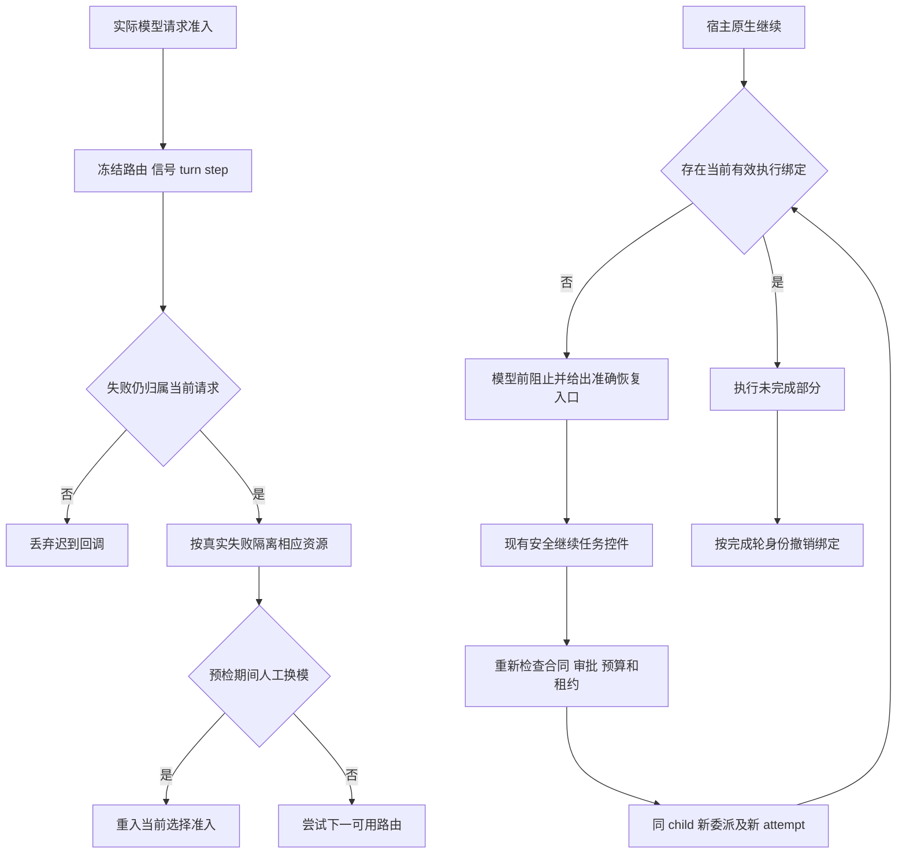

# 代码审查报告

## 1. 总体评价

* **评分**：⭐⭐⭐⭐☆（4/5，限本次路由和继续执行范围）。
* **摘要**：已修复回退预检期间换模导致本轮结束、旧请求错误归因，以及撤销身份后原生继续反复请求被拒技能的问题。保留真实额度/池/短限流分类、供应商 reset、当前合同、独立盲审、上下文绑定及未知副作用租约；没有新增依赖、配置或持久字段。

需求背景见 [3.1.3 PRD](../../../PRD/2026-10-26-runtime-guards-and-settings-3.1.3.md)。定向机器结果见 [routing-recovery-results.json](routing-recovery-results.json)，真实控件结果见 [routing-recovery-browser-qa.json](routing-recovery-browser-qa.json)。本审查未读取生产原始状态、修改账号或重启生产。

## 2. 详细审查

| 级别 | 位置 | 问题描述 | 改进结果 |
| :--- | :--- | :--- | :--- |
| 🔴 已修复 | route-state.getRootFallback | 回退 metadata probe 在途时人工换模，原条件直接返回 undefined；真实 Host 将其解释为结束本轮，即使新选择健康 | 同一有效请求的人工偏好变化返回 retry，重新准入当前选择；旧回调不能写回旧 override。释放、跨请求或资源政策变动仍拒绝旧回调。 |
| 🔴 已修复 | route-state 请求失败归因 | 异步健康提交/额度排序之后重新读取 lastRoutes，可能将旧失败记到后续选择；信号在一个 turn 内也会跨工具 step复用 | 冻结实际 route/policy、recovery 与 picker 身份；信号关联实际请求，并按宿主已有 turn/step、provider 和 recovery 身份过滤迟到回调，避免污染新路由或压缩新上下文。 |
| 🔴 已修复 | service.WaitAgentReady | 旧 childReady Promise 已完成不表示执行权仍有效；原生 followup 能再次请求模型，再循环调用已撤销权限的技能 | 模型请求前检查绑定 active、当前版本和 attempt；不可自动恢复旧绑定。持久专家精确指向“模型与恢复 → 安全继续任务”，一次性专家指向父天枢的新审核/委派，不提供不存在的继续按钮。 |
| 🔴 已修复 | delegate.onChildEnd / binding.revoke | 同 child 新执行已重授权时，旧轮异步收尾可能按 agentId 撤销新身份 | 回调携带完成轮的 delegation/attempt；控制记录已替换则跳过旧收尾，revoke 在原存储互斥区核对 expectedAttemptId 后才写。旧历史仍 revoked，新代不是复活旧权。 |
| 🟡 边界保留 | pool/quota/rate-limit | pool exhausted 只证明聚合成员不可用，不证明整个订阅额度耗尽；普通429也不能冒充quota | 已有分类保留。14h24m hint 在有可用后备时不等待；真正 quota/reset floor、单半开与局部冷却仍生效。没有把本轮修复说成Claude账号已恢复。 |
| 🟡 未作保证 | 原生任务和 preparation | 当前公开 SDK 不提供把已经进入原生 child inbox 的请求原子替换成新合法委派的事务；在当前运行回合内自调 Continue 会绕过沉寂/副作用核对 | 不伪装支持透明转交。实际阻止模型请求并明确现有入口；真实按钮已验证能在同 child 新委派继续。任意 prepareCall 前置异常及 native CLI 内部重试不扩称全覆盖。 |

## 3. 优化后代码示例

实现保留在现有模块，未创建第二套控制器：

- [route-state.ts](../../../src/route-state.ts)：请求归属、回退与迟到回调过滤。
- [agent-binding.ts](../../../src/agent-binding.ts)：可选 expectedAttemptId 的原子撤销。
- [delegate.ts](../../../src/delegate.ts)：连续会话收尾携带完成轮身份。
- [service.ts](../../../src/service.ts)：限生命周期回调和 WaitAgentReady 的局部修改；AcceptTask/Review/dispatch 新政策由根线程维护。
- [host-contract.ts](../../../src/host-contract.ts)：只补官方已存在的可选 turn/step。旧省略字段适配器和两参数 revoke 调用保持可用；没有序列化迁移。



这不是自动授权图。未知副作用、未确认租约、旧合同和独立盲审限制仍可阻断 M；已成功节点不回放。原生 followup 的提示没有充当批准或新 attempt。

## 4. 验证建议

定向单测 **272/272**、实际 rc.3 Host 恢复场景 **8/8**、真实 adapter 抛出错误场景 **2/2** 已通过。SDK会话、AgentLoop、ToolRuntime、RPC、写入和取消是真实实现，供应商为明确隔离的 mock；没有发真实 Claude/Codex 请求。

```bash
npx vitest run tests/unit/route-request-ownership.test.ts tests/unit/service-recovery-admission.test.ts tests/unit/route-state.test.ts tests/unit/agent-binding.test.ts tests/unit/delegate.test.ts tests/unit/agent-control.test.ts tests/unit/pipeline-atomicity.test.ts tests/unit/task-runtime.test.ts tests/unit/planning-runtime.test.ts tests/unit/service-agent-control-restore.test.ts
SWARM_DSH_VERSION=0.2.1-rc.3 npx vitest run --config vitest.integration.config.ts tests/integration/agent-control-host.test.ts
SWARM_DSH_VERSION=0.2.1-rc.3 npx vitest run --config vitest.integration.config.ts tests/integration/recovery-host.test.ts -t '真实 adapter 抛出'
```

验证包含：

- pool、硬quota及带长 hint 的429立即去可用备用，短429保留一次短重试；normal/always两模式真实 LlmError 抛出后均只有失败模型→备用两次请求，宿主 retry事件0。本机隔离样本切换间隔21/22ms，不作为生产延迟承诺。
- 预检/健康保存时换模、配置链外人工选择、旧 turn/step/provider 回调和已释放请求均不会错归新路由或创建幽灵恢复记录；真正资源政策变化仍拒绝旧回调。
- pool错误及timeout后原生跟进均新增模型调用0；合法控件入口以同child、新委派完成真实read，重复旧revision的继续被STALE_EVIDENCE拒绝。
- 取消后确认不足被拒绝；真实写入总次数1，继续只读原文件，前后内容相同。未知租约不因确认按钮而被清除。
- 冷恢复、一次性生命周期、旧绑定历史、规划审核与上下文约束保持回归通过。

### 真实控件

按 agent-browser 技能操作现有 Model & recovery 组件，使用实际隔离 Host 与生产 RPC handler：选择 recovered/max，等待 hang取消沉寂，点击“安全继续任务”。同 child 从 D-1 到 D-2，实际调用为 hang/high→recovered/max，最后 idle/settled；控制台和页面错误均0。截图：[取消沉寂后](routing-recovery-browser-paused.png)、[同child新委派继续后](routing-recovery-browser-resumed.png)。浏览器会话与4191隔离预览均已关闭。

此为 loopback QA bridge，不认证生产浏览器cookie/完整Web组合。一条文本等待locator未命中而超时，最终DOM及真实Host RPC证实新模型与新委派；没有为补测重发控制动作。

### 集成状态

本次子任务代码已完成。根线程并行补入五个运行守卫方法时，曾短暂出现service返回对象缺方法；主线随后补齐，最终类型检查已独立通过。守卫与迁移的另一次独立定向审查54/54通过，范围与限制见 [engineering-independent-review.md](engineering-independent-review.md)。整仓build/全量测试、正式部署与发布仍由根线程提供最终收据；原生内部未测边界、真实provider状态与部署结果不得由本报告替代。
