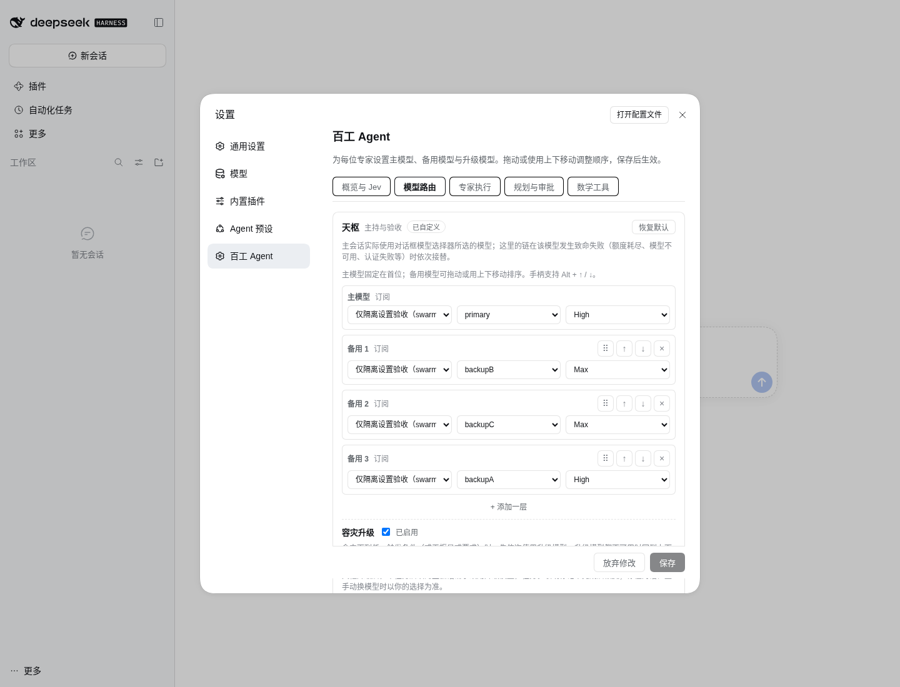

# 3.1.3 设置页真实宿主验收

日期：2026-10-26。对象为 `.work-v3` 的 3.1.3 候选设置实现，使用系统安装的 DSH `0.2.1-rc.3` 启动真实隔离 Web 宿主。五类设置、普通备用链与升级链排序、保存和刷新验证通过。共完成 34 项浏览器断言、14 项落盘配置核对；相关 3 个测试文件 54 项单元测试通过。

## 范围与隔离

- 监听 `127.0.0.1:4187`；专用 `DSH_HOME=.omc/settings313-web-home`，专用进程 HOME。未读取生产凭据，未触碰 3080 或重启生产服务。
- 真实 DSH profile 装载当前工作树插件和本地 QA adapter。adapter 仅提供 `primary/backupA/backupB/backupC/upgradeA/upgradeB` 模型目录及 `high/max` 推理档位，生成入口明确拒绝调用。
- 通过宿主原生账号菜单、设置弹窗和 `settings.section` 注册入口操作，没有制作静态模拟页面。
- 使用 `agent-browser` 默认技能与 CLI；真实拖拽观察到 `isTrusted=true` 的 dragstart/drop/dragend。跨远距专家时使用原生 mouse down/move、容器滚动、mouse up，未用合成 DragEvent 冒充鼠标验收。
- 本阶段 manifest 版本见 [源码绑定](settings-source-binding.json)。本记录验证候选设置代码，不代表生产版本已升级或完整 3.1.3 已验收。
- 验收结束后已关闭本轮隔离宿主和浏览器会话，4187 不再监听。

## 交互结果

| 检查 | 结果与证据 |
| --- | --- |
| 五类 Tab | 概览与 Jev、模型路由、专家执行、规划与审批、数学工具。只挂载当前分类内容，五个 tabpanel 保持 aria 关联；Home/End 激活并聚焦正确分类。 |
| 草稿保留 | 模型顺序与推理档位、专家语言、审批、数学额度跨全部分类保留；一次宿主 ConfigForm 保存后显示已保存。 |
| 普通备用排序 | 原生手柄拖拽与 Alt+方向键生效。主模型没有拖动手柄，备用拖入主模型位置被拒绝。 |
| 稳定身份 | 排序后按原稳定 ID 修改模型和推理档位，只影响被移动的项；其他备用模型不串位。模型切换会沿用原有行为清空旧推理档位，随后显式选择新档位。 |
| 升级排序 | 可将升级第二项移动到第一项；推理档位与触发条件保留。 |
| 隔离与取消 | 跨普通链/升级链、跨专家拖拽不改变配置；真实拖动后 Escape 取消，不产生可保存草稿。 |
| 保存与刷新 | 完整页面刷新后，普通链顺序、升级链顺序、推理档位、语言、审批、数学额度与已保存值一致。 |
| 未管理字段 | 路由 policy、其他角色常规链、升级触发条件、agents.networkProbeUrls/session，以及 memory/experience/persistence/workflow/jev 原值保留；临时项 ID 与 drag token 未写入配置。 |
| 窄屏 | 390×844 下五个分类均可点击，仅显示一个 panel，插件 section 无横向溢出；Alt 排序与放弃修改通过。宿主原有设置侧导航仍占据约 200px，未改写宿主布局，不能把这次验证表述成宿主移动端整体改版。 |
| 错误反馈 | 最终浏览器 page errors 为空；监听到的 error/unhandledrejection 为空。未请求外部生成模型。 |

完整记录：[设置流程 18 项](settings-browser-results.json)、[刷新与窄屏 13 项](settings-browser-reload-results.json)、[取消拖拽 3 项](settings-browser-cancel-results.json)、[配置保留 14 项](settings-persistence-checks.json)、[54 项单元测试](settings-unit-tests.log)、[浏览器日志](settings-browser-console.json)。



[窄屏模型设置截图](settings-narrow-models.png) · [窄屏专家设置截图](settings-narrow-execution.png)

## 验收发现与修复

1. 合法专家策略草稿被错误标为“需修正”：`getPolicyErrors()` 保留值为 `undefined` 的键，Tab 原来按键数判断错误。改为仅检查存在的错误值；增加合法→非法→合法徽标回归。全局保存校验原本正确，没有降低校验要求。
2. 极窄设置正文中，凭据引用等长标识与原固定两列策略网格出现溢出。只调整插件内部样式：长标识允许换行，策略网格随容器宽度切换列数，排序按钮与权限标签可折行。复测五类 section 的 `scrollWidth <= clientWidth`。

浏览器驱动前期曾因 CLI locator 参数、脚本字符串转义、未滚动到可见位置而中断，均修正驱动后重跑；未将这些驱动失败计入最终通过项。落盘核对按宿主有效配置语义比较：宿主会物化默认字段并写回完整配置，因此不能把原始 fixture 中“缺省 upgrade”与宿主已归一化的空升级对象作字节比较，也不能要求未编辑根字段必须不出现在输出中。

## 实现与复杂度边界

新增纯逻辑模块 `client/settings-navigation.js`；`client/settings-page.js` 保存当前 Tab 和稳定行 ID；`scripts/build-client.mjs` 将导航模块装入同一客户端 bundle。未增加依赖、未改设置 API 或持久化 schema。

长度为 L 的模型链重排仍是 O(L) 的查找与不可变数组移动，额外空间 O(L)。稳定 ID 解决身份串位，不宣称把重排变成 O(1)。草稿只在统一保存时交给宿主 ConfigForm；真实浏览器本轮未主动制造并发配置冲突，revision 冲突与旧回调拒绝由单元回归覆盖。

## 复现入口

夹具、启动与浏览器脚本位于 `.omc/settings313-fixture/`。该目录包含隔离宿主登录日志，不作为公开资产；公开证据仅包含本目录已审查的结果与截图。生产部署、真实订阅模型调用和整体发布由主任务单独验收。

```bash
npx vitest run tests/unit/client-settings.test.ts tests/unit/client-bundle-contract.test.ts tests/unit/client-task-progress.test.ts
node scripts/build-client.mjs
```

## 最终 3.1.3 构建快速复测

主线程完成最终 `3.1.3` build 后，重新用该构建启动 4187 隔离 rc.3 宿主。再次通过 8 项实际浏览器断言：五类 Tab、可信原生拖拽、真实保存确认、刷新后的顺序与推理档位保留、390px 五类无横向溢出，以及刷新前后浏览器错误为空。落盘配置与复测前配置作规范化全量比较，除天枢常规链 `[0,3,1,2]` 重排之外没有其他变化。

最终绑定包含 `package.json`、`lib/client.js`、`lib/index.js` 和设置源码的 SHA256：[最终构建哈希](settings-final-build-binding.json)、[浏览器结果](settings-final-build-browser.json)、[完整配置保留检查](settings-final-build-config.json)、[控制台](settings-final-build-console.json)、[桌面截图](settings-final-build-desktop.png)、[390px 截图](settings-final-build-narrow.png)。

本夹具仅提供设置模型目录，没有实际根会话或任务，因此未伪造 `RuntimeGuardStatus` 的任务进度状态验收；该组件的真实任务状态展示由主任务单独验证。本次快速复测没有修改源码，未触碰 3080。
