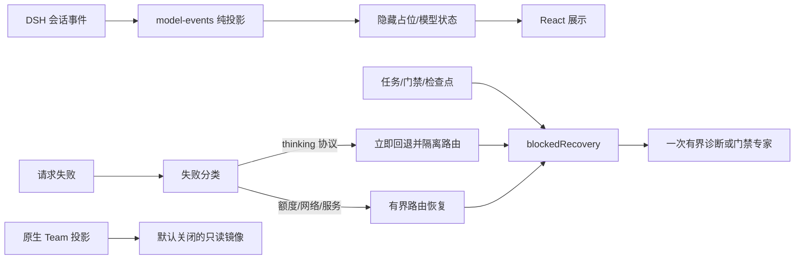

# 3.1.0 架构、复杂度与性能审核

日期：2026-10-23

## 结论

3.1.0 采用最小充分改动：把事件投影与 React 展示分离，修复宿主事件契约；把 thinking 协议失败限定为路由故障；把目标受阻转为有界恢复处方；原生 Team 只加入默认关闭的只读投影；自我进化只做路线规划。

`lib/client.js` 是生成包，不是手工维护的 3000+ 行单文件。当前源模块为：

| 源文件 | 行数 | 职责 | 复杂度 |
| --- | ---: | --- | --- |
| `client/settings-page.js` | 约 1675 | 设置页与表单 | 渲染 O(字段数)，提交 O(路由槽数) |
| `client/model-events.js` | 151 | 纯会话事件投影 | 每个事件 O(1) |
| `client/model-display.js` | 314 | React 展示与控制 | 每次渲染 O(1) |
| `client/task-flow.js` | 348 | 流程图与导出 | O(节点数 + 边数) |
| `client/native-team-projection.js` | 219 | 原生 Team 只读镜像 | O(成员数 + 任务数)，上限 32/100 |

因此，本次继续拆分 `model-events.js` 是合理的；仅因 bundle 行数超过 3000 重写 `lib/client.js` 不会降低事件路径复杂度，反而扩大回归面。设置页仍是后续候选：只有当字段继续增长或多人维护冲突出现时，再按“凭据 / 策略 / 路由 / 数学”拆分。

## 热路径分析

### 模型事件

设一次事件窗口包含 `n` 个事件。注册的定义只对 `assistant/message` 与 `assistant/attempt` 做常数时间字段读取；隐藏占位只复制上一条状态。总时间为 `O(n)`，额外空间为 `O(1)`（每条定义只保留上一状态）。

### 路由恢复

设角色链长度为 `L`，健康条目为 `H`。单次失败选择下一路由为 `O(L)`；健康查找按 canonical route key 直接访问，约为 `O(1)`。默认链长很小，因此无需引入图算法或异步索引。

### 任务状态与检查点

`getStatus` 需要为每个任务重建视图；设任务数 `T`、委派总数 `D`、流程图节点数 `N`。当前实现最坏约为 `O(T·D + T·N)`，但状态查询不是逐 token 热路径，任务与流程都有上限；对交互式使用可接受。只有在实测状态查询进入 p95 关键路径时，才引入任务到委派的反向索引。

### 受阻恢复

门禁最多 7 个，验收缺失项有界；`getBlockedRecovery` 为 `O(G + M)`，其中 `G ≤ 7`、`M` 为缺失项数量，可视为常数上界。推荐角色先去重再返回，避免同一角色重复委派。

### 原生 Team 镜像

只读取宿主已有投影，不写入任务、不创建成员。成员与任务分别以 32/100 为渲染上限；正常情况下为 `O(M + T)`，输出 DOM 数量有界。默认关闭，关闭时不发起 RPC、不注册可见控件。

## 数据管道

## 时间与空间取舍

- 不缓存完整模型事件历史：状态只保留上一调用、当前轮与锚点，空间为常数。
- 不把阻塞诊断写入批准或持久状态：只在 `swarm_status` 读取时计算，避免状态膨胀。
- 不将原生 Team 投影作为事实源：只读、可丢弃，失败不影响百工执行。
- 本地 tarball 的依赖安装发生在一次性安装阶段，不进入运行时热路径。

## 不进入 3.1.0 的优化

- route health sidecar 的串行持久化重构：会改变恢复语义，需单独故障注入与迁移验证。
- `service.ts` 全量拆分：当前函数边界服务于单一状态机，机械拆分会增加跨模块参数与测试成本。
- 将状态查询改成增量索引：缺乏生产 p95 证据前属于过度工程。
- 原生 Team 双向同步：必须先完成准入旁路、双状态竞争、隔离、版本禁用和收益基线实验。

## 验证

- 94 个测试文件、1284 项单元测试通过。
- 8 个真实 DSH 集成文件、42 项测试通过。
- 临时 profile 使用 `link:` 安装 3.1.0，Web 正常启动，插件处于启用状态。
- agent-browser 验证百工预设、插件版本和实验性原生 Team 开关，无页面错误。
