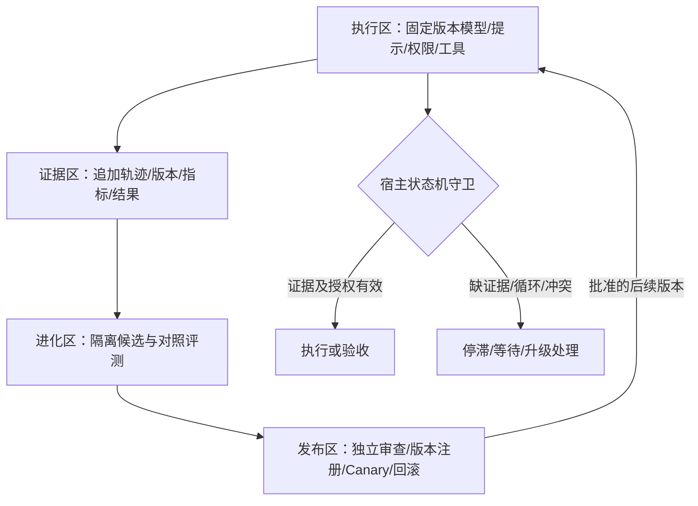

# 四层自我进化与反空转：3.1.1–3.1.4

日期：2026-10-23。按用户要求替代原 3.2–3.5 编号，各阶段独立验收。3.1.1 只实现上下文/经验与当前故障恢复，不宣称后续机制已启用。

## 架构与事实源

百工任务、attempt、租约、版本、独立门禁和验收记录是唯一执行控制面。原生 Team 保持默认关闭的只读投影。进化候选不能修改正在执行任务的配置或事实。

## 版本与验收

| 版本 | 范围 | 具体交付 | 边界 |
| --- | --- | --- | --- |
| 3.1.1 | 上下文/经验与当前修复 | 失效 ref 返回当前授权索引；适用条件进入有界召回；规划审核实际模型及子会话安全选择；有界文件发现与工具失败恢复反馈 | 不自动提升经验、生成工具或修改执行图 |
| 3.1.2 | 技能/工具候选与独立进度抽屉 | 失败聚类；wrapper/脚本/SQL 模板候选；来源证据、隔离运行/回归；会话级进度抽屉、共享 Store、取消/有界重试与过期提示 | 不装载未批准工具，不增加权限；抽屉不成为第二事实源 |
| 3.1.3 | 工作流/路由与反空转 | 服务器验收凭证、全历史结构签名、版本化 DAG、有界重试、可选审核边收益影子分析、停滞恢复 | 不删除安全门禁边，不因低语义变化判成功，不暗改图 |
| 3.1.4 | 治理/Canary | 版本注册、Diff Review、按根会话显式 opt-in 的影子/Canary、样本量、撤回和审计 | 不扩大权限，不取消故障与资源隔离 |

每阶段对照有/无候选，记录成功率、token、p95、人工接管率、误阻断/误放行。样本不足只报观测值，不声称统计显著；正反审核和真实宿主验收后独立发布。

任务进度组件的实现细节和刷新根因见 [独立任务进度抽屉评估](2026-10-23-task-progress-drawer.md)。3.1.2 同时处理会话锚点漂移与请求失败后停止刷新；3.1.3 再按宿主能力评估版本推送。3.1.1 没有把抽屉标记为已实现。

## 3.1.1 当前能力

复用 `ExperienceRepository` 的候选、独立复核提升、去重和有界存储。本轮只将适用条件前 2000 字符加入词法召回；完整适用/排除条件随结果返回，命中不代表适用。未审查、已弃用、过期和同任务经验不作为复用结论；盲审不接收作者经验/过程。

失效上下文返回 `ok:false` 与当前任务授权材料目录，没有正文、旧游标、批准或执行凭证。错误摘要、跨任务、过期版本和盲审禁止内容仍拒绝。有效持久 ref 重启后应可读取，缺 ref 不等于状态丢失。

## 状态机守卫与验收凭证

### 用户授权交互（本轮追加需求）

3.1.1 先强化天枢指引：真正缺少用户决定时，使用现有 `tool-ask-user` 插件的模型工具 `ask_user_question`，提供操作、路径/范围、理由、影响和清晰选项；不能只反复输出「等待历史读取权限」。已有授权先复用，不重复询问。活跃子智能体按宿主限制不直接提问，由天枢统一提出。

3.1.3 把交互纳入运行时：`ACTION_REQUIRED → QUESTION_PENDING → ANSWERED/DECLINED/CANCELLED`。问题 ID 绑定 task/attempt、合同版本和具体操作摘要，未决问题去重。未获答复仅挂起依赖节点，其他已授权无依赖工作可继续；定时等待、跳过或取消绝不授予许可。真实用户回答经宿主来源进入需求历史，过期版本答复须重新核对适用范围。持久化恢复未决问题时不能自动重新发送同一问题或当作已批准。

权限策略拒绝与用户授权是不同事实：明确的私有状态禁止、旧版本、无证据和租约冲突不能通过一个同意选项绕过。应答通道不可用则返回清晰恢复条件并保持检查点，不发起自问自答循环。回归覆盖回答、拒绝、跳过、timed pending、重启、并发重复请求及旧版本答复。

现有服务器门禁、版本/证据和租约守卫继续有效。3.1.3 统一现有验收记录为不透明凭证 ID，不新增可绕过的完成入口。独立验收模块核实证据后签发，绑定根会话、工作区、task/node/attempt、需求/合同/流程/题目版本、artifact digest、适用的 commit SHA、审核身份、指标和证据引用。非 Git 项目明确 SHA 不适用，SHA 不能描述未提交工作区。

服务器核对记录来源、未撤销、当前版本/实际摘要及状态迁移，不能信任 Agent 自填 token 内容。同进程可复用持久记录与不可预测 ID，无需新增签名依赖。重复提交幂等，撤销/跨任务/旧版本拒绝。所有原生 complete 或工具入口仍须经过唯一权威函数。

## 数学假设与反例

### 相似度只是诊断

进展向量以真实证据槽位、独立测试结果、产物摘要和问题数为主；嵌入距离、groundedness 评分仅辅助。`x_t=1-1/(t+1)` 相邻差趋零却每步不同；固定错误答案也可距离为零。低变化不保证有限步停止或正确。没有正定函数及单调下降证明，不称为 Lyapunov 稳定性证明。

连续 k 个窗口低进展产生 `STALLED` 或有界恢复，不能产生 `COMPLETED`。0.1、55% 等阈值必须校准，不能当通用常数。等待真实工具、网络或用户反馈不算语义空转。

### 全局新意守卫

固定任务/合同/图版本下，设可判定结构状态集合 S 有限，大小 N，且后继状态必须与**全部历史**状态不同。抽屉原理保证至多 N 个互异状态，从初态起至多 N−1 次新状态迁移。若使用 ε packing number，必须所有已访问状态两两间距大于 ε；仅相邻非零不足以阻止 A→B→A。

固定长度摘要索引平均 O(1)，构造签名仍为 O(结构大小)，全局历史空间 O(H)。签名绑定版本、产物、证据槽位、未解决问题，排除时间戳/自述噪声；碰撞可疑时比较规范原文。哈希不是语义等价证明，近似检索只能建议停止或升级。容量耗尽显式 `EXHAUSTED`，不能丢弃旧历史却继续宣称全局保证。

仅观察长度 w 的窗口无法区分无重复新状态轨迹与 w+1 个状态循环的局部重复模式；但这不排除某些窗口检测器靠保守误停而总能终止，不能把它称为所有窗口检测器均不终止。用户提到的 “Termination by Novelty” Lean 仓库/版本尚未独立定位，不宣称复现；这里仅采用上述明确假设下的有限集合论证。

### DAG 与受控迭代

Kahn 环检测/拓扑构建 O(V+E)，用入度、后继表及队列游标，避免反复全图扫描和数组 shift 搬移。DAG 仅在节点激活有界时保证有限执行：每节点最多 r 次重试，固定图至多 `(r+1)V` 次激活；无限重规划仍可能不终止。

评审修复展开成有限层 DAG，耗尽后 `ESCALATE`，不能把失败标成完成。长期目标按可恢复阶段/检查点推进，不用任意短截止切断有实际进展的 Agent。真实需求变更显式新 epoch 并保留前序审计；重复改卡不得清空反空转历史。

### 审核边收益

收益来源于独立测试通过率、证据覆盖和产物改善，不取被审者自评分。两个周期不足以证明统计显著。先影子记录可选咨询边，降低优先级或换独立审查者；权限/风控/验收/盲审等必要边不可自动裁剪。任何有效依赖变更产生新图版本并重新准入。

## 数据、发布与回滚

证据保留追加来源，候选记录触发合同、角色、模型/工具版本、diff、成功/失败对照、退出码、边界与回滚点。原始证据与结论分离。3.1.2–3.1.4 的 schema/存储迁移单独设计，本轮不引入嵌入服务、历史签名大表或全历史两两比较热路径。

负向回归覆盖 A→B→A、长周期、版本更改、重启、取消、迟到工具与历史容量耗尽。Canary 若出现跨任务读、盲审泄漏、门禁旁路或重复副作用立即撤回。每次发布独立 tarball、manifest/校验和，并验证唯一宿主与匿名下载，不覆盖旧版本。

参考：[TypeSafe 文档索引](https://docs.typesafe.ai/llms.txt)。类型化概率判断用于辅助，确定性规则仍由代码执行；置信度不是正确性证明。
