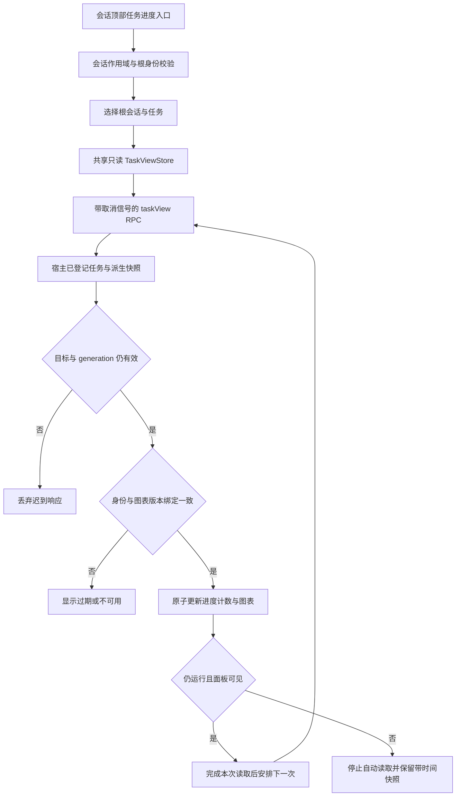

# 任务进度抽屉与刷新链路规划

日期：2026-10-23。状态：只读评估与后续计划，尚未实现抽屉。建议 v3.1.2 完成独立进度入口与刷新修复；提交状态推送和更深的工作流联动放在 v3.1.3。v3.1.1 只收入本计划，不在发布验证阶段追加布局重构。

## 1. 结论

可以把当前 `0/9` 进度、状态统计和图表视角放入会话顶部按钮打开的可收起抽屉，避免它依赖聊天中某条任务卡的垂直位置。聊天记录保留任务卡原始工具结果和“查看当前任务”入口。

抽屉解决的是展示位置和访问入口；它不会自动修复停止轮询、未取消的挂起 RPC、冷恢复未登记或旧任务绑定问题。这些刷新原因必须同时处理，否则同样会在新抽屉里停留在旧状态。以下结论来自当前源码，尚未把用户现场的每一次不刷新定位为同一原因。

## 2. 当前实现证据

| 链路 | 当前行为 | 对新方案的约束 |
| --- | --- | --- |
| `client/task-flow.js:35` 附近 | 从持久 `tool/result` 文本识别 `task_id` 与 Mermaid；同一 taskId 形成任务节点 | 历史可见窗口中没有任务卡时，不能靠扫描可见聊天完整枚举任务 |
| `client/task-flow.js:340` | 仅注册 `conversation.chat.node` | 当前位置依赖任务工具结果的聊天锚点，没有独立的会话进度入口 |
| `TaskFlowRow` | 每个已挂载节点维护自己的 view、loader、poller、SVG 与选中视角 | 不能将原组件同时放到抽屉和 inline 后各自继续轮询 |
| `createTaskPoller` | 成功响应后等待 5 秒再读；页面隐藏时不发读请求；错误或 15 秒超时后停止 | 单次短暂网络错误就足以停止自动更新，直到手动刷新或 Effect 重新触发 |
| `createTaskLoader` | 每个组件最多一个未结算 transport；后续读取等待旧 Promise | 当前本地超时没有取消底层 RPC，旧请求不结算时手动刷新仍可能排在它后面 |
| `TaskFlowRow` Effect 依赖 | `sessionId/taskId/data.seq/loadTask/refresh` | 普通聊天继续不保证改变任务 seq，不能假定新消息总能重启已停止的刷新 |
| 终态轮询 | `accepted` 或 `decision=incomplete` 后停止 | 终态任务被用户明确更新合同后，应由新的版本/任务事件重新激活刷新 |
| `getTaskFromRpc` | 校验 taskId | 相同 `T-1` 可存在于不同根会话；共享状态必须额外绑定 rootSessionId |
| `getDiagramBundle` | 校验 taskId、需求/合同/流程三版本、视角集合与进度守恒 | 必须保留；绘图不能批准新版本执行 |
| `src/service.ts:getTaskViewForRpc` | 要求内存中已登记且具有 rootAgent 的百工根会话；派生当前视图，不发布合同或审核 | 宿主重启后仅打开历史页面，不必然已有可读任务；抽屉不能自动激活执行、补写状态或冒充授权 |
| `src/task-diagrams.ts` | 进度只计算有当前版本、角色和 attempt 唯一有效交付的委派节点；历史图保留最近 32 条 | `0/9` 是节点比例，不能被解释为工时、正确率、总业务目标完成度或验收通过 |

已核对 DSH 0.2.1-rc.2 的公开类型：`conversation.session.header.actions` 与 `utilities` 都是会话作用域扩展位；`connection.rpc.call(channel, endpoint, payload, signal?)` 支持调用方取消。应复用这些公开能力，避免修改宿主聊天布局或直接访问私有事件存储。

## 3. 最小设计

### 3.1 展示层

- 会话顶部增加“任务进度”按钮；仅登记过的百工根会话显示完整入口。
- 桌面从右侧展开，窄屏使用全宽对话面板；采用宿主公开的对话框/焦点管理原语。抽屉样式能力在实施时核对，不以覆盖宿主私有 CSS 实现。
- 抽屉显示任务选择器、当前任务标题、三版本、最近成功读取时间、连接/过期状态、完成节点比例、状态计数、审核与验收状态、图表视角、源码和手动刷新。
- 进度、计数与图表来自同一个经验证的 taskView 快照；禁止分别推算后拼接。
- 聊天节点保留真实历史文本和紧凑入口，明确“记录时状态”；抽屉明确“当前只读投影”。先不删除用户已有历史图表。
- 关闭抽屉不改变任务、租约、委派、审核、模型或长期目标。Escape 关闭、焦点回到触发按钮，图表支持键盘滚动；不抢走对话输入焦点。

### 3.2 状态与数据层

只新增轻量客户端 `TaskViewStore`，不引入 Redux、新数据库或第二套工作流引擎。组件只订阅和渲染，所有读取、取消、重试和迟到丢弃由 Store 处理。

缓存键使用 `(rootSessionId, taskId)`，不能只用 `T-1`。每个目标具有递增的客户端 generation，记录当前读取序号、成功时间、三版本、snapshotDigest、错误和新鲜度。新请求返回必须同时满足：目标键一致、generation 一致、任务身份一致、图表绑定与任务视图一致。不同目标或已卸载的旧结果丢弃。

三版本用于绑定合同，不用于比较同一合同下运行进度的新旧；运行状态会在版本不变时前进。MVP 使用单飞和 generation 排除乱序；将来增加推送时，应采用真实提交序号，而不是把时间戳或模型自述当作单调状态版本。

当前 `taskView` 要求已知 taskId。完整多任务选择器建议增加只读 `swarm.taskIndex`，只返回已授权根会话下的 `{taskId,title,binding,status}` 摘要，避免依赖可见聊天历史。返回值明确包含 `rootSessionId`；必要时追加 workspaceId 供身份核对，但不能凭浏览器传入的 workspaceId 扩权。

任务正文仍复用 `swarm.taskView`。旧服务没有索引能力时，仅展示可验证的历史任务入口并说明“任务目录尚不可用”，不猜测最近的 `T-1`，不自动创建新任务代替旧任务。

### 3.3 刷新与异常

- 打开抽屉、切换任务、页面恢复可见、连接恢复时立即读取；运行中成功后按 5 秒间隔读取，始终只有一个在途请求。
- 15 秒只约束只读展示 RPC，必须实际调用 AbortController 取消 transport，并在 finally 清理单飞锁；它不取消任何智能体、模型请求或长期目标。
- 若旧宿主 transport 不支持或未遵守取消，保留有界的待确认状态，不能靠不断创建新请求绕过旧锁而积累无限挂起请求。降级提示“连接尚未恢复”，保留人工刷新/重新连接入口。
- 临时网络失败允许最多 3 次退避读取，例如 2、5、15 秒；耗尽后暂停并等待明确刷新或连接事件。401/403 不反复重试，不通过切换 sessionId 绕过权限。
- 错误后保留上一份已验证快照，明显标注“已过期”和成功时间；不能清空 view 后把已完成或阻塞任务误画成“待审核”或 `0/0`。
- 终态在取得最后一份验证快照后停止周期请求；重新打开、明确合同更新或相关状态事件触发一次新读取。`incomplete/recorded` 显示为未完成，不画成 accepted。
- `stateRefreshRequired`、旧绑定、任务未登记和权限拒绝分别解释；任何刷新动作都不自动复审、降低阈值、修复任务状态或触发业务执行。
- 宿主重启后，如需要冷恢复只读展示，应独立设计“受支持的元数据核对与持久只读恢复”。持久状态不存在时明确不可恢复，不能把内存态历史聊天当作当前权威任务。

## 4. 安全、隐私与版本兼容

- 首版完整抽屉限定百工根会话。在御史、复核、算衡验算和规划审核子会话中，不自动映射父会话并展示作者交付、其他审核结果或受限证据。
- `taskView` 当前包含审核与委派信息，不能仅靠客户端把部分字段隐藏后宣称隔离成立。若将来支持子会话摘要，新增服务端字段白名单与既有绑定/角色授权检查，独立验证盲审负向用例。
- 所有 RPC 沿用宿主连接鉴权，浏览器只传真实地址和任务标识；不提供任意文件、私有账本、提示词或凭据读取入口。
- v1 快照读取、原始任务卡与现有五图保持兼容；编排视角仍是可选第六图。新面板是只读呈现，没有新的完成、委派或审批入口。
- 使用可选配置 `agents.taskProgressPresentation: inline | drawer` 分阶段启用；配置 schema 和文案随实现提交。先默认保留 inline，真实宿主与兼容回归通过后再调整默认值。
- 不新增生产依赖；若宿主缺少所需公开扩展位，保留原 inline 呈现，不修改宿主 bundle。

## 5. 性能与复杂度

展示位置改变不降低后端计算复杂度。当前 `getTaskDiagrams` 在截取最近32条历史前，会遍历并排序本任务全部委派，单该排序已含 `O(D log D)`；完整 taskView 还处理门禁及完整委派视图，不能宣传为 `O(1)`。

MVP 的性能约束：

- 关闭抽屉后新增周期 RPC 为 0；只对当前可见任务轮询，已缓存任务不同时轮询。
- 打开且运行时每任务每分钟至多约12次成功周期读取，最多一个在途请求；主动切换与人工刷新另计并合并。
- Store 缓存最多8个任务，按最近使用回收；不在浏览器永久保存完整审核正文和证据。只缓存所需视图，避免每个聊天节点持有副本。
- 当前只渲染选中的图表；同一目标、同一 sourceDigest 不重新解析和生成 SVG。关闭面板停止绘图；保留现有 strict、安全 SVG 检查与本地 Mermaid 懒加载。
- 不为刷新而重新编码全量状态或重新计算全库哈希。服务端缓存若需要引入，应绑定真实提交版本并在修改时失效，不能只用三合同版本缓存运行进度。
- 分别报告 RPC、响应大小、JSON处理、Mermaid生成及面板交互耗时。使用0/100/1000条历史委派评估累积成本；本地面板交互可先以 p95≤200ms 为目标，最终基线以真实测量记录为准，不把它等同业务执行性能。

后端摘要、按提交失效缓存及可恢复状态推送可放在 v3.1.3；不要为了抽屉先构建全量事件总线。

## 6. 验收

1. 对话持续追加、压缩、分页和滚动时，入口位置稳定；抽屉的图表视角和任务选择不随普通新消息重置。
2. 同根多个任务、两个根各有 `T-1`、快速切换工作区与子会话时不串数据；旧 Promise 迟到不能覆盖新目标。
3. 运行→失败→受控恢复→完成的真实任务中，统计、节点状态、三版本和 snapshotDigest 来自同一宿主快照。
4. 单次网络中断可有界恢复；永久挂起 RPC 被取消且锁释放，重复手动刷新不积累请求；旧宿主不支持取消时明确降级。
5. accepted/incomplete 后无周期请求；重新打开或新合同产生后能重新读取，且 incomplete 不被展示为验收通过。
6. 宿主冷恢复、任务未登记、旧 ref、旧版本、权限拒绝和错误摘要均显示准确边界，不自动执行恢复或绕过门禁。
7. 盲审子会话不出现父任务作者内容；跨根 taskView、taskIndex 越权请求由服务端拒绝。
8. 32节点/64依赖、32条展示历史、0/100/1000条累计委派与窄屏下完成真实性能记录；关闭抽屉后确认无定时RPC和残留监听器。
9. 使用 agent-browser 记录 DOM、请求次数、页面/控制台错误、截图及开关抽屉的焦点行为；真实宿主版本至少覆盖已安装 rc.2 与项目承诺的旧宿主兼容范围。
10. 保留回滚开关；切回 inline 后不改任何任务状态，导出仍是版本绑定的只读快照。

## 7. 实施边界

| 版本 | 范围 |
| --- | --- |
| v3.1.1 | 当前规划审核模型显示、换模竞态、上下文和工具错误恢复补丁；附本计划，抽屉尚未实施 |
| v3.1.2 | 独立入口/抽屉、共享读取 Store、取消与迟到保护、明确过期状态、最小只读任务目录；与技能工具计划分开提交和验收 |
| v3.1.3 | 在收益与复杂度验证后追加真实提交推送、摘要缓存和工作流刷新联动；继续保留轮询降级与盲审隔离 |

这是待实施设计，不是已经通过真实宿主验收的新功能。实施前还需由正反两路审查确认范围、身份隔离、取消语义和实际测量基线。
