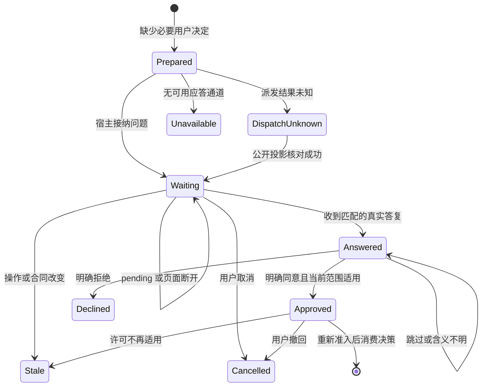

# 3.1.3 授权询问、等待与恢复运行时评估

日期：2026-10-24。状态：只读源码核查与实施计划；未实现下述授权状态机，未修改运行中宿主。范围为百工受管理任务的用户决定链路，不新增第二套宿主审批或目标控制器。

## 1. 结论与实际缺口

3.1.1 已把“确需用户决定时调用 `ask_user_question`、不反复自问自答、子智能体交天枢询问、pending 不算同意”写入 `src/role-registry.ts:358`。这是模型指引，尚不能保证重启、连续目标自动续轮、重复工具调用和并发答复下的行为。

建议 3.1.3 在现有任务服务、任务锁、宿主 userQuestions 和公开目标生命周期接口上补运行时守卫。业务授权与宿主工具审批分别成立；前者不能提升后者的 `never`，也不能替代独立验证、规划门禁、租约及版本绑定。已存在且范围匹配的授权应复用，不为了形成形式记录再次询问用户。

## 2. 源码核查依据

相对路径均以本仓库为根；宿主依据为当前本机 `/usr/lib/node_modules/@deepseek-ai/dsh/node_modules/@deepseek-ai/` 中安装的 DSH 0.2.1-rc.2 包，后续实施需重新核对具体版本。

| 位置 | 已有行为 | 实施约束 |
| --- | --- | --- |
| `src/role-registry.ts:358` | 天枢 5a 指引声明问答、等待、不把未回复视为同意 | 不能把提示词当作已实施的硬等待 |
| `src/task-model.ts:58` | 将真实 assistant 工具调用与 tool/result 配对 | 复用身份配对，不把普通 MCP 文本当作授权 |
| `src/task-model.ts:78` | 对 `user-question-reply` 校验来源、callId、问题合同及 answers | 保留拒绝伪造、错配、跳过及未选选项的边界 |
| `src/task-model.ts:110` | 读取公开消息推导接口；缺历史时声明 unavailable | 重启不能仅凭缓存的问题文案补造人类同意 |
| `src/service.ts:681` | 新实质用户需求使 requestRevision 递增并撤销旧审核、验收 | 答复引起的版本变化必须原子协调，不能授权自身被即时标成旧版本后死锁 |
| `src/service.ts:1906` | `taskLock` 内检查版本、重复 request_id、规划与节点准入 | 在同一预约入口加入决策守卫，重复调用走同一 request_id 语义 |
| `src/service.ts:1996` | 延迟投递前重新核对任务、产物和规划审核 | 允许预约后、实际投递前用户撤回授权，最终检查必须再次拒绝 |
| `src/service.ts:1683` | `AcceptTask` 校验版本适用证据、门禁、未结束委派和流程 | 新授权等待状态只能增加完成限制，不放宽现有检查 |
| `src/index.ts:175`、`src/service.ts:2137` | 当前 pre-step 过滤器主要消费重复子任务结束通知 | 尚无持久授权等待检查；单纯过滤消息不能保证整个 goal 不再自动续轮 |
| `src/runtime.ts:89` | 模型请求前已有角色作用域、恢复和路由准入 | 必须在请求与投递边界检查待决定状态，避免每轮“思考等待”仍调用模型 |
| `src/index.ts:187`、`src/approval-policy.ts:37` | 插件审批叠加在宿主工具决策之上，保留 deny/cancel/ask | 不生成宿主许可，不改宿主审批策略，不把用户问答直接翻译成 allow |

宿主公开实现：

- `dsh-tool-ask-user/lib/index.js:180`：timed 模式按当前 schema 读取 `timeout`；`timeout: -1` 转到阻塞 `userQuestions.ask`；`lib/index.js:218` 默认 legacy，legacy 不声明 `timeout`，不能无条件向所有宿主发送该参数。
- `dsh-tool-ask-user/lib/index.js:27`：pending 明确不是跳过、更不是许可；它允许晚到用户答案继续进入原调用。
- `dsh-user-questions/lib/index.js:531`：要求精确的 live root agent；仍被父级持有的子智能体报 `DELEGATED_CALLER`。持久 parent lineage 不等于当前运行时仍为子智能体，身份不能只看 parentSession 字段。
- `dsh-user-questions/lib/index.js:552`：晚到答案按 callId 投递，校验问题集合，重复排队报 `REPLY_QUEUED`；返回 true 表示接纳排队，不等于百工已消费并完成授权校验。
- `dsh-user-questions/lib/index.js:613`：timed 等待超时返回 pending，并在 finally 释放进程内等待；不能用进程内 Promise 当作持久等待凭证。
- `dsh-user-questions/lib/index.js:668`：无应答者报 `NO_PROVIDER`，取消报 `ASK_ABORTED`；timed 无应答者可等到截止再返回 pending，不能以服务对象存在推断用户能看见问题。
- `dsh-goal/lib/types/index.d.ts:67`、`:75`、`:98`、`:106`：宿主提供 get、disarm、pause、resume，修改采用 expected ref；`disarm` 只撤销进程内自动继续权，不改持久 phase。对自动等待优先评估 disarm 或宿主等待生命周期；不能擅自把用户目标标为人工 paused，也不能无授权 resume。冷恢复和 rearm 语义需集成验证。

## 3. 单一事实源与数据结构

建议新增轻量 `src/authorization-wait.ts`，仅包含纯状态转换、记录验证、去重键和许可适用性判断。存储通过现有 FeatureSession/StateStore 扩展，使用现有 `taskLock` 和分段持久化；不引入数据库、常驻轮询器或另一套任务队列。

建议记录：

```typescript
interface AuthorizationDecisionRecord {
  id: string
  rootSessionId: string
  workspaceId: string
  taskId: string
  operationDigest: string
  scopeDigest: string
  requestRevision: number
  cardRevision: number
  workflowRevision: number
  decisionRevision: number
  questionDigest: string
  hostCallId?: string
  hostQuestionIds: string[]
  phase: 'prepared' | 'dispatch-unknown' | 'waiting' | 'answered' | 'approved' | 'declined' | 'cancelled' | 'stale' | 'unavailable'
  answerRef?: string
  answeredBinding?: { requestRevision: number; cardRevision: number; workflowRevision: number }
  reason?: string
}
```

此为接口提案，不是现有类型。去重键至少覆盖根身份、工作区、任务、操作、范围、问题合同、有效授权版本。范围规范化必须按当前工作区和真实对象标识完成，不能靠模糊自然语言相似度判定两份授权等价。

结构化答案只决定对应操作。选择“拒绝”“仅只读”应形成明确限制，不能以“问题已回答”统一转换成 approved。自定义答案存在歧义时保持 answered，提交一个针对差异的澄清，不自动扩大范围。

`answeredBinding` 记录消费原问题答案后、需求刷新得到的新合同绑定；它只能在同一个任务锁事务中由真实答案派生。用户同时提出新业务范围时，相应规划与审核仍需重新执行，不能将 answeredBinding 作为免审令牌。

## 4. 主状态转换表

| 原状态 | 事件与守卫 | 新状态 | 运行时动作 |
| --- | --- | --- | --- |
| 无记录 | 已有授权有效且范围覆盖 | 不新建等待 | 复用来源引用；继续正常审批、版本和租约校验 |
| 无记录 | 确需用户选择且没有匹配授权 | prepared | 在 taskLock 内落盘问题合同及稳定 id，释放锁后调用宿主询问 |
| prepared | 同键并发或重复请求 | prepared / 原状态 | 返回既有记录，不重复创建问题，不额外消耗审核或执行预算 |
| prepared | 确认宿主接纳且获得真实 callId | waiting | 绑定宿主调用，显示操作/范围/影响；阻断依赖动作 |
| prepared | 调用回执丢失、崩溃或无法确认是否已展示 | dispatch-unknown | 进入 reconcile，不能立即重发或假称已提问 |
| waiting | pending、断开页面、无答案 | waiting | 不批准；无独立工作时停止模型与目标自动续轮 |
| waiting / dispatch-unknown | 查询宿主公开问题投影得到同一 callId | waiting | 复用同一提问；不重复弹出新问题 |
| waiting | 原问题、来源身份和版本均匹配的真实答复 | answered | 原子保存 answerRef 与新需求绑定；不直接执行副作用 |
| answered | 明确同意且操作、范围及新合同均适用 | approved | 重跑预约、最终投递、宿主审批和独立门禁；至多消费一次待执行请求 |
| answered | 明确拒绝 | declined | 不执行业务；记录可行替代或终止原因 |
| answered | 跳过、空答案、模糊范围 | answered | 保持无许可；只在确需时澄清差异，不重复同一问题 |
| waiting / approved | 用户撤回或明确取消 | cancelled | 撤销待投递；已发生副作用须回读核对，不自动回滚或重放 |
| 任意有效记录 | 原操作/范围/合同变更，授权不再适用 | stale | 拒绝旧答案批准新版本；保留历史，不丢失原答复 |
| prepared | 无应答者、缺能力或权限拒绝 | unavailable | 一次性报告入口与所需决定，保留检查点；不自问自答 |
| 重启后的非终态 | 公开投影能证明答案已接纳/排队/消费 | 按核对结果 | 使用宿主 callId、消息 id 和任务 decisionRevision 幂等恢复 |
| 重启后的非终态 | 缺少投影或答案身份不可证明 | dispatch-unknown | 明确待核对；提供恢复入口，禁止静默当同意或重复弹问 |

提问、模型网络等待不持有 `taskLock`、工作区写租约或无限占用调度器槽位。记录状态更改、问题派发和外部答案接纳无法跨系统做真正原子事务，因此采用先记意图、幂等接纳、公开投影核对，不宣称网络条件下 exactly-once；副作用仍依靠现有 request_id、attempt 和最终投递校验防重。

## 5. 等待与目标续轮



需要分别验证三个边界：

1. **工具前台等待**：legacy 调用自然阻塞；timed schema 下必需授权使用 `timeout: -1`，而普通偏好询问可以短时 pending。禁止用定时结束当作“默认同意”。
2. **任务调度等待**：只有依赖该操作/范围的节点不可执行；独立且已授权的工作仍可推进。没有 ready 节点时释放资源并显示 waiting-user，不让天枢反复重审、改卡、评分。
3. **长期目标等待**：阻塞原工具 Promise 不代表宿主 goal 永远不续轮。采用宿主公开 get/disarm 与生命周期边界，或经验证的 pre-step 挂起适配；不得偷偷改宿主状态文件。恢复必须由真实匹配答复及当前活动目标身份触发，保留“用户手动暂停/取消、目标被替换、额度已耗尽”优先级，不自动恢复这些状态。若当前公开 API 无法安全自动 rearm，则明确需要用户在宿主入口继续，不能无限生成下一轮来弥补。

对 `agent/request` 的等待应由可取消事件 Promise 或拒绝进入本轮完成，不能在每次模型请求里启动一个永不完成的新等待，也不能通过抛通用异常把正常待用户态显示为运行失败。具体采用宿主哪一公开 pre-step/目标驱动接口，需要隔离宿主实测后确定；本计划不声称当前 API 已支持原子 suspend/resume。

## 6. 完成硬门禁的复用与加强

当前百工并非只有 Prompt 门禁：`src/service.ts:1923` 在预约处校验规划审核；`src/service.ts:2000` 附近在实际 dispatch 前再次核对；`src/service.ts:1698` 至 `:1714` 在 accept 处计算证据和未结束节点，失败返回 blocked。授权等待守卫应接入这些既有入口，不平行创建 `complete_task` 控制面。

后续若引入独立验收凭证，优先采用服务内部生成、绑定任务/需求/合同/流程/产物/证据摘要与策略版本的 receipt，由既有接受函数消费。它不是交给模型拼装的可信字符串；防重放、撤销及提交前 CAS 必须存在。Jev 的概率判断只为输入信号，不能单独签发硬许可。

兼容现有 `swarm_accept` 参数，不向旧调用方强加一个可自行填充的必填 token。内部统一的 `kernelTransition` 只有持有效 server receipt 才能进入 accepted；旧入口可通过当前独立证据查找取得同一 receipt，不能根据 caller summary、模型自述或历史 accepted 记录铸造新许可。待用户、取消和停止只能保留检查点或记录未完成，始终不能转换为 accepted。

需单独评估现有 `AcceptTask` 在 `:1737` 写 acceptance 后，`:1768` 才执行远程 Jev 复评的业务语义：若未来政策规定这次复评也是接受的必需条件，应改为 prepare→独立评估→CAS commit，而不是先标 accepted 再补打分。本评估不把现有复评描述为已执行阻断的准入门禁。

现有 `src/service.ts:1741` 至 `:1766` 已包含任务 accepted 后的经验 addCandidate 和 promoteCandidateWithEvidence 自动流程；后者需独立复核，失败保留候选。后续四层规划中的“不自动提升”应准确指“不允许未经独立复核的自动提升”，不能把已存在的有审查提升流程写成尚不存在。

宿主原生 goal.complete 与百工接受是不同入口；仅拦百工工具不等于拦住所有 SDK/原生目标完成。实施需逐一枚举受管理目标的公开完成 seam，在保持普通会话不受影响的条件下验证覆盖；找不到公开 hook 时声明覆盖边界，不能宣称不可绕过整个宿主。

## 7. 文件、接口与兼容计划

| 文件 | 预期最小改动 |
| --- | --- |
| `src/authorization-wait.ts`（拟新增） | 纯 reducer、授权适用判断、去重及 reconcile 策略；禁止直接发问或提升权限 |
| `src/evidence.ts`、`src/feature-session.ts` | 可选决策记录与分段校验；旧状态没有记录时维持旧行为，不能伪造历史同意 |
| `src/service.ts` | 复用 taskLock、request_id、预约及最终 dispatch 校验、accept 与只读 status；远程 ask 不持锁 |
| `src/host-contract.ts` | 仅增加经过本机公开类型验证的可选 userQuestions/goal capability；缺能力显式降级 |
| `src/runtime.ts`、`src/index.ts` | 受管理根会话的待用户续轮守卫；子智能体只报告缺口；无关普通会话保持原状 |
| `src/task-model.ts` | 复用既有配对验证；必要时支持公开持久问答投影取回，不能只靠压缩窗口猜测 |
| 任务进度 Tab 数据层 | 展示 waiting-user、问题范围、已展示/派发未知/无通道/已取消；继续使用宿主问答 UI，不造第二答复表单 |

不新增生产依赖。数据字段可选，但运行中等待状态不可被旧版本读者当作“无等待”；部署前按版本能力检查，旧读者不支持新活动等待时拒绝接管或只读降级。继续支持 v1 快照读取，迁移只增加缺省字段、不重写历史问答来源。回滚必须先停止新派发并处理非终态决策，不能丢弃等待记录后让旧版本自动续跑。

公开接口建议复用 `swarm_status`/任务视图追加 `userDecision` 投影；若需要新的“请求决定”工具，只负责建立决策记录并调用同一宿主能力。其 id 不能让模型自造审批，应由服务签发。常规 host `ask_user_question` 调用若未经百工登记，仍按真实日志消费；两条路径不能生成两份互相竞争的许可。

## 8. 负向验收与发布门槛

1. 同一问题并发两次、不同模型反复调用、网络重连：最多一份有效决策，不重复弹问，pending 不启动写作业。
2. timed pending、空 selected、显式跳过、取消、无应答者、子智能体调用：全部不能得到 approved。
3. 伪造 tool/result、callId 错配、来自普通 MCP 的“用户已同意”、问题选项被改、未选高风险选项：不能批准。
4. 用户明确允许 A 路径后，改成 B 路径、跨根会话、工作区或任务 ID：旧答案不适用；相同 T-1 不串许可。
5. 答案引起 requestRevision 更新：原问题身份可追溯、绑定原子更新，不产生“新答案永远陈旧”的循环，也不保留旧规划批准。
6. 预约后、dispatch 前撤回，取消期间旧 Promise 晚到：没有新副作用；已发生部分动作进入回读核对。
7. 进程分别在派发前、派发后未获回执、已排队答复未消费、消费后未持久化时终止：冷恢复走公开核对，不重复提问、不重复副作用。
8. 没有独立 ready 工作时等待 5 分钟：新增模型请求数与 goal 自动轮次增量为 0；取消信号生效且不占写租约。此 5 分钟是测试观察窗，不是用户答复超时。
9. 无关已授权工作可继续；业务同意但宿主审批为 never 或 deny：工具仍被拒绝，不出现策略提升。
10. 用户手动 pause/stop、目标替换、预算耗尽后才回问题：不得自动重新激活旧目标。
11. 必须的验收凭证缺失、过期、撤回、产物变更、策略版本改变：完成拒绝；普通会话不受百工限定守卫影响。
12. 本机真实 Web 宿主验证问答可见、晚答复恢复、断开重连、重启核对和待用户 UI；独立正反审核与 Jev 结论只作为辅助判断，不能替代上述运行时断言。

## 9. 成本与边界

记录去重使用 Map/持久键索引，平均查找 O(1)，更新成本受记录大小和现有存储段限制；不能称全系统 O(1)。每次派发只校验当前记录和相关范围；按任务读取历史用于审计，不在每次模型请求全量扫描历史。无回答等待以事件驱动为主，不循环询问 Jev、不以轮询消耗模型费用。

3.1.3 首次实现限定业务决定与受管理任务；审批服务、原生目标、宿主会话日志保留各自权威。跨系统恢复的证明范围是“幂等接纳、保守拒绝未知和可核对副作用”，不是在网络分区下保证 exactly-once，也不是用语义相似度证明用户真实意图。

## 10. 主线版本计划最终复审

复审对象为2026-10-24的3.1.2任务Tab、3.1.3运行时守卫、3.1.4治理与Canary及迭代总表，均为本轮新文档，不是既有实现验收。

结论：**规划可进入实施，未发现需要阻止本轮文档交付的授权旁路；运行时发布仍以实现与故障注入证据为前提。**

| 复审点 | 版本计划现状 | 意见 |
| --- | --- | --- |
| 旧 `swarm_accept` 兼容 | 3.1.3 §2.1保留旧入参，但进入同一独立验证与服务器receipt管线 | 满足；无有效receipt/独立验证不得从summary补签或放行，错误receipt不得静默忽略 |
| 答案导致requestRevision改变 | 3.1.3 §3.1保存questionBinding、answerOrigin、appliesToBinding | 满足；同范围答复原子映射当前授权，旧规划继续失效；不能以防自我过期为名保留旧审核 |
| 派发回执未知与重启 | 3.1.3 §3.1–3.2列RECONCILE_REQUIRED、真实call记录与排队答复 | 满足；没有公开查询能力时保持核对状态，不重复发问、不从聊天摘要猜批准 |
| 目标安静等待 | 3.1.3 §3.2不假设pause/resume，要求模型请求及goal轮次增量为0 | 满足为实施目标，尚非能力证明；当前宿主若无法可靠停止自动续轮，必须阻止该自动等待适配发布，保留受支持的人工停止/继续入口，不能回退到仅Prompt“请等待” |
| 子智能体和宿主审批 | 合法天枢根询问、业务同意不提升never/deny | 满足；实际root按宿主live ownership识别，不能仅按持久parentSession判断 |
| 展示只读 | 3.1.2 §3–4要求单一快照、根身份、generation、无自动派发/验收/冷恢复授权 | 满足；Tab只读不等于服务端盲审隔离，字段白名单与权限需真实负向用例 |
| Canary未答不启用 | 3.1.4 §5限定实际选择或既有明确范围授权，pending不启用 | 满足；既有授权可复用，不能因增加Canary名词反复询问同一许可 |
| 回滚不复活权限 | 3.1.4 §6保留问题/receipt/历史索引，旧读者不兼容时只读恢复 | 满足；撤销、取消与已消费状态不可因切旧版本归零 |

实施时还需明确两个技术验收细节，不改变当前排期：

1. ask派发等待必须释放taskLock、写租约及无用调度槽；取消观察不等于底层作业已停止。受支持能力不足时显式标为不支持，不用重新发LLM轮次来维持“运行”。
2. Canary撤回若在途句柄长期不结算，先设置禁止新派发的fence，按预先约定的观察窗转人工核对或只读恢复；不能强行释放未知副作用租约、重放动作或永久等待后宣称已回滚。观察窗只界定维护升级路径，不是擅自终止有进展的长期业务任务。

本复审未更改源码、配置、版本、已发布资产或运行宿主，也未执行真实问答与授权。

### 10.1 最终Jev结果后的授权专项复核

主线已完成明确payload的实际Jev复审并转交本专项核对：`ask.authorization_safety = 0.69`，`check.no_auth_bypass = 0.92`，classify为“可实施规划”。前者相对其他条目较低，应完整保留为授权运行时仍需实证的提示，不把它换算成真实事故概率，也不以较高的check值覆盖它。两者问题口径不同，均不是宿主行为证明；本专项没有再次调用Jev、重评分或以阈值自动批准。

最终文件已核实两项修正实际落入主计划：3.1.3 §3.2明确缺少可靠公开goal续轮抑制能力就阻止自动等待适配发布，不能退回Prompt等待或编造pause接口；3.1.4 §6明确永久未结算句柄转禁止新派发、人工核对或只读恢复，并报告撤回未完成，不能假称回滚。

据此未发现新的文档缺口，无需为提高分值继续添加控制面或自动化平台。仍作为**实现发布前的条件**保留：

- 在隔离真实宿主验证disarm/rearm或所选公开等待机制，确认无ready工作时模型请求与goal轮次不增加，且用户手动stop、目标替换、预算耗尽优先于晚到答复。
- 验证真实宿主问题投影、晚答复排队及消费身份在重启/压缩后的可核对性；不能恢复callId或真实答案来源时保持reconcile，不重复询问或默认同意。
- 验证版本刷新与当前授权适用性同一锁内落账，以及最终dispatch再次拒绝撤回、陈旧或跨范围同意；问答同意仍不提升宿主never/deny。
- 验证取消/撤回与永久在途作业的fence及未知副作用保留，不把停止观察、超时或停止模型等同业务操作已经停止。

这些条件未满足时相应适配不得发布；它们不阻止本轮规划MD交付，也不能被当前Jev“可实施规划”分类或文档解析通过所替代。
