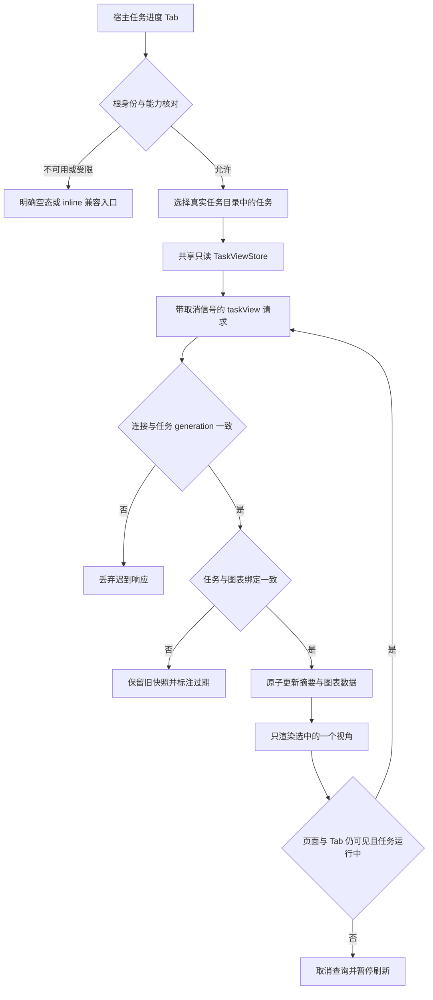

# 任务进度 Tab 可行性与界面架构评估

日期：2026-10-24。状态：只读评估，尚未实现。目标版本：v3.1.2。

本评估使用 `frontend-architecture` 技能中的单一职责、共享服务端状态、按需渲染和可访问性原则。只核对当前源码与本机 DSH `0.2.1-rc.2` 的公开扩展类型和注册实现，不修改运行插件、宿主或版本。旧的抽屉文档保留历史依据；本次用户明确选择Tab，实施契约以[3.1.2版本计划](2026-10-24-v3.1.2-progress-tab-and-tool-candidates.md)为准，本文件提供依据，兼容降级保持原有inline展示。

## 1. 推荐结论与反方边界

推荐在现有“对话 / 轨迹 / Notebook”之后增加“任务进度”主 Tab，而非抽屉。这里可以提供稳定的大幅绘图区域、任务选择、状态摘要、六视角导航及证据说明，避免占用聊天滚动位置，也避免侧栏与抽屉争抢图表宽度。对于长期任务，用户能反复回到相同任务和视角，不因新增对话而丢失位置。

Tab 只是独立入口，不会使旧请求自动取消、过期图表变新或恢复冷会话任务。v3.1.2 必须把共享读取 Store、新鲜度、取消、身份与版本绑定作为同一交付范围。

反方意见成立的部分：Tab 不能与聊天全文同时占据同一主区域；六张图全部同时渲染会增加 Mermaid 布局和浏览器内存成本；公开视角目录是共享注册表，不能仅靠组件返回 `null` 就保证普通会话中不出现 Tab 标题。解决办法是主 Tab 只挂载一个选中图，保留聊天中的紧凑进度/导航入口，非百工与盲审子会话显示明确的受限空态且不请求父任务数据。若实施发现当前宿主没有安全的可见性扩展能力，不改写 DOM，也不引入第二套 Tab 导航。

## 2. 已核对的宿主扩展契约

以下宿主路径统一以 `/usr/lib/node_modules/@deepseek-ai/dsh/node_modules/@deepseek-ai/` 为基准。

| 精确源码位置 | 当前事实 | 实施约束 |
| --- | --- | --- |
| `dsh-client-ui-conversation/lib/types/client/contract/slots.d.ts:259` | `conversation.view` 是 `kind: 'list'`、`scope: 'session'` 的公开扩展位，宿主每次只呈现选中的视角 | 新增普通 View，不覆盖 `conversation.session`、header 或宿主 bundle |
| `dsh-client-ui-chat/lib/client.js:13222` | `chat` 注册到 `conversation.view`，`order: 0` | 不替换聊天 View |
| `dsh-client-ui-trajectory/lib/client.js:8205` | `trajectory` 注册到同一 slot，`order: 10` | 轨迹是否可见受宿主开发者工具设置影响 |
| `/home/zhairy/.dsh/profiles/web/node_modules/@beihaizb/dsh-notebook/lib/client.js:1644` | Notebook 注册 `{name:'conversation.view',id:'dsh-notebook',order:15,label:'Notebook'}` | 新入口建议 `id: 'swarm-task-progress'`、`order: 20`，在当前 0/10/15 三项之后 |
| `dsh-client-ui-renderer/lib/client.js:1203` | list 渲染条目使用 `entry.options.order ?? 0` 并升序排列 | 使用公开 `order` 参数；这里没有另设 CSS 顺序或高优先级抢占的理由 |
| `dsh-client-ui-conversation/lib/client.js:19555` | Tab roster 由 `slots.entries('conversation.view')` 投影，除 `trajectory` 的宿主条件外未见按百工根身份过滤 | 会话作用域不等于标题按角色自动隐藏；首次实现需验证普通会话空态与禁读行为 |
| `dsh-client-ui-conversation/lib/client.js:17987` | header 用 `useConversationViews` 与当前 View 状态生成 `role='tablist'`/`role='tab'` | 复用宿主 Tab，无需监听聊天 DOM 或重排已有按钮 |
| `dsh-client-ui-conversation/lib/client.js:17928` | 视角由 `renderSlot('conversation.view', ..., {only:viewId})` 选择；blank 会话可以不渲染正文 | Tab 非选中时当前 View 不呈现；生命周期仍应明确释放订阅与取消请求，不假设 CSS 隐藏等于卸载 |
| `dsh-client-ui-conversation/lib/types/client/contract/slots.d.ts:469` | View owner 提供 `openView(view,focus)`、`viewRequest` 与 `completeViewRequest()` | 聊天紧凑入口可用公开 View 导航定位任务，禁止 DOM 点击模拟 |
| `dsh-client-connection/lib/types/rpc.d.ts:254` | `call(channel, endpoint, payload, signal?: AbortSignal)` | 只读查询支持真正的调用方取消；前端超时不能只停止等待 Promise |

建议注册形状为 `conversation.view` / `swarm-task-progress` / `order: 20` / 本地化 label。“在 Notebook 之后”针对本次核对的插件组合成立；第三方以后注册其他 `order` 时不保证任务进度永远是全站最后一个 Tab，验收应检查上述相对顺序。若 Notebook 未安装，则直接跟在当前可见的宿主视角之后。无须把 Notebook 设为插件依赖。

本机 Notebook 为 blank 会话另行注册活动 View 与输入区入口，见其 `lib/client.js:1651`。任务进度首版没有已知任务时不必复制这项行为：新建空会话不自动激活任务，不为出现 Tab 而创建任务卡。

## 3. 六视角的信息架构

主 Tab 内布局按“任务选择与绑定 → 状态摘要 → 六视角导航 → 当前图画布 → 对应证据与诊断”组织。

| 分组 | 导航项 / kind | 呈现内容 | 必须保留的解释 |
| --- | --- | --- | --- |
| 规划 | 执行前编排 / `orchestration` | 拆分维度、并行组及编排结果 | 现有数据中可选；没有记录时禁用该项并解释“未记录”，不自动补编排 |
| 执行 | 工作流 / `workflow` | 当前 DAG、节点状态、就绪与阻塞原因 | 默认视角；只读，不通过点击节点实施或跳过门禁 |
| 协作 | 委派架构 / `architecture` | 已记录的根代理与角色关系，可链接已授权成员会话 | 不是部署图或完整外部依赖图 |
| 历史 | 委派记录时序 / `sequence` | 已登记开始与终结事件 | 开始含排队，不能解释为真实模型调用开始；截断明确提示 |
| 证据 | 合同与证据流 / `dataflow` | 合同、上下文、交付与证据计数关联 | 不展示凭据、完整私有提示词或任意文件内容 |
| 状态 | 生命周期快照 / `lifecycle` | 当前状态分布与状态说明 | 当前不是完整状态迁移日志，不补画不存在的迁移 |

六项导航集中在同一页面，不意味着六张 SVG 同时生成。桌面使用可键盘操作的六项视角导航；窄屏可折叠为有明确标签的单选控件。视角名称提供文字，图标仅辅助识别。当前视角保留每任务缩放和滚动，不随普通新消息重置。

摘要展示 `有效完成委派 / 委派节点总数`、独立状态计数、规划与验收状态、三版本、上次成功更新时间、新鲜度。总数为 0 时显示“不适用”，不得算作 100%。`incomplete/recorded`、`blocked`、`accepted` 必须不同。节点完成比例继续注明不代表工时、正确率或验收通过。

图表区提供适应画布、放大/缩小、横纵滚动、文字节点列表、源码折叠、只读快照导出。每个视角都显示 `basis` 和截断信息。不能依赖颜色表达唯一状态。错误使用可读状态区域，并保留此前已经验证的快照与过期标识。

## 4. 共享数据与身份边界

当前 `client/task-flow.js:262` 的 `TaskFlowRow` 各自持有读取器、轮询器、选中视角与 SVG；`client/task-flow.js:340` 只注册聊天节点。直接将该组件同时挂到主 Tab 和每条历史任务卡会产生重复读取与状态副本，不能作为最终实现。

新增轻量 `TaskViewStore`，组件只订阅和渲染，不增加 Redux、数据库或新的工作流引擎。缓存键至少包含宿主连接 generation、根会话身份与任务 ID；同一根的 `T-1` 与其他根的 `T-1` 不得共用条目。连接重建后必须重新核对根身份，不能凭旧缓存断言当前有效。

宿主当前 `src/service.ts:2146` 的 `getTaskViewForRpc` 只接受已登记、具有有效 `rootAgent` 的百工根会话，派生视图而不发布合同。这个检查证明目标是已登记百工根，不单独证明调用者具有某项根级 ACL。新任务目录与响应 envelope 需由服务端返回经过宿主连接鉴权及目标校验的 `rootSessionId`；客户端请求的字符串本身不构成身份凭据。宿主所有者可以查看其有权访问的多个根会话，不能把所有跨根查看一律拒绝当成现有或推荐的访问政策。

- 只读任务目录从根会话的真实状态列举 `{taskId,title,binding,status}`，不通过搜索当前可见聊天窗口猜测最近 `T-1`。
- 进度、状态计数和六图必须原子来自同一 `taskView` 快照；保留 `client/task-flow.js:160` 已有的 taskId、三版本、图表集合和进度守恒检查。
- 三合同版本用于绑定，不代表运行进度的单调序号。同一合同下节点也会推进。MVP 用单飞与 generation 拒绝迟到结果；推送阶段再增加真实提交序号，不能拿时间戳、摘要的字典序或模型自述当单调版本。
- 首版完整任务页限已授权百工根会话。御史、规划审核和其他盲审子会话不得自动映射父根读取作者内容、其他审查结论或受限证据。普通会话显示“本会话没有可用的百工任务”；盲审空态不泄露父任务标题或节点数量。
- 浏览器中由用户主动导航已授权父任务，不等于数据被自动注入子 Agent 上下文；二者分别验收。不能宣称已阻止宿主所有者人工读取或转述内容。Agent 工具沿用真实 `exec.agent` 与服务端角色/绑定校验，不能用浏览器自报 root/session 字符串替换执行身份。
- 后续若需要子会话摘要，必须新增服务端字段白名单与角色授权；客户端隐藏字段不是隔离证明。
- 兼容旧宿主：公开 slot 或目录能力不可用时保留现有 inline 展示和清晰提示，不恢复抽屉，不覆盖宿主私有样式或 bundle。

## 5. 刷新、暂停与性能

现有 `createTaskPoller` 在错误/15 秒本地超时后停止，见 `client/task-flow.js:203`；取消时仅清定时器而没有传入 RPC signal。`TaskFlowRow` 错误时还会 `setView(null)`，见 `client/task-flow.js:287`。这些是新 Tab 必须同时修复的实际链路，不应只迁移样式。

建议契约：

1. 打开 Tab、切换任务、页面重新可见、连接恢复时读取一次；成功后按 5 秒安排下一次，只对当前任务读取。
2. 切到对话、轨迹或 Notebook、页面隐藏、会话切换、组件卸载时取消只读查询并停止定时器；恢复时先确认目标再读。暂停展示查询不停止 agent、任务或长期目标。
3. 15 秒超时为展示 RPC 的取消点，不能扩展成任务执行时限。取消信号实际传递到 transport；若旧调用未结算且 transport 不合作，进入连接待恢复状态，不反复清锁新开请求。最多 3 次退避恢复；401/403 不循环重试。失败保留最近验证快照及时间。
4. Store 缓存最多 8 个任务，LRU 释放无订阅项；不在浏览器持久保存完整证据与审查正文。历史聊天记录无需每条同时轮询。
5. 仅选中图表按 `sourceDigest` 解析；摘要变化但当前图源码未变时不重建 SVG。维持 Mermaid strict 与现有安全 SVG 检查。
6. 终态停止周期读取；重新进入 Tab、明确版本更新或状态事件可读取一次，不能永久冻结旧 `accepted/incomplete` 快照。

每个可见运行中任务约 12 次成功周期读取/分钟；手工刷新和目标切换额外计数并合并。缓存和取消改善重复开销，不把真实 `taskView` 派生宣传为 `O(1)`。当前 `src/task-diagrams.ts:92` 会排序本任务历史委派，含 `O(D log D)` 成本；六图中只有最近 32 条记录进入历史展示，但截断之前的计算仍需衡量。

本轮先测 RPC 次数、响应体积、JSON 处理、Mermaid 生成、Tab 切换及内存；0/100/1000 条历史委派分别报告。公开目标可设交互 p95≤200ms，测量前不宣称已达标。状态推送和按提交失效缓存放到 v3.1.3，避免为一个 Tab 先建设全量事件总线。

## 6. v3.1.2 实施拆分与验收

| 单元 | 候选文件 | 目的 |
| --- | --- | --- |
| 共享读取 | `client/task-view-store.js` | 身份、generation、取消、重试、新鲜度与有界缓存 |
| 独立视角 | `client/task-progress.js` | 公开 Tab 注册、任务选择、状态摘要与六视角导航 |
| 复用图表 | `client/task-flow.js` | 抽取纯快照校验/画布与历史紧凑入口，避免双轮询 |
| 只读目录 | `src/service.ts` 及现有 RPC 注册模块 | 有授权边界的任务目录与响应根身份，不触发执行 |
| 回归 | 对应 client 与 RPC 测试 | 取消、乱序、跨根、盲审和兼容退化 |

候选文件路径用于实施规划，不代表已新增这些运行模块。本评估不新增依赖、不迁移核心状态、不增加委派/完成/授权 API。

验收必须覆盖：

- 真实 rc.2 宿主中顺序为“对话 → 可见时的轨迹 → 已安装时的 Notebook → 任务进度”，停用 Notebook 仍可用；插件停用后 Tab 与监听器随之清理。
- 长对话追加、压缩、分页、切换任务后，Task 选择、视角与当前进度不依赖聊天锚点；两个根各有 `T-1` 时无串读。
- 六项导航完整；旧五图快照的编排项显示不可用原因，不能伪造第六张图；生命周期快照不冒充迁移历史。
- 网络断开、永不结算、取消不合作、迟到返回、冷恢复未登记、权限拒绝分别有明确状态，无无限挂起请求或无限重试。
- Tab 隐藏后新增周期 RPC 与 Mermaid 生成均为 0；多条历史任务卡不各自增加读取。
- 普通/盲审子会话不自动请求父任务；Agent 工具越过真实执行身份绑定时由服务端拒绝。浏览器 owner 在多个已授权根之间正常切换可用，未授权调用方由真实宿主访问策略拒绝，不混为“所有跨根查看必须拒绝”。
- 真实任务状态推进时，进度/节点/版本/图表来自相同权威快照；图表读取不发布审批、不重放业务操作。
- 使用 `agent-browser` 核对 Tab 交互、窄屏、焦点、键盘、DOM、请求数、控制台/页面错误和截图；保留旧宿主 inline 回归。

最终意见：同意以原生主 Tab 替代抽屉，同时保留“单一事实源、一个共享读取层、一个选中图画布、真实新鲜度与服务端隔离”的实施约束。当前属于可行性结论，不是已完成的功能验收。

## 7. 对分版本最终方案的 UI 与数据域复审

复审对象：`2026-10-24-v3.1.2-progress-tab-and-tool-candidates.md`、`2026-10-24-v3.1.3-runtime-guards-and-user-decisions.md`、`2026-10-24-v3.1.4-evolution-governance-and-canary.md` 和 `2026-10-24-iteration-roadmap-and-requirement-matrix.md`。本次仅文档复审，未运行未实现功能的 UI 验收。

结论：**规划方向通过，无必须退回抽屉的 UI 阻断项。以下访问与取消语义必须在主实施契约中保留明确解释，实施验收前不能宣称已经满足。**

| 项目 | 复审结果 | 必须保留的实施边界 |
| --- | --- | --- |
| 共享 roster 与根会话空态 | 通过 | 普通/受限子会话可见 Tab 标题而显示空态；返回 `null` 不能隐藏共享目录标题；不做 DOM 移除 |
| 六导航与可选编排 | 通过 | 六项导航保留，旧五图的编排项显示未记录；不要求后端凭空生成第六图；一个选中画布 |
| 单 Store 与版本 | 通过 | 根身份、连接 generation、taskId 与三版本绑定；同合同下状态变化不能只靠合同版本刷新 |
| 真正取消与挂起降级 | 有条件通过 | AbortSignal 到达 transport；旧 Promise 仍未结算时不能以清单飞锁为手段叠加新请求；同步服务端派生不承诺被信号抢占 |
| 浏览器访问政策 | 需精确表述 | owner 可查看其授权的多个根；重新鉴权不等于跨根一律拒绝。当前 `src/rpc.ts:89` 只校验目标字符串，`src/service.ts:2147` 只核对目标根登记，不能据此声称已有细粒度调用者 ACL |
| Agent 绑定与盲审 | 需精确表述 | `src/tools.ts:79` 从 `exec.agent` 取得真实执行者；UI 读取不自动进入子 Agent 上下文。盲审隔离验收针对自动检索、工具和 prompt 注入边界，不限制人工 owner 的已授权导航 |
| 性能与局部优雅 | 通过 | 保留 `O(D log D)` 现状说明，按需绘图/缓存/减少重复读优先；不为 Tab 引入全量事件总线或新的执行控制器 |
| v3.1.3 与 v3.1.4 数据呈现 | 通过 | 只有后端真实提供的等待、receipt 与停滞状态才能展示；语义/收益观测先影子，不在 v3.1.2 前端猜测后续状态 |

建议主计划在“安全、恢复和复杂度”处明确区分三类主体：宿主浏览器 owner、受限 API 调用者、执行中的 Agent。它们可以具有不同访问范围，不能用缓存 key 的根身份隔离代替权限设计，也不能把安全的用户导航误判成盲审自动泄露。

取消测试应分别验证客户端不再投递结果、transport 请求确实结束、单飞锁释放/保持待恢复，以及后端没有新增重复派生；已有不可中断的 Mermaid 解析或同步派生完成后丢弃结果，与“取消后不再发起新的绘图/查询”是不同断言。

本报告此前“跨根目录和正文请求由服务端拒绝”的泛化表述已在本次复审中修正，避免把现有目标根检查误写为细粒度 ACL 证明。

复核闭环：已重新读取 v3.1.2 主计划，`§3` 第80行补充 transport 实际结束、迟到结果丢弃、单飞锁恢复及同步派生/Mermaid 不被抢占的边界；`§4` 第88行补充浏览器 owner 与 Agent 不同主体、真实 `exec.agent`、现有 RPC 非细粒度 ACL 证明以及人工导航不属于自动盲审保证。上述两项必要澄清已处理，UI 与数据域文档复审通过。此结论仍限方案正确性，不等于尚未实施功能的真实宿主验收。
