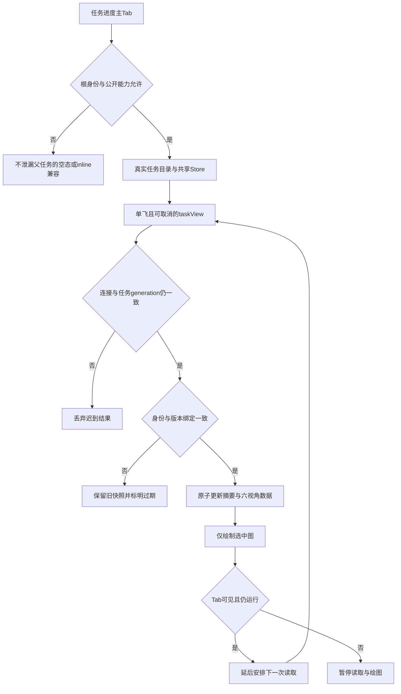

# v3.1.2：原生任务进度 Tab 与受控工具候选

日期：2026-10-24；2026-10-25按Ruflo源码研究修订。状态：已授权进入3.1.2实施，不能凭计划认定部署/发布通过。优先级P0为任务进度主Tab及刷新修复；P1为复用经验机制的工具候选元数据。若P1不能满足隔离验收，不随P0自动启用，不以赶版本为由执行未审查代码。

本文件取代旧抽屉方案的实施入口；宿主依据、精确行号与反方意见见[可行性评估](2026-10-24-progress-tab-feasibility-review.md)。排期以[迭代总表](2026-10-24-iteration-roadmap-and-requirement-matrix.md)为准。

Ruflo采纳依据见[固定提交研究](2026-10-25-ruflo-design-adoption.md)：采用console的导航/读取状态分离、可见时单飞读取、错误保留旧结果与来源化不可执行候选；独立实现，不安装Ruflo或第二执行器。本轮宿主目标为DSH0.2.1-rc.3，rc.2及已承诺旧宿主仍需兼容验证。

## 1. 主入口与取舍

采用宿主公开`conversation.view`，拟注册`id: swarm-task-progress`、`order: 20`、本地化标题“任务进度”。当前对话/轨迹/Notebook为0/10/15，因此顺序为：

```text
对话 | 轨迹（可见时） | Notebook（安装时） | 任务进度

任务选择 · 合同/需求/流程版本 · 最近更新时间 · 实时/过期/离线
有效完成委派 0/9 · 待执行/可执行/执行中/完成/失败/阻塞/跳过/未知
六视角导航
主要图表画布                       选中节点详情（有选择才展开）
状态说明 / 证据引用 / Mermaid源码 / 导出
```

Tab适合大图、长时间查看和稳定选择；代价是不能与聊天全文同时占据主区域。聊天保留原始工具结果、紧凑摘要与“查看任务进度”入口，不能把历史消息改写为当前事实。无需Notebook依赖，不抢占其他插件Tab，不承诺永远排在任意第三方Tab最后。

DSHrc.3公开导航自定义的隐藏/置顶/菜单选择由宿主与用户决定；order20是默认相对顺序，不强制覆盖用户布局或修改DOM来挂回已隐藏的入口。

宿主当前Tab目录为共享注册表，组件返回null不会移除Tab标题。首版明确采用：已授权百工根会话展示完整任务页，普通会话/受限子会话展示不泄露父任务的空态，不发送父任务查询。若将来宿主增加公开可见性谓词再接入，禁止自行修改DOM来隐藏标题。

缺公开slot时保留inline兼容入口；不回退到抽屉，不覆盖宿主bundle。空白会话不自动创建任务、加载父会话或启动模型来“填满”页面。

## 2. 六视角与数据真实性

| 导航 | kind | 主要问题 | 交互与不能声称的内容 |
| --- | --- | --- | --- |
| 执行前编排 | `orchestration` | 为什么这样拆分、哪些可并行 | 展示拆分与并行组；旧数据无记录时显示“未记录”并禁用画布，不补造编排 |
| 工作流（默认） | `workflow` | 当前哪一步、为何阻塞、下一步依赖 | 当前版本DAG和节点详情；点节点不执行、不跳门禁 |
| 委派架构 | `architecture` | 哪些角色与已有子会话协作 | 仅已有授权关系，允许导航已有会话；不是部署架构或无限团队树 |
| 委派记录时序 | `sequence` | 实际登记了哪些委派与结束 | startedAt含排队；不冒充逐模型调用开始或精确工时甘特；显示截断数 |
| 合同与证据流 | `dataflow` | 合同、上下文、交付、证据如何绑定 | 只读引用/计数/版本；不展开凭据或任意私有文件 |
| 生命周期快照 | `lifecycle` | 当前状态分布及合法恢复条件 | 没有迁移日志时只画快照；不能虚构历史迁移 |

六项导航统一存在，不等于同时渲染六张SVG。桌面用文字明确的视角选择器；窄屏用可访问单选控件。图标只辅助，不代替名称。每图展示basis、版本/摘要、数据完整性和截断信息。

进度只计算当前有效委派节点：`completed/total`，状态计数之和必须等于total。total=0显示“不适用”。失败、阻塞、跳过独立统计；节点完成不等于任务accepted，更不表示工时或正确率。`incomplete/recorded`、`accepted`与待授权/停滞必须区别显示；后端未提供的新状态不由前端猜测。

画布保持主要空间，提供放大/缩小、适应、滚动、文字节点列表、源码折叠及快照导出。P0通过结构化节点列表选择详情；仅在SVG节点可安全映射到已知ID时增加点击联动，不添加Mermaid任意click脚本。颜色之外保留文字/形状状态，键盘、焦点和屏幕阅读器沿用宿主Tab语义。窄屏详情在页面内展开，不另造任务抽屉。

## 3. 同一事实源与刷新

拟新增轻量`TaskViewStore`，复用`swarm.taskView`和现有快照校验，不引入Redux、数据库或第二套任务引擎。聊天和Tab不得各自保存完整权威状态或各开轮询。

| 数据 | 契约 |
| --- | --- |
| 缓存身份 | 至少`connectionGeneration + rootSessionId + taskId`；workspace由服务器核对，不由客户端自报授权 |
| 目录 | 拟增只读`swarm.taskIndex`，按已鉴权根返回taskId/title/binding/status及根身份；不扫描可见聊天猜T-1 |
| 正文 | 任务、状态计数和六图来自同一taskView快照；继续校验三版本、snapshotDigest、进度守恒 |
| 新旧判定 | 客户端generation+单飞丢弃迟到响应；三合同版本不是同版本运行进度序号，摘要不能按字典序比较新旧 |
| 展示状态 | 保留最近正确快照、成功时间及stale/offline/partial标记；不能错误后清成0/0待审核 |
| 偏好 | 每任务记住所选视角、缩放/滚动；只存小偏好，不在URL/localStorage保存证据正文、凭据或完整任务数据 |
| 导航 | 用公开openView/viewRequest转到任务；共享链接仅在宿主公开路由支持时实现，不覆盖宿主URL合同 |



打开Tab、切换任务、连接恢复或页面重新可见时立即读；成功后可沿用5秒间隔。15秒展示RPC截止必须传递AbortSignal，不取消Agent、长期训练或业务作业。断网等暂时错误只做有界退避（2/5/15秒为待验证初值）；401/403不循环重试。

对不合作transport，不通过每次超时新开请求绕过单飞锁；进入明确连接待恢复状态。Tab隐藏时取消只读请求，新增周期RPC和绘图为0；关闭Tab不停止业务执行。终态取得最终快照后不周期读，重开/真实版本事件可再读一次。执行推送及commit序号留给3.1.3，MVP不先建设事件总线。

取消验收分别核对transport真正结束、旧响应被丢弃、单飞锁释放或明确待恢复。AbortSignal不抢占已经运行的同步派生或Mermaid解析；这类计算完成后丢弃失效结果，不宣称点击关闭立即终止所有CPU工作。

首版缓存最多8任务作为待测初值，仅可见任务刷新；当前只绘制1张图。每任务每分钟约12次成功周期读，主动刷新另计且合并。旧inline历史保留，但当前轮询只有共享Store一处。单次RPC失败不导致长期冻结。

## 4. 安全、恢复和复杂度

御史、算衡验算、规划审核等子会话不自动映射父根；服务器返回字段白名单先于UI过滤。跨根同名T-1、连接重建、切换工作区都必须重新鉴权。目录/图表刷新不复审、不变更合同、不恢复租约、不自动派发或完成任务。

浏览器登录者与Agent是不同主体：owner可人工查看其已授权的多个root；当前`src/rpc.ts:89`的字符串检查和`src/service.ts:2147`的目标根检查不等于细粒度调用者ACL。新增目录/RPC须按宿主实际身份与访问能力校验；缺细粒度能力时明确边界，不伪造已有隔离。Agent工具继续依据`exec.agent`判断；Tab数据不自动进入子Agent上下文，人工查看父任务也不属于自动盲审隔离的保证范围。

冷恢复遵守真实持久状态和受限交接；仅有历史聊天不能恢复当前执行权。`stateRefreshRequired`明确说明需显式同步，与UI过期不同。3.1.1一次性交接不等于长期持久化；本版本不偷偷开启持久化。

设历史委派D、节点V、边E、响应字节B。当前图表派生含历史排序O(D log D)与校验成本；切成Tab不会变成O(1)。MVP减少重复读取和SVG生成，不机械拆服务端大文件。只有实测RPC成为瓶颈后才增加按真实提交序号失效的摘要缓存；不能只按合同版本缓存执行状态。

性能验收：0/100/1000条委派、32节点/64边、窄屏/桌面测RPC次数、响应体积、JSON/SVG耗时与内存。交互p95≤200ms是待测目标，不能包装成实测结果或INP。图源码未变不重绘；保留本地Mermaid strict与安全SVG校验。

## 5. 技能/工具候选的最小范围

已有`ExperienceRepository`及accepted后的候选/独立证据晋升可复用。P1仅补工具候选的来源、版本/diff、适用/排除、预期权限、测试/回滚和隔离状态；生成的wrapper、脚本、SQL模板先作为候选工件，不自动写入当前执行区或全局tool schema。

借鉴Ruflo的来源标记与不可提升观察，候选来源必须与真实任务/工件引用同行；旧记录缺字段仍按普通经验兼容。工具候选强制`evaluation: unavailable`、`executionEnabled: false`，不能经既有普通经验promote或recall入口意外变成可执行技能/作者提示注入。来源枚举、模型质量分和caller自填SHA均不是独立验证。

候选必须经过静态检查、至少一个失败样本和一个未失败样本、真实隔离评测与独立复核。工作树隔离不是安全沙箱；没有能够约束文件、网络、凭据及资源的执行能力时，保持`evaluation_unavailable`，不得直接运行不可信脚本。用户已有授权仍不能替代宿主工具审批。

不新增Jev限流/费用额度；不靠对同一证据反复评分把候选“抽样通过”。未经审查的工具不装载，有审查的配置提升只作用于后续允许的版本/任务。

## 6. 拟改文件、API与兼容

| 文件（拟定） | 目的 |
| --- | --- |
| `client/task-progress.js` | conversation.view注册与任务页布局 |
| `client/task-view-store.js` | 唯一读取层、取消/重试、身份和新鲜度 |
| `client/task-flow.js` | 复用校验/画布、聊天历史与紧凑导航，移除重复轮询 |
| `scripts/build-client.mjs`、相关client注入声明 | 打包新模块与公开宿主能力，不改生成lib手写代码 |
| `src/rpc.ts`、`src/service.ts`、`src/host-contract.ts` | 只读目录、响应身份、已验证的可选能力 |
| `src/tool-candidate.ts`（新增）、`src/experience.ts`、`src/feature-session.ts`（P1） | 可选候选元数据及验证，不新建可执行工具控制面 |
| `tests/unit`、`tests/integration` | UI/目录/取消/盲审与旧宿主退化回归 |

不计划新增生产依赖。候选字段和只读RPC为增量扩展；v1快照与旧五图可读。若宿主不支持新增展示能力，保持inline；升级打包仍构建lib、检查导出依赖闭包和隔离安装。实施包目标3.1.2，只有本机/兼容验收与实际发布后才能更新完成状态。

## 7. 验收与回滚

1. rc.3真实宿主及rc.2兼容验证默认0/10/15/20相对顺序，尊重宿主自定义入口；Notebook停用、轨迹隐藏仍可使用；普通及盲审会话不读父任务。
2. 六导航可达，缺编排有明确原因；默认工作流可读，生命周期不伪造历史，状态不只靠颜色。
3. 长对话追加/压缩/分页不改变当前任务和视角；两个根各有T-1、快速切换、迟到响应均不串数据。
4. 网络失败、永久挂起、取消不合作、冷恢复、旧绑定与权限拒绝准确降级；隐藏后无新周期RPC，不影响业务。
5. Tab与聊天共用快照，状态总和=委派节点数；incomplete不显示accepted；过期快照不显示“实时”。
6. agent-browser核对点击/键盘/焦点/窄屏、DOM、请求数、脚本错误及截图；旧宿主兼容回归及完整打包校验。
7. 工具候选没有实际沙箱时不执行，盲审不读作者候选，候选失败不影响核心任务提交。

独立展示可通过可选开关退回inline，释放Store监听器/在途RPC；不恢复抽屉，不撤销任务/证据。候选回滚保留来源与失败标记，不删除原始轨迹。实现完成后再做真实宿主、正反Agent、明确payload Jev复审；本文件不是功能通过证明。

参考：[宿主可行性与行号](2026-10-24-progress-tab-feasibility-review.md)、[W3C Tab交互模式](https://www.w3.org/WAI/ARIA/apg/patterns/tabs/)。
