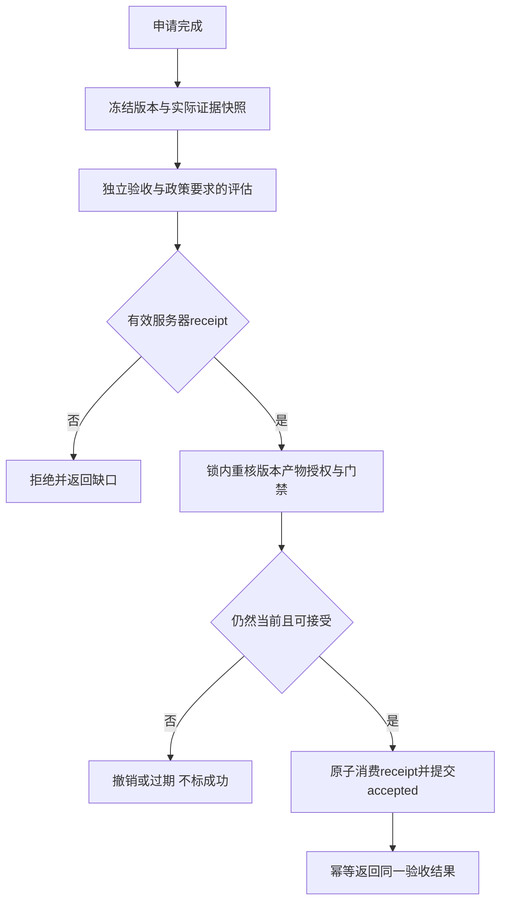
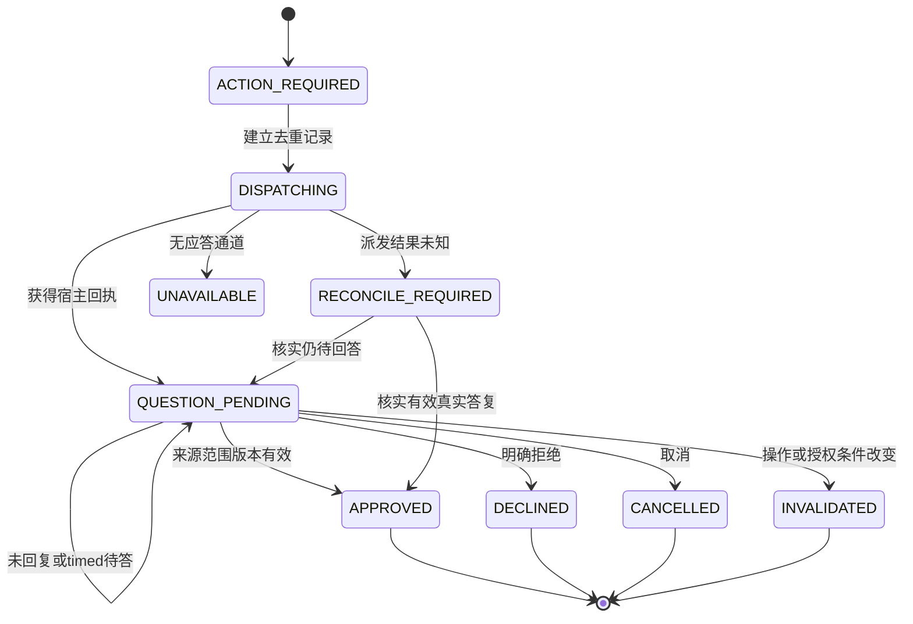

# v3.1.3：硬状态守卫、授权等待与数学反空转

日期：2026-10-24。状态：实施计划，未实现。依赖3.1.2的只读任务页与身份一致的数据层；不依赖新的图数据库、嵌入服务或第二套工作流引擎。

2026-10-25修订：依据[Ruflo固定提交研究](2026-10-25-ruflo-design-adoption.md)，增加“可信权威提交→轻量失效通知→只读投影”的评估方向，吸收领域事件的聚合身份/版本/因果引用及索引复用。通知不是控制命令、授权、receipt或完整事件历史；不引入Ruflo EventStore、第二WAL/数据库或通信拓扑控制器。

数学条件、实际反例与复杂度见[数学专项评估](2026-10-24-mathematical-topological-review.md)，宿主问答与生命周期行号见[授权专项评估](2026-10-24-authorization-waiting-review.md)。本文件是实施与验收契约，不能把这些计划说成3.1.1已具备的能力。

## 1. 当前事实与目标

3.1.1已有服务端任务锁、版本/题目绑定、证据门禁、DAG校验、租约和最终派发检查；当前检查点主要比较未解决项原文与证据ref。它能挡部分重复，不能挡所有A/B改写、引用换ID和反复改卡。

当前`AcceptTask`先保存验收结果，之后追加远程Jev复评；该复评是提示，不是所有模式下的强制凭证。天枢5a已有ask_user_question指引，但没有完整的持久授权等待、去重和goal续轮抑制状态机。

目标是：支持的执行/完成入口统一受代码守卫；真实用户决定使用宿主问答并安静等待；固定阶段内保留全历史结构重复信息；规划与调度分离，失败恢复可核对且有界。安全性保证是“无条件就拒绝非法迁移”，不保证任何开放任务必定成功。

参考实现已定位到[dsh-parallel-dev固定提交的pre-execute钩子](https://github.com/zzd1990/dsh-parallel-dev/blob/ef1546ff8d9c14ccc30fee87f26cbde35efb0e1e/src/host/index.js#L1031)及[纯门禁函数](https://github.com/zzd1990/dsh-parallel-dev/blob/ef1546ff8d9c14ccc30fee87f26cbde35efb0e1e/src/host/gate-decision.js#L43)。可吸收运行时拒绝与纯判定分离；其支持advise、用户豁免，且钩子异常时继续next，因此不能作为“任何路径均不可绕过”的现成证明。本计划不照搬异常放行：完成校验异常时拒绝该完成迁移并保留只读诊断，其他独立安全操作可继续；直调服务入口仍须同一守卫。

## 2. 权威迁移与验收凭证

抽象COMPLETED对应插件`accepted`；某个专家`completed`、某节点`succeeded`、原生goal完成不是同一事实。阶段accepted仍有deferred时，不能把整个长期目标标为完成。

拟在现有验收服务内统一：

\[
\delta(s,\mathrm{accept}(r))=\mathrm{ACCEPTED}
\iff \mathrm{Current}(r,s)\land\mathrm{Authorized}(r,s)
\land\mathrm{EvidenceValid}(r,s)\land\mathrm{RequiredGates}(r,s).
\]

否则拒绝迁移，返回缺口，不靠主持Agent“记得检查”。`verification_token`的含义是服务器签发并保存的**不透明receipt ID**，不是LLM可自填的同结构JSON。TypeScript类型不提供防伪；单宿主可用受限记录和不可预测ID，不先建设新签名服务。

| receipt绑定（拟定） | 校验目的 |
| --- | --- |
| rootSessionId/workspaceId/taskId/nodeId/attemptId | 禁止跨根、同名T-1及旧attempt复用 |
| request/card/workflow/question/policy版本 | 需求、流程、题目或验证政策改变即失效 |
| artifactDigest/evidenceDigest及证据引用 | 当前真实产物与独立证据一致；Git SHA适用时附带，不能替代dirty工作区摘要 |
| 独立签发者/生产者身份及隔离事实 | 作者不能以另一角色名自签独立验收；复用既有身份/盲审检查 |
| 状态、撤销、适用范围、消费结果 | issued/consumed/revoked明确，重复合法完成幂等，撤销后不放行 |

### 2.1 兼容入口与事务

旧`swarm_accept`参数不强制新增必填字段。旧入口必须进入同一服务器验收管线：可以查找当前独立验证记录或发起真正的独立验证，再取得内部receipt；不能从caller summary、Agent自述或旧accepted记录铸造新凭证。若传入伪造/错误receipt则拒绝，不能忽略错误字段再走放行分支。内核的接受迁移必须持有效receipt。

拟定顺序：

1. 冻结当前任务/产物/证据/政策快照；锁内只做有界本地工作，远程评估不占taskLock。
2. 独立模块验证实际证据。若新政策明确把Jev复评列为必需，则在提交accepted**之前**取得该快照的有效评估；保留题目版本、负结论和不可用策略，不反复抽样求通过。
3. 重取任务锁和适用的工作区准入，重新校验版本、产物摘要、未结束委派、未决授权、必需门禁及撤销状态。
4. 同一次权威存储提交中记录receipt消费与accepted，CAS失败返回stale；原始审计按同一事务ID追加。持久化失败不能留下“已通过”的临时返回，也不能重放已完成副作用。

锁与租约只约束受管理写入，不能阻止任意外部进程或OS root改文件。实际哈希/读取稳定性与外部修改检测必须保留；“不可绕过”的威胁模型是可信宿主及受支持API，不宣称限制了操作系统特权所有者。

所有支持的完成路径都要列举：Agent工具、service直接调用、原生适配、长期goal完成入口。`tools/pre-execute`是防护层，不是唯一事实源。找不到公开完成hook时标记该适配未支持，不能声称全宿主已封住旁路；普通非百工会话不受影响。原生Team complete不改变百工验收。用户stop/cancel仍可停止工作，不能因此生成accepted。

## 3. 用户决定状态机

先分类原因：实际缺少用户专属决定才发问；模型不确定、路由错误、旧ref、宿主明确禁止或技术故障不自动变成“缺授权”。已有范围匹配的授权复用；技术故障做一次有界诊断或进入受支持维护入口，不让用户为同一范围反复确认。

提问复用`tool-ask-user`的`ask_user_question`，说明具体操作、路径/范围、理由、影响、允许和拒绝选项。子Agent只报告缺口，由合法天枢根会话提问。业务同意与宿主tool approval分别成立；业务同意不能提升never/deny、扩大工具面或跳过租约/证据门禁。

### 3.1 状态与去重

| 当前状态（拟定） | 事件与合法下一步 |
| --- | --- |
| `ACTION_REQUIRED` | 已有适用同意→记录适用来源；否则原子建立稳定decision ID |
| `DISPATCHING` | 调宿主问答；取得真实question/call ID→`QUESTION_PENDING`；回执未知→`RECONCILE_REQUIRED` |
| `QUESTION_PENDING` | 等真实答复；timed pending/超时保持等待，不重新发问 |
| `APPROVED` | 来源、选项、范围、当前版本均可验证；仍须正常规划/工具审批/最终dispatch准入 |
| `DECLINED` / `CANCELLED` / `INVALIDATED` | 禁止相应动作；可以记录未完成或明确调整方案，不伪装成成功 |
| `UNAVAILABLE` / `RECONCILE_REQUIRED` | 应答者缺失、派发未知、来源不可恢复；显示恢复条件，不能猜同意或自动重发 |

dedupKey绑定根/工作区/任务/稳定目标谱系、operationDigest、路径/资源范围及authorizationPolicyVersion；问题绑定保存当时合同版本及真实宿主question/call ID。调用方随机换问题ID、改同义提示或换模型不能绕过去重。

同意答复可能使requestRevision增加，不能因此让它立即自我过期而循环再问。保存`questionBinding + answerOrigin + appliesToBinding`，在锁内同时核对新需求和原操作范围：同范围真实回答可建立当前授权，旧规划批准仍正常失效；操作/目标被改则重新判断适用性，不能扩大旧同意。

自由文本、空selected、未选择的高风险选项、普通MCP文本里的“用户同意了”、伪造tool/result均不直接授权。复用现有`task-model.ts`真实call/result配对；不从摘要/压缩文本猜人类同意。将来若需要持久问答投影，只能用宿主支持的真实来源。

### 3.2 安静等待与恢复

legacy问答默认阻塞；timed模式中必须等回答的决定使用`timeout:-1`。pending、跳过、取消、无answerer或时间流逝绝不等于批准。不能只停一个Promise却让原生goal继续空白续轮。

1. 只挂起依赖该决定的节点，不占写租约等待用户；有无依赖的已授权ready工作时可继续。
2. 没有ready工作时，核对宿主公开pre-step/goal生命周期能力，使新增模型请求与goal轮次增量为0。不得修改宿主私有状态、伪造Agent.status或擅自调用不存在的pause/resume。
3. 当前宿主不支持可验证的timed待答暂停时，只能使用已验证同时抑制goal续轮的阻塞式等待；若宿主没有可靠的公开抑制能力，阻止该自动等待适配发布，明确不支持，不能退回Prompt“等待”。若连应答渠道也无，返回UNAVAILABLE，通过受支持入口停止自动续轮并说明缺失能力，不编造暂停接口。
4. 重启后按真实question/call记录核对pending与已排队答复；派发成功与回执丢失无法判定时走reconcile，不宣称跨网络exactly-once。
5. 有效答案仅触发一次幂等恢复，重新检查当前goal版本、人工pause/stop、取消、预算与租约；不能用迟到答复重新激活被替换/取消的目标。

此图仅描述业务决定，不把APPROVED等同任务accepted，不替代宿主权限审批。

## 4. 数学反空转：两个身份键与有限保证

### 4.1 切断重复改卡逃逸

采用两类不同用途的键：

- **bindingKey**：完整根/任务/attempt及需求/合同/流程/题目/政策版本，用于授权与证据安全，不能省版本。
- **noveltyKey**：固定目标谱系内的规范结构进展投影，用于识别无净变化；不把时间戳、随机ref、round号或纯revision递增当新意。

novelty投影优先使用稳定义务ID、独立验证结果、证据内容摘要及覆盖槽位、产物内容、未解决finding、有效授权状态和规范图语义。单纯给相同证据换UUID/给节点改名/重复改卡不清历史。真正的新用户需求必须有真实来源并建立显式新阶段；不得由Agent自称“新epoch”重置预算。

状态引用版本用于验证适用性，但相同决策的循环指纹不能只因版本号改变而变新。语义节点ID/义务映射需要服务器保留来源；无法判定两版是否同义时只给诊断，不让LLM裁定自己获得无限新阶段。

### 4.2 可证明命题

固定阶段、固定有限投影`q:S→Q`，`|Q|=N`。已接纳的后继必须满足：

\[
q(s_{t+1})\notin\{q(s_0),\ldots,q(s_t)\}.
\]

由抽屉原理，初态之后至多N−1次新状态迁移。若改用ε-packing，必须所有已访问状态两两分离；仅相邻非零不能排除A→B→A。

这只是固定投影轨迹的有限性，不是语义正确或成功保证。任意产物摘要/浮点抖动/无限新义务并不天然构成实用有限Q。投影要用已声明的义务槽位、测量协议和量化分辨率；保留原始证据，不能把摘要位数有限冒充有效语义终止证明。

仅重复检查最近w个状态会漏过w+1周期；“所有窗口算法必然不终止”的强断言不成立，固定轮次停机就是反例。这里只采用可验证的全历史结构查重，不声称完成了未核验的Lean定理。

### 4.3 进展和停止的工程规则

在已结算的决策/检查点边界检查结构进展，不在每个token或每次合法轮询检查。真实工具仍运行、待网络/额度恢复、待用户时，进入有运行句柄的等待态，不把相同文本判为循环。

检查覆盖主持者无工具结束的轮次、重复规划/审核预约与委派结算；否则只挂委派检查点仍会漏掉主持者自问自答。模型文本写“等待”不构成真实question ticket，不能凭这几个字生成批准；需要决定的事实来自操作政策/权限检查，派发与待答来自宿主回执。传输层重试继续由既有路由恢复管理，不按每个stream attempt生成新业务决策。

重复业务状态还须结合相同控制动作/失败指纹、无新增验证槽位、无在途真实工作。重复后暂停当前轨迹，返回`LOOP_DETECTED`证据、已见签名引用和恢复条件；不能转成accepted。可让合适的独立角色做一次有界诊断，但不能在“谋定→御史→改同义卡”之间无限恢复。原有轮次/资源最后防线保留。

`0.1`、`55%`、连续两轮等没有普适性。余弦距离不是熵；相邻距离趋零不推出序列收敛、有限停止或正确；没有正定函数/下降条件不能称Lyapunov证明。3.1.3只把嵌入/groundedness作为可关闭的影子观察，不默认引入新网络服务。

严禁正负增量互相抵消后把“质量退化”叫稳定。先独立处理质量退化、证据新增、合法等待，再观察相似度。统计阈值与误停评估留给3.1.4。

### 4.4 存储与成本

复用现有增量/分段存储，拟增加按任务谱系的有界签名集合和小型控制记录；定点更新变更键，不能把整个历史Set放进TaskRecord并每轮全量克隆/JSON编码。新增集合必须登记分段校验/恢复能力，不先创建第二WAL或全局图数据库。

固定长度索引平均查找O(1)，构造规范签名O(B)，对象键排序另计；历史空间O(H)。全历史向量逐一比较是O(Hd)，不放调度热路径。碰撞可疑时比较规范结构；近似过滤器/向量近邻不能提供精确历史保证。

达到签名逻辑容量时显式EXHAUSTED/归档核对，不静默删旧项继续宣称全局。容量设计预留取消、未完成和验收记录空间，防止重复出现“诊断状态过大导致所有写入失败”。历史损坏/写入失败保守阻止新的自动派发并提供只读诊断，不能制造accepted或卡死整个只读控制面。无限容量/无限重规划配置下不宣称有限终止。

跨重启保证的前提是可用的受支持持久记录或经过校验的维护交接。内存态且无交接时，不能把缺失历史当作新空集合自动继续，也不能声称已恢复全局守卫；应明确history_unavailable并进入恢复核对。不秘密开启持久化，确需改变保留策略时用宿主询问工具取得一次范围明确的决定。

## 5. DAG、重试与审核边

每个批准图版本冻结，LLM用于规划和必要的新事实重规划；就绪队列、依赖结算和调度顺序由代码决定，不在每节点再问LLM“下一步找谁”。这不等于整个任务只允许一次LLM或取消独立规划审查。

Ruflo的mesh/hierarchical是通信拓扑，百工的DAG是执行依赖，不能混用。可复用角色/后继Map索引思路；动态换边、queen选举或经验权重不允许修改当前批准图。任何影响执行依赖的变更都须新图版本及正常审核，强制依赖不因观测收益低被剪除。

标准Kahn算法O(V+E)，用入度、后继表和队列游标。当前完整验证另有祖先遍历和后继复制，只有测量需要时局部复用索引；不把整个验证器称为线性。并行组只是允许的偏序，实际派发仍受写租约、角色权限、模型资源和依赖约束。

固定图V节点、每节点最多r次重试且恢复不重置额度时，激活上界`(r+1)V`。若最多m次自动重规划，各图≤V，且恢复已计入r或不产生额外激活，粗上界才是`(m+1)(r+1)V`。若每个规划阶段最多h次恢复、每次恢复后最多A次计算激活（含诊断），改用粗上界`(m+1)(h+1)A`，另加有限重规划/恢复和控制动作。无限恢复/重规划会失去此保证，必须有独立的自动激活记录，重复改卡不能归零。合法长任务等待不受这些次数当作短时截止。

评审修复循环展开有限层DAG；最后一次评审通过走正常验收，失败且耗尽才ESCALATE。不能“最后一轮无论通过失败都升级”，那会制造新的受阻。控制动作的确定性边界可用有限重规划/恢复/节点激活的良序剩余量论证，不把无限外部等待时间混为有限计算步。

可审计的候选秩为`R=(remainingReplans, remainingRecoveries, remainingActivations)`，按字典序比较非负整数。普通计算激活减少第三项；恢复减少第二项，只有第二项确实减少才可重新分配第三项；重规划减少第一项，只有第一项减少才可重置后两项。新建工具、问答、评估或恢复句柄必须归属于已扣计数的一次激活，或有限且单独记账的控制预留；不能以“产生真实等待”绕过计数。只有对同一个已登记在途句柄的被动等待/事件观测可保持R，不新发LLM、不重发工具。结算/取消后新建句柄须重新准入；每个句柄的结算迁移单调且有限。

首次必要询问、取消与安全结算具有独立的有限控制预留，避免计算激活为零时无法请求用户或安全退出；预留不得无限补充、重问或创建新工作。上述有界控制迁移与严格降秩的计算激活共同排除无限自动计算，不能保证外部用户/网络在有限时间响应。这些计数约束自动控制轨迹，不是给Jev新增调用/费用额度。结论要求初始值及每次合法重置值有限；配置无限或真实用户建立新目标时，不能沿用当前阶段有限上界。

执行依赖边与历史审核关系分开：

| 边 | 是否可因观测收益下降而删 |
| --- | --- |
| 权限、风险、独立验证、盲审、接口/数据先决依赖 | 不可自动删；缺失只能换等价合格路径或升级 |
| 可选咨询/建议 | 先影子记录，可降低优先级或换合格审查者；改变有效执行依赖须新图版本并重审 |

3.1.3只记录独立测试、证据覆盖、版本、成本及混杂，不因两周期无增益断言统计显著/因果无效。权重衰减与阈值实验在3.1.4做；执行DAG不为“学习”引入回边。

### 5.1 提交后失效通知的可选评估

只在当前权威存储提交成功后，以root/task/真实commit序号发出有界失效提示；图表仍从已鉴权taskView读取同源快照。重复提示合并、迟到/乱序提示不回退；断连、缺口或无法证明连续性时全量重读。不得用墙钟时间或合同三版本假装运行进度序号，不从浏览器通知生成证据/许可。若测量不优于3.1.2可见时轮询，保持原机制，不为“事件驱动”新建常驻消息服务。

## 6. 实施边界与文件

| 拟改文件/模块 | 目的 |
| --- | --- |
| `src/authorization-wait.ts`（新增） | 纯状态迁移、范围判断、去重、等待恢复 |
| `src/verification-receipt.ts`（新增） | 服务器证据绑定、签发/撤销/消费与幂等 |
| `src/progress-guard.ts`（新增） | 规范结构签名、重复诊断、有限恢复计数 |
| `src/service.ts`、`src/policy.ts`、`src/evidence.ts` | 在原预约/派发/accept入口复用守卫，不造第二状态机事实源 |
| `src/feature-session.ts`、`src/state-core.ts`及现有分片适配 | 可选集合的校验、增量更新、恢复、容量与能力版本 |
| `src/host-contract.ts`、`src/runtime.ts`、`src/index.ts`、`src/task-model.ts` | 只接已核实的公开问答/goal能力，最终请求/工具/完成入口一致 |
| `src/checkpoint.ts`、`src/workflow.ts`、`src/scheduler.ts` | 边界检查、稳定义务和有界激活；保持现有写租约 |
| `swarm_status`与任务Tab | 只读显示等待/停滞/凭证适用性，不提供旁路批准按钮 |

无新增生产依赖。旧快照可读，旧工具入参兼容；老数据的accepted保留“旧政策历史”身份，不能冒充新凭证。新活动等待/receipt不能被旧读者忽略后继续执行：能力不兼容时只读或拒绝接管。安全守卫不因关闭学习/展示开关消失。

维护恢复与业务执行分离：不能要求修复失效审核服务的维护任务先通过同一失效门禁。复用经授权、受限、可审计的维护入口做诊断/隔离验证/部署，不给原业务任务免审，也不让任意Agent直接改私有状态。

## 7. 必须通过的验收矩阵

| 类型 | 负向/正向用例与成功条件 |
| --- | --- |
| 完成 | 伪造/撤销/跨任务/旧版本receipt、产物变更、未知副作用均拒绝；重复合法接受幂等 |
| 完成旁路 | 工具、service、原生适配/goal完整覆盖；未知宿主能力明确未支持；普通会话不受影响 |
| 问答 | 未答、timed pending、跳过、拒绝、取消、无应答者、伪造来源均不授权 |
| 等待 | 无ready工作时观察5分钟：新增模型请求和goal轮次增量=0；这是观察窗，不是答复限时 |
| 问答恢复 | 并发重复、派发回执丢失、重启、迟到答复、人工stop/替换目标与授权撤回均无重复副作用 |
| 版本 | 答复引起requestRevision增加后同范围同意可追溯适用，但旧规划不自动复活 |
| 循环 | A→B→A、周期w+1、证据换ref、同义问题、仅增版本/时间戳均不能重置相同谱系历史 |
| 合法进展 | 实际新证据、已声明统计采样槽位、在途长工具及真实外部事件不误判空转 |
| 拓扑 | 有环拒绝；有限层修复最后通过可accepted，最后失败才升级；自动重规划/恢复不无限 |
| 容量与恢复 | 断电/损坏/索引满不丢全历史保证、不阻断只读诊断、不假成功；重启后守卫历史继续有效 |
| 审核边 | 强制边即使观测收益为0也不删除；可选边调整不越权、不暗改图 |
| 安全/性能 | CAS并发、租约、盲审、回滚能力与实际复杂度基准；正反Agent及Jev不替代运行断言 |

发布前必须在已安装宿主和承诺兼容宿主上实测问答等待/晚答复/中断重连、冷恢复、真实任务与长工具，记录未覆盖边界。不能用fixture成功声称所有长期任务必然完成。

## 8. 回滚

先停止新派发、保存检查点并核对在途工具/问答；未决问题不能直接删掉后回旧版本。旧运行时不能理解当前活动政策/等待/receipt时，只读恢复或停机迁移，不自动接管。学习策略、展示和语义启发式可以撤回，必需授权/验证守卫不能作为“回滚”被绕开。Jev不新增本地限流或费用额度；反空转守卫约束重复流程，不等同按成本停止Jev。
