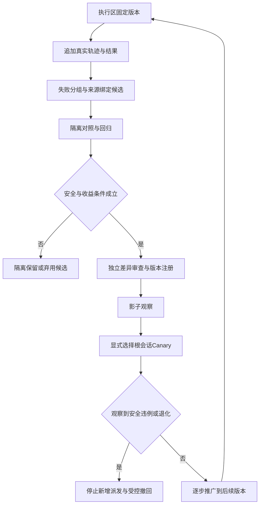

# v3.1.4：四层进化治理、语义校准与 Canary

日期：2026-10-24。状态：后续实施计划，未实现。前置：3.1.2已验证的只读工作区/候选元数据，以及3.1.3真实生效的授权、验收、重复状态与恢复守卫。

2026-10-25修订：吸收[Ruflo固定提交研究](2026-10-25-ruflo-design-adoption.md)中的来源化记忆、retrieve/evaluate/distill/consolidate阶段分离、固定回放与可恢复候选治理。所读ReasoningBank的judge是规则质量评价，不作为百工的独立验收；来源枚举、自填摘要和模型reward也不能签发receipt。优先复用现有经验/评测，不引入AgentDB、HNSW、SONA、联邦或daemon依赖。

本版本先证明候选对当前用例有收益，再考虑扩大自动化；不训练模型权重，不允许进化候选修改正在执行任务的权限或强制安全门禁。

Ruflo的性能目标、默认阈值和单机基准不迁移为本项目事实。任何检索/缓存优化必须用独立参考结果对照，缺测/不确定时不提升；旧经验的来源与适用范围保留，不能通过反复蒸馏把agent_output洗成system_observation。读写权限仍在百工/宿主边界校验，不由经验相关性决定。

## 1. 四层职责

| 区域 | 内容与写入者 | 核心不变量 |
| --- | --- | --- |
| 执行区 | 已注册版本的模型/提示/检索/工具/权限；受控部署写入 | 一个任务阶段的政策与权限固定，候选不能热改当前任务 |
| 证据区 | 服务器追加轨迹、实际调用/测量、成本、用户反馈、业务结果 | 原始来源追加保存；修正另加记录，不能覆盖失败让候选看似成功 |
| 进化区 | 失败聚类、上下文/技能/工具/路由/流程候选及隔离评测 | 候选不是指令或批准；缺真正沙箱则不执行不可信代码 |
| 发布区 | 独立Diff Review、版本清单、影子评估、显式Canary、撤回 | 发布和提升有证据、适用边界与回滚点；不恢复已经撤销的许可 |

复用`ExperienceRepository`、现有分段存储、Git和release manifest，不为个人插件先建设另一套模型注册平台或图数据库。3.1.1已有候选及独立证据晋升，3.1.4补的是评测/治理闭环，不把已有能力说成完全不存在。

## 2. 候选生命周期与权威

拟复用既有candidate/validated/deprecated状态，增加可选的评测状态/发布引用；不把“运行一次没报错”直接映射为validated。

候选记录最少包含：

- 原始任务/稳定目标谱系、需求/合同/图/政策版本、来源证据与失败指纹；
- 基线与候选artifact/config digest、diff、适用/排除范围、工具和模型能力要求；
- 验证者身份、独立审查、测试命令/退出码、数据划分及环境版本；
- 质量、时延、token、实际成本、未知/估算标记和外部故障因素；
- 安全权限差异、启用范围、撤回版本、冷恢复与在途任务处置。

上下文手册、记忆条目、技能和流程候选可以不同载体，但通过同一来源/审核/版本机制管理。未复核内容保持引用材料，不写入system指令；盲审继续排除作者经验、历史评分和同伴结论。提示注入筛查只是辅助过滤，不能授予工具权限。

激活只面向后续明确允许的根会话/阶段。已有用户授权按原范围复用，不能为了形式审批反复提问；授权改变、真实工具执行、配置提升仍经过宿主相应审批与3.1.3最终准入。

## 3. 语义早停的校准方式

3.1.3的结构重复、凭证和授权守卫仍是基础。语义相似、groundedness与审核边收益先影子记录，不因一次模型评分就阻断全部业务。

### 3.1 指标契约

| 指标 | 来源 | 约束 |
| --- | --- | --- |
| 证据覆盖增量 | 已验证义务/槽位的新增覆盖与内容摘要 | ref换UUID不算新增；已声明统计采样槽位可逐个完成 |
| 质量变化 | 独立测试、格式/契约检查、缺陷发现与固定数据集 | 质量退化单独处理，不与正向新意相加抵消后称“稳定” |
| 相邻距离 | 明确版本的可选嵌入/特征与距离定义 | 余弦差不等于熵；无分布定义不宣称信息熵归零 |
| groundedness | 明确来源与题目的窄判断 | 区分证据缺失、模型误判、服务不可用，不把置信度当正确率 |
| 等待事实 | 实际工具/网络恢复/用户问题句柄与事件 | 合法等待不作为低进展样本，不消耗新的推理轮次 |

可研究的归一化进展分数写作`p=w_g*g+w_d*d+w_e*c`，但权重、尺度、缺测及窗口k/阈值ε必须在数据上校准。该式是启发式排序信号，不提供Lyapunov、正确性或有限停止证明。没有嵌入能力时保持纯结构方案，不能为了这个分数强加新在线服务。

优先使用低成本可观测量；不默认每轮再调一个大模型评价“大模型有没有进展”。Jev可以提供窄判断，但不对同一不变证据重复采样直到通过，也不把便宜等同零时延。保持用户既有Jev不限调用预算/费用上限策略，流程去重属于状态守卫，不是新增限流。

### 3.2 对照与统计

1. 固定样本与基线，覆盖简单任务、跨模块任务、算法、重复审核、长期工具、待用户、模型故障和错误恢复。
2. 先把已记录轨迹脱敏后冻结，控制策略离线回放的是**决策**，不能回放下单、写文件或其他真实副作用。
3. 同一轨迹对各策略使用相同产物序列；缓存绑定相同题目/模型/证据版本的评估，避免每个策略重新调用裁判造成成本偏差。
4. 开发/校准/验收样本分开，防止用验收集调ε、k和55%等阈值。预先约定最小可接受效应与误停代价，不能测试后换标准。
5. 报成功/误放行/误停、token、p50/p95、人工接管、重复决策数及观察样本量；实际供应商quota读取与估算成本分别标记，unknown不当0。

30个样本中0次误停不证明误停率为0。仅在独立同分布二项近似成立时，0/n的单侧95%上界可写为`1-0.05^(1/n)`；n=30时约9.5%。相关轨迹、重试和同题样本不能当作独立样本堆大n。可以按任务分组做配对区间/回放比较；数据不足时保持影子或人工判断，不宣布统计显著。

## 4. 审核边的观测收益与衰减

将“因果有效性”改称**观测收益**，除非后续有能识别因果的实验设计。下版质量改善可能来自其他审查、任务变化或测试集变化，两周期不提升不能普遍证明零效果，`p>0.05`也不能证明等效。

只对可选咨询关系做实验：

\[
w_{t+1}=\lambda w_t+(1-\lambda)u_t,\qquad 0\le\lambda<1,
\]

其中u来自有可比基线的独立观测收益及明确归一化。没有可比数据则保持unknown，不衰减成“无价值”。低权重最多降低可选咨询优先级、换合格审查者或建议人工升级；不是直接删强制依赖。相同基线下连续u=0会衰减，只说明该更新规则的性质，不是因果证明。

权限、风控、独立验收、盲审、接口/数据先决条件永不自动裁剪。需要更换等价审查路径时创建新图版本、重新准入并保留旧事实。最后允许评审通过时正常验收，不能无条件推到EXHAUSTED；失败且有限恢复用尽才升级。

历史审核关系可以有重复反馈，执行DAG仍无环；二者不是同一个图。无需给每条执行边建设机器学习服务，先复用边界事件生成离线收益表。

## 5. Canary 与激活

按“影子 → 一个明确选择的维护根会话 → 一个经授权的只读业务阶段 → 扩大范围”推进。个人环境样本少时不伪造5%流量统计；需要比例分组时再采用可重复的root ID/cohort版本分配，同一根固定策略。

- 影子只记录建议，不改变路由/权限/任务状态，不重复执行工具。
- Canary对象、策略版本、观察窗、停止条件由实际用户选择或既有明确授权确定，使用tool-ask-user，不因未回复启用。
- 执行区政策在阶段内固定；学习候选不热改已发出的请求，也不换掉盲审隔离。
- 安全违例（未答即授权、凭证旁路、跨任务泄漏、重复副作用）任何一次都停止扩大并进入受控撤回，不能被token或时延收益抵消。
- 一般退化先按预设基线核对，区分供应商宕机与策略失误；样本不足不自动全量推广。

新模块的停止条件不可借用全局route-health写入把所有模型通道拖死。候选元数据/评测失效时隔离候选，稳定执行与只读诊断保留；安全事实无法确认时相应动作保守暂停。

## 6. 版本、存储与可恢复回滚

注册表首先使用版本化清单/已有候选记录，指向Git commit、配置及工件摘要，不增加第二数据库。真实数据继续走现有按任务分片/增量写入；评测轨迹大正文作为受限引用，不重新塞进热状态。

撤回候选时：停止新的候选派发，等真实在途句柄结算并核对副作用，保存活动政策/问答/receipt/历史索引检查点，再恢复兼容版本。回滚不能删除未决授权后恢复自动执行，不能让旧读者把新状态当作无等待。没有可验证的降级迁移时只读恢复，不能以“保持在线”为由旁路新安全守卫。

在途句柄永久未结算时，禁止新派发并转人工核对/只读恢复，报告撤回未完成；不无限等待后宣称回滚成功，也不释放副作用未知的租约让替代执行重复操作。

证据与失败标记保留追加审计，用户对数据保留/删除的明确指令按既有权限执行；“只写不改”不是永久保存敏感原文的强制。保留足够的摘要/撤销引用以防过期凭证复活，实际留存策略单独明确。

## 7. 拟改模块、验收与发布

| 拟改模块 | 作用 |
| --- | --- |
| 现有experience/候选服务与轻量评测脚本 | 冻结样本、基线/候选、结果与来源绑定 |
| 现有任务/政策适配 | 激活范围、cohort版本、影子结果；安全守卫不作为可学习内容 |
| 现有分段存储/证据引用 | 元数据增量提交、容量、恢复、旧版本能力检查 |
| 任务进度Tab | 显示当前政策/候选状态、影子与实际区别、撤回状态，不直接编辑权限 |
| 既有打包/安装/发布脚本 | 构建lib、依赖闭包、隔离安装、部署前检查点、manifest/SHA256及匿名下载 |

不计划新增生产依赖；先用仓库已有测试/脚本能力，不为规划引入训练集群或大型在线实验平台。

最低验收：

1. 未审查候选、过期来源、无沙箱、缺基线均不能成为已激活工具。
2. 同一真实轨迹回放不发生副作用，评估调用计数可重复，operational与evaluation token分开统计。
3. 合法等待和生产性长任务不会因相似度被误判完成；阈值缺测/不确定时保持影子。
4. 强制门禁边永不因收益低被移除；权限变化必须经独立治理。
5. root/cohort隔离，未回复不启用Canary；人工stop、晚答复、重启、模型故障、半写入与撤回均有真实恢复证据。
6. 候选失败不拖死核心状态；索引满与未知统计如实显示，不丢历史制造通过。
7. 多尺寸Tab、盲审隔离、旧快照读取、真实宿主端到端与正反审核均通过；Jev判断不替代测试或统计证据。

三个后续版本分别发布，不将尚未通过的实验一并装作“自我进化已完成”。若实施需要破坏现有API或让旧读者不安全接管，应重新评估版本号/迁移，不能为了补丁编号隐藏架构变更。

参考：[Semantic Early-Stopping一手论文](https://arxiv.org/html/2606.27009v1)、[TypeSafe文档索引](https://docs.typesafe.ai/llms.txt)。论文将距离收敛保留为经验猜想；本计划不引用未经定位的Lean证明作为发布依据。
