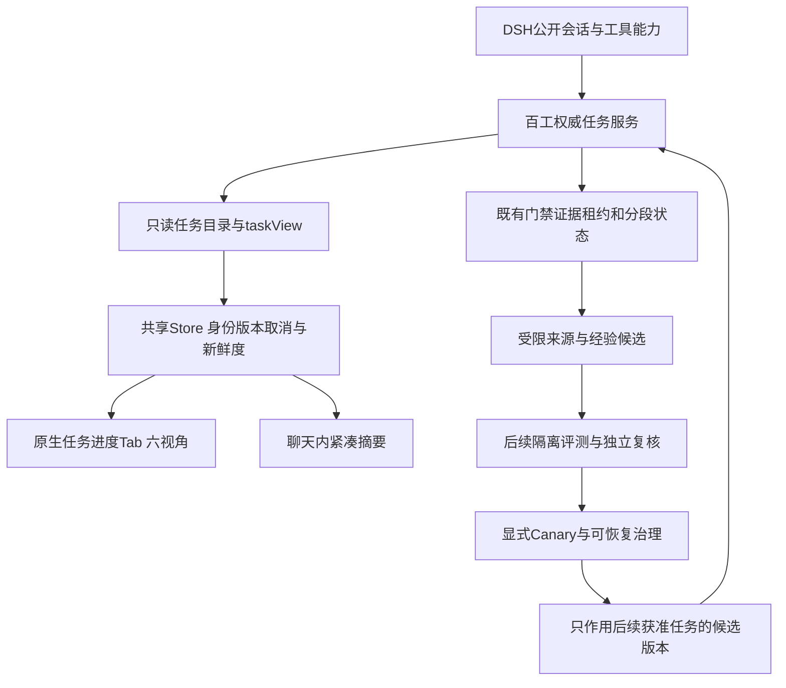

# Ruflo设计研究与百工分阶段吸收方案

日期：2026-10-25。对象：百工3.1.1之后的3.1.2–3.1.4路线。研究为源码审阅与设计映射，不是Ruflo运行验收；未安装其依赖、执行初始化器、启用daemon或注册第二个MCP执行器。

## 1. 结论与证据边界

吸收四点：任务中心的独立工作区、读取投影与执行状态分离、有来源的经验候选、以基线/回放约束学习。百工保留现有任务服务、证据门禁、租约、真实模型目录/额度和分段存储，不直接引入Ruflo运行时。

固定研究提交：[`fe99f748c577158ec3e517c7b421670a4601f54f`](https://github.com/ruvnet/ruflo/tree/fe99f748c577158ec3e517c7b421670a4601f54f)，提交时间2026-10-24，根package.json版本3.61.1。Ruflo名称与`claude-flow`包名并存，不能据目录名称猜版本。研究副本位于忽略目录`.omc/ruflo-research`，不进入发布包。

根许可为[MIT](https://github.com/ruvnet/ruflo/blob/fe99f748c577158ec3e517c7b421670a4601f54f/LICENSE)。本次提炼原则并独立实现，不复制Ruflo源文件或引入依赖；以后复制实质代码须保留对应版权/许可、更新`THIRD-PARTY-NOTICES.md`，各子包和外部依赖许可另外核验。

README、ADR、代码和运行结果是不同证据：本轮不运行Ruflo全套CLI/MCP/联邦/学习基准，不以测试文件存在或演示素材证明所有宿主路径已接线。

## 2. 可迁移的设计哲学

### 2.1 Harness拥有约束，模型提供建议

Ruflo围绕模型、工具、记忆、循环与控制组织harness，并有domain/application/infrastructure及宿主适配器。百工吸收“规则在代码、变化在边界”的思路，不为目录整齐拆成几十个包。

实际限制：[Task实体的complete](https://github.com/ruvnet/ruflo/blob/fe99f748c577158ec3e517c7b421670a4601f54f/v3/%40claude-flow/swarm/src/domain/entities/task.ts#L204)只检查running，再保存completed/output；这个实体本身不具备百工独立证据、版本/Jev政策/租约验收语义。其默认五分钟timeout和三次retry也不能直接套给长期任务。此结论只针对所读实体，不声称整个Ruflo没有其它验证层。

### 2.2 读取模型独立于执行控制

[事件投影](https://github.com/ruvnet/ruflo/blob/fe99f748c577158ec3e517c7b421670a4601f54f/v3/%40claude-flow/shared/src/events/projections.ts#L24)重建可查询读取模型；[领域事件](https://github.com/ruvnet/ruflo/blob/fe99f748c577158ec3e517c7b421670a4601f54f/v3/%40claude-flow/shared/src/events/domain-events.ts#L19)保留聚合身份、版本、来源、因果/关联标识。百工六图同样应是权威状态的只读投影，不能形成第二控制面。

console的[wf-state](https://github.com/ruvnet/ruflo/blob/fe99f748c577158ec3e517c7b421670a4601f54f/plugins/ruflo-console/hooks/wf-state.ts#L11)把正确读数、读取时间、错误、读取锁与导航选择分开；[wf-live](https://github.com/ruvnet/ruflo/blob/fe99f748c577158ec3e517c7b421670a4601f54f/plugins/ruflo-console/hooks/wf-live.ts#L53)可见时单飞读取、失败保留旧值、刷新后保留人工选择、首次读不虚构完成通知。这些是3.1.2直接可用的交互/数据原则。

不照搬其静默忽略扩展hook错误：百工应隔离展示失败、保留脱敏可定位反馈；关键权限/提交/验收错误不能作为普通展示失败吞掉。

### 2.3 增量须有可信边界和全量参考

[增量解析器](https://github.com/ruvnet/ruflo/blob/fe99f748c577158ec3e517c7b421670a4601f54f/plugins/ruflo-console/hooks/data/wf-incr.ts#L57)检查头部/锚点是否仍延续，截断/重写/锚点不确定时全量解析，未结束行只作暂态，避免重复计数。[有界缓存](https://github.com/ruvnet/ruflo/blob/fe99f748c577158ec3e517c7b421670a4601f54f/plugins/ruflo-console/hooks/data/wf-incr-store.ts#L41)与[全量解析对照测试](https://github.com/ruvnet/ruflo/blob/fe99f748c577158ec3e517c7b421670a4601f54f/plugins/ruflo-console/tests/wf-incr.spec.ts#L111)提供可借鉴的验证方法。

百工3.1.2直接读taskView，不新建聊天解析器；图源未变才复用SVG。3.1.3按真实提交序号评估增量失效通知；未来追加日志必须测随机切分、重复、截断、替换，并与独立全量结果比较。增量解析不等于宿主支持范围I/O，不能把省CPU宣传成省所有读取字节。

### 2.4 经验带来源，候选不自证

[来源类型](https://github.com/ruvnet/ruflo/blob/fe99f748c577158ec3e517c7b421670a4601f54f/v3/%40claude-flow/cli/src/memory/memory-initializer.ts#L35)区分user_claim、agent_output、system_observation、tool_result与unknown，并在[写入前校验](https://github.com/ruvnet/ruflo/blob/fe99f748c577158ec3e517c7b421670a4601f54f/v3/%40claude-flow/cli/src/memory/memory-initializer.ts#L2992)。默认unknown保留旧数据兼容，但来源标签不是签名/权限。

[mod-projection](https://github.com/ruvnet/ruflo/blob/fe99f748c577158ec3e517c7b421670a4601f54f/v3/%40claude-flow/cli/src/guidance/mod-projection.ts#L26)将外部观察保持为`verified:false`、`learningEligible:false`，校验白名单、来源revision/摘要及容量。百工3.1.2skill/tool候选保持不可执行、评估不可用；真实工件/测试/权限/回滚引用与来源同行，不经普通经验promote或recall意外提升/注入作者提示。

### 2.5 检索、评价、蒸馏、治理分别验收

[ReasoningBank的judge](https://github.com/ruvnet/ruflo/blob/fe99f748c577158ec3e517c7b421670a4601f54f/v3/%40claude-flow/neural/src/reasoning-bank.ts#L397)实际使用trajectory.qualityScore与步骤reward规则，不是该文件开头描述的真实LLM独立裁判。只吸收retrieve/judge/distill/consolidate的分段组织，不将质量分自动当独立证据。

百工3.1.4采用固定轨迹、基线与候选比较、失败样本保留和可撤销版本；缺样本/沙箱或不能区分混杂时保留候选，不热改当前任务权限。

## 3. 分版本采纳矩阵

| 思路 | 代码事实与百工落点 | 不采纳 |
| --- | --- | --- |
| 独立console、导航/读取状态分离 | 3.1.2原生任务Tab六图、共享Store、可见时单飞、stale保留 | 不另起console服务或照搬Claude终端布局 |
| 叶模块、纯函数/IO适配分离 | 3.1.2读取/校验/布局各司其职，纯逻辑可测 | 不按行数大拆全部service或引入DDD框架 |
| 类型来源、不可提升观察 | 3.1.2候选元数据；3.1.3可信来源/receipt绑定 | 来源标签不是权限，自评不是验收 |
| 版本化事件、读取投影 | 3.1.3成功权威提交后评估轻量失效提示，断连全量重读 | 不建第二WAL/SQLite事实源，不执行命令重放 |
| 拓扑角色/邻接索引 | 3.1.3按需复用现有DAG后继、角色索引与ready队列 | 通信网络不等执行DAG；不引入queen/Raft或动态剪强制边 |
| 增量与全量对照测试 | 3.1.2同源快照/SVG复用；3.1.3必要时增量优化 | 不宣称端到端O(1)，不以近似缓存判断许可 |
| 分阶段经验循环 | 3.1.4回放、反事实基线、受控提升与回滚 | 不照搬未复现性能倍率、静态质量阈值或训练平台 |
| 多模型成本/质量建议 | 3.1.3实际目录/额度先过滤；3.1.4影子校准建议 | 不引入静态模型ID/价格分，不新增Jev限流/费用额度 |
| 联邦、mTLS、共享向量库、daemon | 当前不进入，确有多机器需求再单独ADR | 不将个人单宿主升级为分布式控制平台 |

源码对照：[TopologyManager索引](https://github.com/ruvnet/ruflo/blob/fe99f748c577158ec3e517c7b421670a4601f54f/v3/%40claude-flow/swarm/src/topology-manager.ts#L17)、[多模型路由静态字段](https://github.com/ruvnet/ruflo/blob/fe99f748c577158ec3e517c7b421670a4601f54f/v3/%40claude-flow/integration/src/multi-model-router.ts#L89)。采纳矩阵是百工交付要求，不表示已经实现。

## 4. 不可越过的推断边界

1. README的Agent数量、ANN基准或成本倍率不是百工实测；本轮不引用为本项目性能指标。
2. Task.completed不等accepted；动态通信拓扑不得改变已批准依赖或跳过门禁。
3. [ADR-337](https://github.com/ruvnet/ruflo/blob/fe99f748c577158ec3e517c7b421670a4601f54f/v3/docs/adr/ADR-337-plugin-supply-chain-integrity-memory-governance.md)标注Proposed，不能仅据该文宣称namespace ACL/供应链治理已生效，也不据未检索到一个路径推断全库无同类实现。
4. 新意、语义相似度、经验reward与UI状态不能签发verification receipt；[3.1.3数学/授权约束](2026-10-24-v3.1.3-runtime-guards-and-user-decisions.md)保持有效。
5. 用户决定走DSH公开`ask_user_question`，pending不授权，不能用Ruflo确认窗替代宿主审批。

## 5. 百工目标结构

末端连接表示后续获准版本的配置选择，不允许经验库直接写任务/授权/完成状态。3.1.2只交付读取投影与不可执行候选，隔离评测/Canary仍属后续。

## 6. 复杂度与性能取舍

设历史D、图V/E、快照字节B、追加字节ΔB、订阅者S、缓存K、历史向量H、维数d。

| 路径 | 成本与边界 | 选择 |
| --- | --- | --- |
| 共享Store同键查找 | key已知时Map平均O(1)，通知O(S) | 小型有界K与可见订阅，不让每条聊天各读一次 |
| taskView解码/校验 | 至少O(B)，当前历史图派生可能含O(D log D) | 一份正确快照原子投影，切Tab不声称O(1) |
| 未变图源 | 可复用图，源字符串比较仍与其长度有关 | 缓存仅展示，换根/断连/版本不匹配即失效 |
| Kahn核心 | O(V+E)，完整校验另计 | 复用索引，小图不引入图数据库 |
| 可信追加事件 | 可接近O(ΔB)，首次/缺口/损坏回全量 | 3.1.3测量后再做，无连续性证明不猜增量 |
| 全历史向量直接比较 | O(Hd) | 不先引入embedding/HNSW服务，先测现有词法召回瓶颈 |

可迁移的是增量与独立全量对照的方法，不是他人机器上的毫秒值。

## 7. 实施、验收与回滚

**3.1.2**：P0原生六图Tab、目录、共享Store、只读身份/版本/取消/新鲜度；P1受限skill/tool候选，`evaluation: unavailable`、`executionEnabled: false`，不注册可执行工具。验收同键单飞、迟到/跨根不串数据、隐藏无新增周期读、错误保留旧值并标stale、六图缺记录不伪造、盲审不自动读父任务、候选不能被普通晋升/召回路径意外启用。

宿主目标DSH0.2.1-rc.3，同时回归rc.2及已承诺旧宿主。rc.3导航自定义由宿主管理，尊重用户隐藏/置顶；order20是默认相对顺序，不覆盖用户布局。

**3.1.3**：继续receipt/授权等待/全历史结构新意/有限DAG；评估成功权威提交之后发root/task/commit序号失效提示，重复合并、乱序不回退、断连全量读取。提示不是授权/证据，缺可信游标不承诺完整事件历史。无实测收益则保留3.1.2读取机制。

**3.1.4**：retrieve→evaluate→distill→govern，沿用四层边界。校准集与发布集分开，保留失败与来源，旧经验不是新证据；可选咨询收益不裁剪强制依赖。明确授权、真实隔离评测和独立验收后才Canary。

每版分别做正反复审、明确payload的Jev辅助判断、测试、真实宿主与打包闭包/隔离安装。Jev健康不代替业务测试，不新增其本地限流/费用额度。

回滚：3.1.2退回inline并释放读取/监听器，不停止业务或删轨迹。后续等待/receipt/历史索引经检查点迁移，旧读者不能忽略新状态接管；副作用未知先核对，不重放“恢复”。不重建用户profile、不覆盖其他插件依赖、不关闭全局供应链保护。

## 8. 本轮研究核对记录

已核对固定commit与干净研究副本，只读克隆，未执行外部指引/安装脚本。已读console刷新/状态、增量解析/有界缓存/对照测试、事件/投影、候选白名单、来源验证、Task完成/超时、拓扑索引、ReasoningBank规则judge及模型路由配置。

未复现Ruflo整套CLI/MCP/联邦/学习性能。3.1.2部署、DSHrc.3升级、发布与实际验证由实施证据另记，本报告不预先宣称成功。
