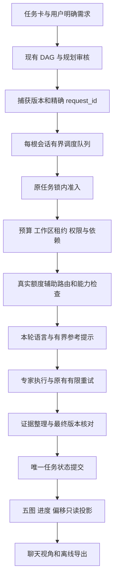

# 2.5.0 实施修订与交付范围

依据用户提供的 [原始方案](../../2.5.0%20优化升级实施.md)，保留其目标，将伪代码映射到当前 SwarmService / ConfigEditor / TaskStore。原始文件保持不改写。版本经用户确认：本机及 GitHub 均为 **2.5.0**，不覆盖 2.4.0。

## 需求到实现

| 原方案维度 | 实际落地与消费入口 | 验收边界 |
|---|---|---|
| 五图与跨图同步 | `task-diagrams.ts` 从同一任务、节点、委派快照生成 workflow / architecture / sequence / dataflow / lifecycle；聊天视角切换、源码与 JSON 导出 | 同一版本和 snapshotDigest；时序仅委派记录，生命周期仅快照，不虚构模型起止或迁移 |
| 进度与偏移 | 当前有效完成的委派节点比例、独立失败/阻塞/跳过/未知计数、版本/attempt/摘要偏移诊断；RPC/聊天消费 | 节点比例不代表工时、正确率或验收；不以图重绘放行，不自动重放补偿业务 |
| 语言 | `agents.language` 设置选择简中/英文/繁中/日文/韩文；`swarm_delegate.language` 可逐次覆盖；新建、连续、原生、规划审核共用指令 | 只约束可见说明及交付，JSON键/代码/公式/路径不翻译；用户明确语言要求优先于默认；不控制隐藏推理、不因语言差异重试业务 |
| 记忆与上下文 | 复用本 owner ExperienceRepository，已独立复核、未过期记录有界词法召回；适用/排除/版本身份完整保留；精确路径去重 | 不跨 root/workspace，不注入盲审/验算/复核；召回仍须核对适用性，不成为当前门禁证据；不删除原对话或原始证据 |
| 分解、依赖与并发 | 复用风险驱动 DAG 与现有节点准入；新增每根会话有界 FIFO / priority / roundRobin 队列，覆盖完整执行和证据提交 | 排队前捕获版本，排队后仍校验依赖/审批/预算/租约；不提高配置并发、不生成未授权补偿任务 |
| Token / 缓存 | 连续专家已有版本背景渐进披露；当前加入有界参考、路径去重、同源码 SVG 不重复渲染、串行 single-flight 刷新 | 不用相似回答跳过专家执行；不缓存验收或副作用；字符预算不冒称 Token 精确值，未测得固定节省比例 |
| Agent 框架 | 注册表能力标签进入主持角色目录；`swarm_status.capability_tags` 返回只读建议；scheduler 接收纯配置策略接口 | 标签仅建议，不授予工具权限，不自动降级高风险审核；现有角色/权限真源保持 |
| Archify | 可选离线导出 CLI，真实适配上游 3.0.1 五类 schema；固定提交及 validate/deliver 收据 | 不将自有 IR 冒称官方 IR；不增加生产依赖；空时序明确 unavailable；standard 校验不冒称 showcase / visual-check |

原方案的 `dispatch`、`limits.maxActive/maxTeam`、`~/.dsh/settings.yaml`、直接编辑 `lib` 等不是当前插件接口。实际编辑 `src` / `client`，配置写真实 `swarm-core` namespace，不另建任务状态库。

## 执行链



图只说明调用关系；不能替代每个业务任务自己的流程审核。旧合同、未知副作用、失败审核继续由原门禁拒绝。

## 配置

设置 → 百工 Agent 可直接保存默认交付语言，沿用原子表单、revision CAS 和未知字段保留。调度和记忆使用宿主 ConfigEditor 中 `swarm-core` 的真实配置：

```json
{
  "agents": { "language": "zh-CN" },
  "scheduling": { "strategy": "fifo", "maxActive": 8, "maxPending": 128 },
  "experience": { "enabled": true },
  "memory": { "enabled": true, "maxMatches": 3, "maxChars": 4000, "ttlMs": 604800000 }
}
```

记忆默认关闭；`experience.enabled` 也需开启，缺失时状态诊断明确说明。跨进程保留还需用户配置 `persistence.enabled`；本次维护不擅自改变现有 memory-only 策略。TTL 只控制参考检索，不自动删除审计事实。没有引入 Chroma/Pinecone/Redis、外部 embedding 服务或任意 JS 策略加载：首版使用原方案允许的本地存储替代，保留类型化可扩展接口。

优先级只重排已经请求的作业；无抢占，低优先级不承诺无饥饿。roundRobin 公平性以单根会话角色组定义。原有风险分层和模型链继续工作，不以字数或关键词自动降低审查强度。

## 关联修复与关停

反方推动修复：语言草稿遗漏、旧 persona 中文硬编码、慢 RPC 轮询重叠、重复生成五图、导出脚本打包遗漏。全量回归进一步暴露运行中委派在关停时未形成完整快照的竞态。

关停现在先关闭新准入，拦截延迟 dispatch/模型请求及写操作；逐 owner 在任务锁内保存完整状态，再清理存储。已启动预算不退款，冷恢复标记需核对而不重放；关停幂等。任一 checkpoint/清理失败均继续尝试其他 owner 清理并聚合报告，不冒称未保存数据已经恢复。

## 验证与发布

源码单测、真实 DSH SDK/AgentLoop、agent-browser 桌面与390px、真实 DeepSeek 五语短回复、Jev MCP 辅助审核、Archify 五类真实 CLI 收据、唯一 systemd 宿主升级和独立预构建包安装分别验收。固定比例 Token 节省、普遍正确率、隐藏推理语言或所有供应商生成均不在已验证结论中。

实施证据、性能边界、真实宿主结果及发布资产见 [2.5.0 验证记录](../../evidence/optimization-2.5.0/README.md)。
